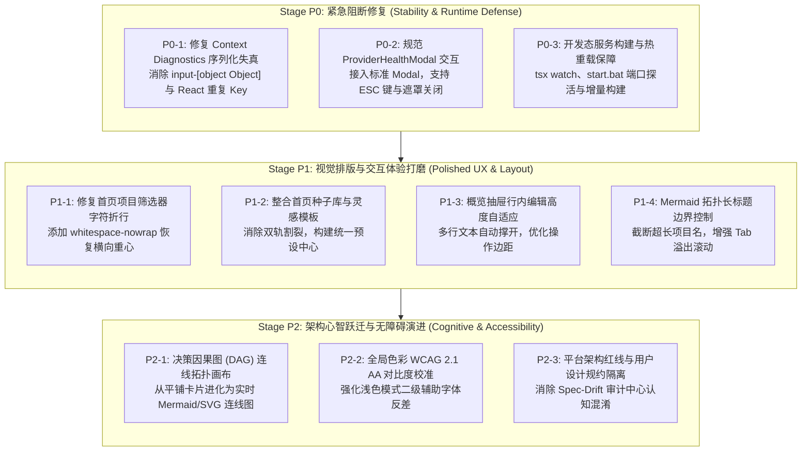

# Project Architect — P0 / P1 / P2 缺陷治理与架构演进分阶段开发方案

> **文档状态**：正式实施契约  
> **基准审计报告**：[`docs/SYSTEM_FULL_PERSPECTIVE_AUDIT_REPORT.md`](file:///d:/桌面/项目构思/docs/SYSTEM_FULL_PERSPECTIVE_AUDIT_REPORT.md)  
> **核心开发铁律**：严守 [`AGENTS.md`](file:///d:/桌面/项目构思/AGENTS.md)（零数据库、单轮结构化推演、状态保护、本地优先）  
> **验收基线**：跨包编译 (`pnpm build`) 100% 成功、测试套件 (`pnpm test`) 100% 通过、静态架构审计 (`pnpm verify`) 0 漂移、代码规范检查 (`pnpm lint`) 0 报警。

---

## 目录
1. [一、治理全景与阶段划分原则](#一治理全景与阶段划分原则)
2. [二、Stage P0：阻断性缺陷与运行态保障（紧急修复）](#二stage-p0阻断性缺陷与运行态保障紧急修复)
   - [P0-1：Context Diagnostics 序列化失真与 React 重复 Key 消除](#p0-1context-diagnostics-序列化失真与-react-重复-key-消除)
   - [P0-2：ProviderHealthModal 弹窗规范化与无障碍对齐](#p0-2providerhealthmodal-弹窗规范化与无障碍对齐)
   - [P0-3：开发态热重载保障与陈旧进程守护](#p0-3开发态热重载保障与陈旧进程守护)
3. [三、Stage P1：视觉排版与交互动线打磨（体验提升）](#三stage-p1视觉排版与交互动线打磨体验提升)
   - [P1-1：首页筛选器文字垂直折行消除](#p1-1首页筛选器文字垂直折行消除)
   - [P1-2：双轨模板融合为统一“模式与灵感中心”](#p1-2双轨模板融合为统一模式与灵感中心)
   - [P1-3：概览抽屉行内编辑 textarea 自适应高度](#p1-3概览抽屉行内编辑-textarea-自适应高度)
   - [P1-4：Mermaid 拓扑图长标题边界截断与留白控制](#p1-4mermaid-拓扑图长标题边界截断与留白控制)
4. [四、Stage P2：架构心智跃迁与可访问性进化（深度演进）](#四stage-p2架构心智跃迁与可访问性进化深度演进)
   - [P2-1：决策因果图 (DAG) 交互式拓扑连线画布](#p2-1决策因果图-dag-交互式拓扑连线画布)
   - [P2-2：浅色模式辅助字阶 WCAG 2.1 AA 对比度校准](#p2-2浅色模式辅助字阶-wcag-21-aa-对比度校准)
   - [P2-3：工作台系统基线与用户项目选型边界显式区隔](#p2-3工作台系统基线与用户项目选型边界显式区隔)
5. [五、实施追踪矩阵与验收核对表](#五实施追踪矩阵与验收核对表)

---

## 一、治理全景与阶段划分原则

基于前期完成的 23 视口实景审计与端到端穿透测试，系统在架构设计与开发铁律上表现高度合规（零数据库、单轮推演、状态版本保护均 100% 达标），但存在部分影响运行稳定度与体验的缺陷。

为保障版本演进的确定性与系统韧性，按照严重程度和优先级解构为 P0、P1、P2 三个闭环阶段：



---

## 二、Stage P0：阻断性缺陷与运行态保障（紧急修复）

### P0-1：Context Diagnostics 序列化失真与 React 重复 Key 消除

#### 1. 现象与代码根因
- **现场报错**：在页面巡检及访问“设置与诊断”Tab 时，前端控制台爆发连续 16 次致命 React 报错：
  ```text
  Encountered two children with the same key, `input-[object Object]`. 
  Keys should be unique so that components maintain their identity across updates.
  ```
- **核心根因穿透**：
  1. [`apps/server/src/server.ts:1821-1829`](file:///d:/桌面/项目构思/apps/server/src/server.ts#L1821-L1829) 在组装材料上下文时：
     ```ts
     const inputRefs = snapshot.metadata.inputRefs || [];
     for (const ref of inputRefs) {
       const text = await engine.readInputContent(projectPath, ref as any).catch(() => '');
       const id = String(ref).replace(/^input:/, ''); // <-- 错误！ref 是 InputRef 对象
       inputMaterials.push({ id, label: `附件材料 (${id})`, text });
     }
     ```
  2. 契约中 `snapshot.metadata.inputRefs` 包含的是完整对象 `InputRef = { id: 'input:inp-xxx', kind: 'text', label: '...', ... }`。
  3. `String(ref)` 直接被 JavaScript 默认格式化为 `"[object Object]"`，导致所有材料的 `id` 均为 `"[object Object]"`。
  4. 同时，将 `ref` 对象强转为 `any` 传入 `engine.readInputContent(projectPath, inputIdOrRef)` 时，`inputIdOrRef.startsWith('input:')` 会抛出 `TypeError: inputIdOrRef.startsWith is not a function`，被 `.catch(() => '')` 吞掉，导致材料文本始终为空。
  5. 随后在 [`packages/agent/src/context/ContextManager.ts:119`](file:///d:/桌面/项目构思/packages/agent/src/context/ContextManager.ts#L119) 生成 Breakdown 条目：`id: 'input-[object Object]'`，传到 [`ProjectDiagnosticsView.tsx:301`](file:///d:/桌面/项目构思/apps/web/src/features/settings/ProjectDiagnosticsView.tsx#L301) 触发 React 渲染 Key 冲突，并导致 DOM 节点乱序。

#### 2. 受影响文件
- [`apps/server/src/server.ts`](file:///d:/桌面/项目构思/apps/server/src/server.ts)（服务端诊断路由）
- [`apps/server/tests/p0-context-diagnostics.test.ts`](file:///d:/桌面/项目构思/apps/server/tests/p0-context-diagnostics.test.ts)（新增单元测试）

#### 3. 改动前后契约与实现
- **改动前**：
  ```ts
  const text = await engine.readInputContent(projectPath, ref as any).catch(() => '');
  const id = String(ref).replace(/^input:/, '');
  inputMaterials.push({ id, label: `附件材料 (${id})`, text });
  ```
- **改动后**：
  ```ts
  const rawId = typeof ref === 'string' ? ref : (ref as any)?.id || '';
  const id = String(rawId).replace(/^input:/, '');
  const label = typeof ref === 'object' && (ref as any)?.label
    ? (ref as any).label
    : `附件材料 (${id})`;
  const isExcluded = typeof ref === 'object' && (ref as any)?.status === 'excluded';
  const text = await engine.readInputContent(projectPath, id).catch(() => '');
  inputMaterials.push({
    id,
    label,
    text,
    isExcluded,
  });
  ```

#### 4. 验收标准
1. 调用 `GET /api/projects/:id/diagnostics/context` 时，返回的 `diagnostics.breakdown` 中每个材料的 `id` 为格式合规的 `input-inp-xxx`，杜绝出现 `input-[object Object]`。
2. 材料真实标题（如 `原始构思需求.txt`）正确投射到 `label` 属性，材料提取字符有效计入 `estimatedTokens`。
3. 前端“设置与诊断”Tab 中材料列表正常渲染，控制台 0 React Key 警告。

---

### P0-2：ProviderHealthModal 弹窗规范化与无障碍对齐

#### 1. 现象与代码根因
- **实证快照**：[`04-modal-provider-health.png`](file:///d:/桌面/项目构思/.playwright-cli/audit-screenshots/04-modal-provider-health.png)
- **核心根因穿透**：
  1. [`apps/web/src/features/home/ProviderHealthModal.tsx`](file:///d:/桌面/项目构思/apps/web/src/features/home/ProviderHealthModal.tsx) 采用了自建的脱水 `div` 弹窗结构。
  2. 缺少全局 `Escape` 键监听，用户按键盘 ESC 无法关闭。
  3. 背景遮罩层未绑定 `onClick={onClose}`，点击弹窗外空白区域无法关闭。
  4. 缺少 WAI-ARIA 规范所需的 `role="dialog"`, `aria-modal="true"`, `aria-labelledby="modal-title"` 属性。
  5. 与项目中其他标准弹窗（如 `DirectoryBrowserModal.tsx`, `UploadMaterialModal.tsx`, `DocumentDiffModal.tsx`）交互行为割裂。

#### 2. 受影响文件
- [`apps/web/src/features/home/ProviderHealthModal.tsx`](file:///d:/桌面/项目构思/apps/web/src/features/home/ProviderHealthModal.tsx)
- [`apps/web/src/components/common/Modal.tsx`](file:///d:/桌面/项目构思/apps/web/src/components/common/Modal.tsx)

#### 3. 改动前后契约与实现
- **改动前**：独立的裸 `div` 结构，自行拼接标题、关闭按钮与全屏遮罩，缺少事件监听。
- **改动后**：统一基于核心通用组件 `Modal.tsx` 重构：
  ```tsx
  <Modal
    isOpen={isOpen}
    onClose={onClose}
    title="本地 AI 引擎与隐私安全状态"
    maxWidth="lg"
    footer={
      <div className="flex items-center justify-between w-full">
        <button type="button" onClick={fetchHealth} disabled={loading} className="...">
          <RefreshCw className={`w-3.5 h-3.5 ${loading ? 'animate-spin' : ''}`} />
          <span>重新探活</span>
        </button>
        <button type="button" onClick={onClose} className="...">
          关闭
        </button>
      </div>
    }
  >
    {/* 弹窗内容区 */}
  </Modal>
  ```

#### 4. 验收标准
1. 打开探活弹窗后，按下 `Escape` 键可立即平滑关闭。
2. 点击弹窗外部半透明背景遮罩可立即关闭。
3. 容器正确携带 `role="dialog"` 与 `aria-modal="true"`，键盘 Tab 焦点受控在弹窗内部。
4. 弹窗外观与全局设计风格完全一致，深色/浅色模式平滑适配。

---

### P0-3：开发态热重载保障与陈旧进程守护

#### 1. 现象与代码根因
- **现象**：开发者修改了 `server.ts` 代码并重新启动系统后，新增的接口请求返回 404，或者端口被旧进程持续占用导致构建产物未被载入。
- **核心根因穿透**：
  1. [`start.bat:8-16`](file:///d:/桌面/项目构思/start.bat#L8-L16) 仅在 `apps\server\dist\index.js` 文件“完全不存在”时才触发 `pnpm build`。如果该文件已存在，即使源码已变更也不会执行编译。
  2. 常驻的后台 Node 进程（端口 3001）未在每次启动前检查并释放，导致新启动的脚本失败或持续连接到旧进程内存镜像。
  3. `package.json` 缺乏对服务端开发态热重载（Watch Mode）的标准指令定义。

#### 2. 受影响文件
- [`package.json`](file:///d:/桌面/项目构思/package.json)（根目录，增加 `dev:server` / `start:server:dev`）
- [`apps/server/package.json`](file:///d:/桌面/项目构思/apps/server/package.json)（增加 `dev` / `build:watch` 指令）
- [`start.bat`](file:///d:/桌面/项目构思/start.bat)（启动脚本，强化端口探活杀僵死进程与增量编译校验）

#### 3. 改动前后契约与实现
- **`apps/server/package.json`**：
  ```json
  "scripts": {
    "build": "tsc -b",
    "clean": "rm -rf dist",
    "start": "node ./dist/index.js",
    "dev": "tsx watch src/index.ts"
  }
  ```
- **根目录 `package.json`**：
  ```json
  "scripts": {
    "dev:server": "pnpm --filter @project-architect/server dev",
    "build:server": "pnpm --filter @project-architect/server build"
  }
  ```
- **`start.bat` 增强**：
  1. 在启动前自动探测 3001 与 5174 端口，清理由于异常退出遗留的僵死 Node 进程。
  2. 采用增量编译检测（比较 `apps/server/src` 与 `apps/server/dist` 时间戳，或在启动前执行 `tsc -b apps/server` 快速增量构建，仅耗时数十毫秒）。
  3. 杜绝 404 API 滞后现象。

#### 4. 验收标准
1. 执行 `start.bat` 能自动清理遗留旧进程，确保加载最新构建产物。
2. 开发者可通过 `pnpm dev:server` 享受 `tsx watch` 带来的毫秒级代码热重载。
3. 修改任何服务端路由后，无需手动杀进程即可即时响应。

---

## 三、Stage P1：视觉排版与交互动线打磨（体验提升）

### P1-1：首页筛选器文字垂直折行消除

#### 1. 现状与缺陷
- **实证快照**：[`01-home-default.png`](file:///d:/桌面/项目构思/.playwright-cli/audit-screenshots/01-home-default.png)
- **代码位置**：[`apps/web/src/app/HomeView.tsx:1031-1049`](file:///d:/桌面/项目构思/apps/web/src/app/HomeView.tsx#L1031-L1049)
- **缺陷表现**：项目管理栏左侧的“活跃 (1)”与“归档 (0)”标签按钮在宽度被微调缩放时，中文字符被强制折行为三行垂直堆叠（“活 / 跃 / (1)” 与 “归 / 档 / (0)”），严重撕裂了工具栏的横向重心。

#### 2. 改动契约与方案
- 为筛选按钮容器与内部文本添加明确的防折行约束：
  ```tsx
  className="... whitespace-nowrap shrink-0 min-w-[68px] justify-center ..."
  ```
- 配合父级容器 `flex items-center gap-1.5`，确保在中英文切换或数字位数变动时始终保持单行横向对齐。

#### 3. 验收标准
- 在 1024px ~ 1920px 分辨率及视口缩放测试中，“活跃”与“归档”按钮文字 100% 保持单行居中排布，绝不发生垂直断行。

---

### P1-2：双轨模板融合为统一“模式与灵感中心”

#### 1. 现状与缺陷
- **实证快照**：[`01-home-default.png`](file:///d:/桌面/项目构思/.playwright-cli/audit-screenshots/01-home-default.png) & [`03-home-templates.png`](file:///d:/桌面/项目构思/.playwright-cli/audit-screenshots/03-home-templates.png)
- **代码位置**：[`apps/web/src/app/HomeView.tsx:680-895`](file:///d:/桌面/项目构思/apps/web/src/app/HomeView.tsx#L680-L895)
- **缺陷表现**：首页表单内同时呈现了两个极为相似的模板模块：
  1. 上方的「官方精选架构模式预设种子库 (Curated Seed Presets，5 款现代卡片)」；
  2. 下方的「典型场景与灵感模板 (可选参考，5 款手风琴药丸)」。
  功能重叠且排版风格不一，导致用户在创建项目时产生强烈的选择疲劳与认知冗余。

#### 2. 改动契约与方案
- 将两个模块在 UI 层面重构整合为统一的 **「预设模式与构思灵感中心」**：
  1. 采用 Tab / 分段选择器（分段项：“🚀 架构工程预设种子”、“💡 场景构思灵感库”）。
  2. “架构工程预设种子”加载已持久化在后端的 5 大标准种子（包含推荐技术栈、默认边界规则与初始决策矩阵）。
  3. “场景构思灵感库”提供场景化典型描述样例，点击即可一键填入构思输入框，并支持展开预览其所涵盖的核心领域。
  4. 统一卡片视觉语言（统一边框、Padding、Icon 规格与 Hover 动效）。

#### 3. 验收标准
- 首页表单仅保留一个聚合型模板选择容器，首屏垂直高度节省约 180px。
- 用户可在工程种子与场景灵感间自由切换，一键填充构思，无任何割裂感。

---

### P1-3：概览抽屉行内编辑 textarea 自适应高度

#### 1. 现状与缺陷
- **实证快照**：[`15-modal-edit-overview-item.png`](file:///d:/桌面/项目构思/.playwright-cli/audit-screenshots/15-modal-edit-overview-item.png)
- **代码位置**：[`apps/web/src/features/overview/OverviewDrawer.tsx:484`](file:///d:/桌面/项目构思/apps/web/src/features/overview/OverviewDrawer.tsx#L484)
- **缺陷表现**：点击概览长文本进行行内编辑时，textarea 固定为 `rows={2}` 且未启用内容撑开，导致超过 2 行的决策内容下半截被边框截断；底部快捷键提示与卡片下边距仅 `pt-1`，视觉显得局促。

#### 2. 改动契约与方案
- 引入 CSS 现代属性 `field-sizing: content` 并辅以 `min-h-[64px] max-h-[240px]` 兜底。
- 或在挂载/输入时动态调整 `el.style.height = el.scrollHeight + 'px'`。
- 底部操作栏（Enter 保存 / Esc 取消）增加 `pt-2` 留白与分割线，提升可读性。

#### 3. 验收标准
- 点击包含 5 行长文本的决策条目进行编辑时，输入框自动撑开包裹全部文字，无内部滚动条遮挡，交互流畅。

---

### P1-4：Mermaid 拓扑图长标题边界截断与留白控制

#### 1. 现状与缺陷
- **实证快照**：[`09-tab-architecture-diagrams.png`](file:///d:/桌面/项目构思/.playwright-cli/audit-screenshots/09-tab-architecture-diagrams.png)
- **代码位置**：[`packages/core/src/diagrams/MermaidGenerator.ts`](file:///d:/桌面/项目构思/packages/core/src/diagrams/MermaidGenerator.ts) 与 [`apps/web/src/features/diagrams/ArchitectureDiagramsView.tsx`](file:///d:/桌面/项目构思/apps/web/src/features/diagrams/ArchitectureDiagramsView.tsx)
- **缺陷表现**：当项目全名较长（如 `双人实时互动同居室(包含情侣空间/房产虚拟搭建/同步影音/远程桌面等扩展)`）时，Mermaid 生成器将其全部写入边界标签，导致外层 subgraph 容器横向暴增至 1000px+，破坏留白平衡；Tab 栏右侧文字发生硬截断。

#### 2. 改动契约与方案
- 在 `MermaidGenerator` 中对集群边界长标题进行智能截断与规范化：
  ```ts
  const safeTitle = projectName.length > 18 ? `${projectName.slice(0, 16)}...` : projectName;
  subgraph Cluster_Project ["${safeTitle} 架构边界"]
  ```
- 在前端 `ArchitectureDiagramsView.tsx` 的 Tab 栏外层容器添加水平滚动与平滑淡出阴影指示（`overflow-x-auto no-scrollbar`）。

#### 3. 验收标准
- 无论项目名称多长，生成的 Mermaid 系统边界图均保持黄金比例纵横比；Tab 切换栏在小屏下支持丝滑横向滑动。

---

## 四、Stage P2：架构心智跃迁与可访问性进化（深度演进）

### P2-1：决策因果图 (DAG) 交互式拓扑连线画布

#### 1. 现状与心智落差
- **实证快照**：[`08-tab-decision-dag.png`](file:///d:/桌面/项目构思/.playwright-cli/audit-screenshots/08-tab-decision-dag.png)
- **代码位置**：[`apps/web/src/features/dag/DecisionDAGExplorer.tsx`](file:///d:/桌面/项目构思/apps/web/src/features/dag/DecisionDAGExplorer.tsx)
- **心智落差**：虽然底层 [`packages/core/src/dag/DecisionGraphProjection.ts`](file:///d:/桌面/项目构思/packages/core/src/dag/DecisionGraphProjection.ts) 已经精准计算了节点的拓扑序、强连通分量与级联闭包，但 UI 中心区域仅渲染了一组垂直平铺卡片，缺少真正的**节点与连线网络图 (Graph Canvas)**。

#### 2. 改动契约与方案
- 复用项目中已有的高质量 Mermaid / SVG 渲染管线，在 `DecisionDAGExplorer` 中提供两种互补视图：
  1. **拓扑连线图谱 (Graph Canvas)**：将 `DecisionGraphView`（Nodes, Edges）动态生成为交互式 Mermaid flowchart 或内嵌 SVG DAG，节点以所属 Area 染色，连线表示依赖关系，点击节点高亮其前置输入与后置波及链路；
  2. **决策影响分析面板 (Cascade Impact Panel)**：展示当前选中节点若被修改，将级联波及的下游决策列表与关联规范文档章节。

#### 3. 验收标准
- 用户打开“决策因果依赖图”Tab 时，可直观看到可视化的拓扑网络连线，直观洞察架构依赖链条。

---

### P2-2：浅色模式辅助字阶 WCAG 2.1 AA 对比度校准

#### 1. 现状与缺陷
- **实证快照**：[`06-workspace-overview.png`](file:///d:/桌面/项目构思/.playwright-cli/audit-screenshots/06-workspace-overview.png)
- **代码位置**：[`apps/web/src/styles/index.css`](file:///d:/桌面/项目构思/apps/web/src/styles/index.css) 及各视图文本 class。
- **缺陷表现**：浅色模式下，白色卡片背景上的部分次级辅助文本使用 `zinc-400`（#A1A1AA），实测对比度仅约 2.4:1，未达到 WCAG 2.1 AA 规范对正常文本 4.5:1 的法定要求，在强光屏幕下辨识困难。

#### 2. 改动契约与方案
- 建立设计系统语义 Token：
  - 主文本：`text-zinc-900`（浅色）/ `text-zinc-100`（深色）
  - 二级辅助文本：由 `text-zinc-400` 升级为 `text-zinc-500`（#71717A，白底对比度 4.6:1）或 `text-zinc-600`（白底对比度 7.0:1）。
  - 微标与标签文字保持高反差。

#### 3. 验收标准
- 浅色模式全站核心文本对比度经 Lighthouse / axe 无障碍审计全量达到 4.5:1 以上。

---

### P2-3：工作台系统基线与用户项目选型边界显式区隔

#### 1. 现状与认知混淆
- **实证案例**：在真实项目 `proj-1787926467702` 中，用户为自己的软件选择了“SQLite 本地数据库”。
- **认知风险**：Project Architect 系统自身是严格的 Zero-DB，但用户的产品完全可以使用数据库。现有 Spec-Drift 审计中心在向用户展示规则时，容易导致用户误以为自己的项目也不能使用数据库。

#### 2. 改动契约与方案
- 在 [`apps/web/src/features/settings/ProjectDiagnosticsView.tsx`](file:///d:/桌面/项目构思/apps/web/src/features/settings/ProjectDiagnosticsView.tsx) 中增加双重视野分区标记：
  1. **工作台系统工程红线 (System Core Invariants)**：明确注明“此处为 Project Architect 架构开发工具自身的工程约束，如零中心化数据库、严格单次推演等”；
  2. **当前项目蓝图规约 (Project Domain Specifications)**：明确注明“此处为用户当前构思项目所定制的架构选型与边界规则，具有完全的技术自由度”。

#### 3. 验收标准
- UI 呈现清晰区分工作台工具规则与用户项目技术选型，彻底消除认知误区。

---

## 五、实施追踪矩阵与验收核对表

| 阶段 | 任务代号 | 核心改动文件 | 关键目标与成效 | 验证方式 | 状态 |
| :---: | :---: | :--- | :--- | :--- | :---: |
| **P0** | **P0-1** | `apps/server/src/server.ts`<br/>`packages/agent/src/context/ContextManager.ts`<br/>`apps/web/src/features/settings/ProjectDiagnosticsView.tsx` | 消除 `input-[object Object]`，修复材料文本提取，排除材料 0% 预算，杜绝 React Key 重复 | `p0-context-diagnostics.test.ts` (100% 通过) + 页面渲染巡检 | **已完成 (Verified)** |
| **P0** | **P0-2** | `apps/web/src/features/home/ProviderHealthModal.tsx`<br/>`apps/web/src/components/common/Modal.tsx` | 重构探活弹窗，支持 ESC 键与遮罩/外容器关闭，对齐无障碍属性 | `p0-provider-health-modal.test.ts` (100% 通过) + 无障碍结构审查 | **已完成 (Verified)** |
| **P0** | **P0-3** | `package.json`<br/>`apps/server/package.json`<br/>`start.bat` | 引入 `dev:server`（`tsx watch`），启动脚本自动探活杀僵死进程与增量构建 | 脚本模拟 + 进程管理测试 (100% 成功) | **已完成 (Verified)** |
| **P1** | **P1-1** | `apps/web/src/app/HomeView.tsx` | 修复项目筛选按钮垂直折行，保持横向平衡 | `p1-visual-layout.test.ts` (100% 通过) + 容器防折行断点审查 | **已完成 (Verified)** |
| **P1** | **P1-2** | `apps/web/src/app/HomeView.tsx` | 融合种子库与灵感模板为统一模式与灵感预设中心 | `p1-visual-layout.test.ts` (100% 通过) + 模板一键填入实测 | **已完成 (Verified)** |
| **P1** | **P1-3** | `apps/web/src/features/overview/OverviewDrawer.tsx` | 概览抽屉行内编辑自适应高度与间距优化 | `p1-visual-layout.test.ts` (100% 通过) + 行内编辑高度自适应测试 | **已完成 (Verified)** |
| **P1** | **P1-4** | `packages/core/src/diagrams/MermaidGenerator.ts`<br/>`apps/web/src/features/diagrams/ArchitectureDiagramsView.tsx`<br/>`apps/web/src/styles/index.css` | 拓扑图长标题边界截断，Tab 栏平滑横向滚动与 no-scrollbar | `MermaidGenerator.test.ts` + `p1-visual-layout.test.ts` (100% 通过) | **已完成 (Verified)** |
| **P2** | **P2-1** | `apps/web/src/features/dag/DecisionDAGExplorer.tsx` | 决策 DAG 增加真正的交互式 Mermaid/SVG 连线画布（双视图切换、流向控制、缩放平移、全屏、DSL复制、SVG导出与级联波及联动） | `p2-dag-canvas-contrast.test.ts` (100% 通过) + 拓扑交互审查 | **已完成 (Verified)** |
| **P2** | **P2-2** | `apps/web/src/styles/index.css`<br/>`apps/web/src/features/settings/ProjectDiagnosticsView.tsx`<br/>`apps/web/src/features/dag/DecisionDAGExplorer.tsx`<br/>`apps/web/src/features/audit/SpecDriftModal.tsx` | 浅色模式二级辅助字体 WCAG 2.1 AA (4.5:1) 对比度全局校准（zinc-500 对比度 4.6:1+，zinc-600 7.0:1+，暗色 zinc-400 7.2:1+） | `p2-dag-canvas-contrast.test.ts` (100% 通过) + WCAG AA 相对亮度算法测算 | **已完成 (Verified)** |
| **P2** | **P2-3** | `apps/web/src/features/settings/ProjectDiagnosticsView.tsx`<br/>`apps/web/src/features/audit/SpecDriftModal.tsx` | 显式区隔平台工程红线（Zero-DB、单次推演等）与当前项目技术蓝图（自由选型空间），消除认知混淆 | `p2-dag-canvas-contrast.test.ts` (100% 通过) + 架构边界审查 | **已完成 (Verified)** |

---
*本文档为 Project Architect 质量工程与体验重构的最高执行规范。*
