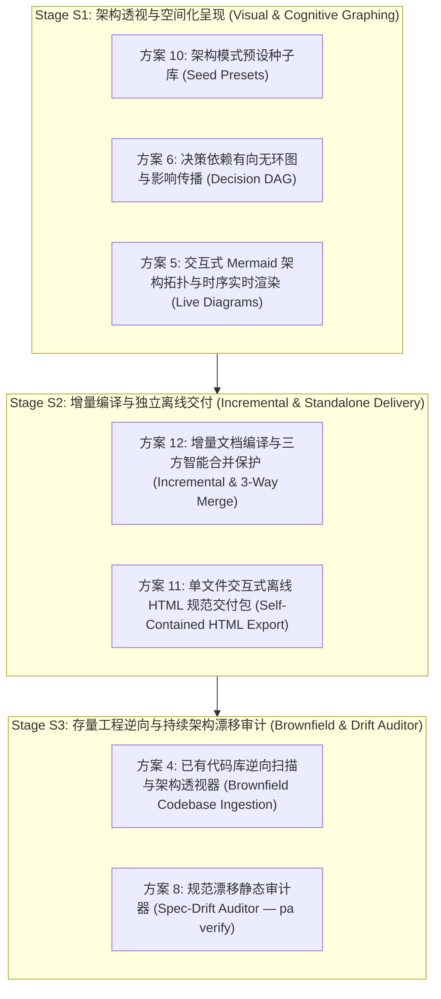

# Project Architect — 7大高价值方案分阶段实施蓝图 (Stage S1 - S3)

> **目标**：实现用户决策选定的 7 大核心增强方案，确保每一项功能均端到端打磨至生产可用级别（跨 Contracts → Core → Server → Web UI → CLI → 测试套件完整闭环），严守 `AGENTS.md` 铁律，杜绝孤立模块与空跑代码，达成 100% 测试通过与 0 规范漂移。

---

## 一、方案全景与阶段划分原则

为确保架构演进的稳固性与功能间的协同增益，将 7 大方案解构并组织为三个紧密耦合的阶段：

---

## 二、分阶段深度设计与实施规范

### 阶段 S1：架构透视与认知空间化 (Visual & Cognitive Graphing)
> **核心目标**：赋予系统开箱即用的专业架构模板种子、决策间因果依赖追踪与级联影响计算能力，以及全动态渲染的 Mermaid 架构蓝图，彻底将文本决策升级为立体认知网络。

#### 1. 方案 10：架构模式预设种子库 (Curated Architectural Seed Presets)
- **Contracts (`packages/contracts/src/presets.ts`)**：
  - 定义 `ProjectPreset`：包含 `id`, `name`, `category`, `description`, `recommendedStack`, `defaultBoundaryRules`, `defaultAreas`, `initialDecisions` (带 `category`, `status: "confirmed"|"candidate"`, `impactLevel`), `suggestedChecklists`。
  - 首批官方精心打磨种子：
    1. `local-first-desktop`（本地优先桌面级生产工具）
    2. `cli-developer-tool`（现代多平台开发者命令行工具）
    3. `edge-microservice`（事件驱动/无状态边缘微服务）
    4. `offline-sync-mobile`（离线同步与边缘存储移动端应用）
    5. `extensible-plugin-system`（可插拔核心与插件扩展系统）
- **Core (`packages/core/src/presets/index.ts`)**：
  - 纯函数 `PresetRegistry`：校验种子合法性、根据种子实例化 `CreateProjectRequest`，将初始决策以规范的 `CommitProposal` 写入，确保审计日志与状态版本链完整。
- **Server & Web**：
  - Server 暴露 `GET /api/presets`，并在 `POST /api/projects` 中支持 `presetId`。
  - Web 端在项目创建弹窗中提供精美预设卡片选择器，支持预设架构详情即时展开预览。

#### 2. 方案 6：决策依赖有向无环图与影响传播 (Decision Dependency DAG)
- **Contracts (`packages/contracts/src/dag.ts` & `decisions.ts`)**：
  - 扩展 `DecisionItem` 支持可选 `dependsOn?: string[]`（前置依赖的 `decisionKey` 列表）。
  - 定义图契约：`DecisionGraphNode`, `DecisionGraphEdge`, `DecisionGraphView`, `CascadeImpactResult`（直接受影响决策、间接传递依赖、受影响的文档领域 Area、是否存在环路环检测状态）。
- **Core (`packages/core/src/dag/DecisionGraphProjection.ts`)**：
  - 纯函数图引擎：基于当前 `decisions.json` 与 `questions.json` 构建有向依赖图。
  - **环路检测**：采用 Tarjan / DFS 强连通分量算法，若检测到循环依赖，标红示警并隔离环路。
  - **影响传播闭包计算**：给定任意一个决策 Key（如修改、撤回或发生冲突），计算其全量下游传递依赖闭包（Transitive Closure），精确输出哪些规范文档章节将因此发生重评。
  - **拓扑排序**：输出最佳架构认知阅读路径与决策确认序列。
- **Server & Web**：
  - 投影视图服务输出 `GET /api/projects/:id/dag`。
  - Web 端在 Overview 或专属面板提供交互式 DAG 视图，支持悬停高亮级联波及链路、环路警告与拓扑流。

#### 3. 方案 5：交互式 Mermaid 架构拓扑与时序图实时渲染 (Live Architecture Diagrams)
- **Core (`packages/core/src/diagrams/MermaidGenerator.ts`)**：
  - 纯函数生成器：依据当前 `ProjectSnapshot`（Areas, Confirmed Decisions, Boundaries, DAG 关系）动态合成标准 Mermaid 脚本：
    1. **系统拓扑与边界图 (System Context & Boundaries — C4/Graph)**
    2. **核心业务与数据流向图 (Data Flow & Area Interactions)**
    3. **状态生命周期/关键交互时序图 (Core Sequence Diagram)**
- **Contracts (`packages/contracts/src/diagrams.ts`)**：
  - 定义 `ArchitectureDiagram`, `DiagramType`, `DiagramsResult`。
- **Server & Web**：
  - Web UI 提供独立的“架构图表 (Architecture Diagrams)”工作区，集成动态 Mermaid 渲染器，支持平移缩放 (Pan/Zoom)、深浅主题自适应、一键复制 Markdown 源码与导出高清晰度 SVG。

---

### 阶段 S2：增量文档编译与独立离线交付 (Incremental & Standalone Delivery)
> **核心目标**：彻底解决全量重编带来的性能与状态震荡，引入段落级三方合并防丢保护；并提供无需 Node.js/Server 环境即可独立打开、零外部 CDN 依赖的单文件交互式 HTML 交付包。

#### 4. 方案 12：增量文档编译与三方智能合并保护 (Incremental Compilation & 3-Way Merge Guard)
- **解耦 Outdated 标记**：
  - 改变目前“全局 stateRevision 递增即导致全部 9 篇文档全部标记为 outdated”的粗放机制。
  - 为每份文档建立领域与决策依赖指纹 `inputFingerprint`（仅关联与该文档模板强相关的 `areaId` 与 `decisionKey`）。
- **段落级三方合并保护 (`SectionMergeGuard.ts`)**：
  - 针对用户在 `documents/*.md` 中手动追加、修改的自定义段落（如手写业务说明），在重新编译时使用 Markdown AST 进行 Section-level 3-Way Merge。
  - 系统保留用户自定义内容并更新系统自动生成区块，出现真实语义冲突时生成标准 Markdown 冲突折叠标记，防止直接覆盖丢失劳动成果。
- **修复规范映射遗留缺陷**：
  - 严格补齐 `SECURITY_SPEC.md`, `SYNC_SPEC.md`, `PRIVACY_SPEC.md` 的增量模板映射。

#### 5. 方案 11：单文件交互式离线 HTML 规范交付包 (Self-Contained Interactive HTML Export)
- **Core (`packages/core/src/export/StandaloneHtmlExporter.ts`)**：
  - 将整个项目的 8-9 篇编译后 Markdown 规范文档、决策审计追踪表、边界规则、DAG 拓扑及预编译 Mermaid 静态 SVG 统一切换打包为单个完全自闭合的 `index.html`。
  - **零外部请求 (Zero CDN)**：内嵌轻量级自研现代排版 CSS、纯原生 JavaScript（实现侧边栏即时文档切换、全文模糊检索索引、明暗主题切换）。
  - **交付场景**：可直接通过邮件、微信发送给无技术背景的甲方或离线内网环境，双击即可无障碍交互阅读。
- **Web UI & Server**：
  - 导出菜单提供“导出单文件离线 HTML 包”按钮，支持即时下载。

---

### 阶段 S3：存量工程逆向与持续架构漂移审计 (Brownfield & Drift Auditor)
> **核心目标**：打破仅能从零创建项目的局限，支持逆向透视已有存量代码库并生成候选决策；配合本地 CLI 静态审计器 `pa verify`，实现规范与实际代码实现之间的持续防漂移治理。

#### 6. 方案 4：已有代码库逆向扫描与架构透视器 (Brownfield Codebase Ingestion)
- **安全与沙箱隔离 (`WorkspaceGuard.ts` 升级)**：
  - 允许用户选择本地已有代码库路径（只读扫描）。
  - 严格限制：仅允许异步 Worker 线程扫描、超时 5 秒熔断、最大扫描文件数 500、最大读取尺寸 100KB。
  - 彻底过滤：`node_modules`, `.git`, `dist`, `target`, `vendor`, `.turbo`, `coverage` 等。
- **Core 探测引擎 (`CodebaseScanner.ts`)**：
  - 自动识别包清单 (`package.json`, `Cargo.toml`, `go.mod`, `pyproject.toml`)。
  - 提取架构事实（语言、框架、单体 vs Monorepo、数据库客户端依赖、鉴权依赖）。
  - **用户授权第一原则**：扫描结果 100% 仅生成 `candidate` 候选决策，附带证据与理由，严禁擅自直接锁定，必须由用户在前端确认。

#### 7. 方案 8：规范漂移静态审计器 (Spec-Drift Auditor — `pa verify`)
- **Core 审计器 (`SpecDriftAuditor.ts`)**：
  - 纯函数分析器：对照 `decisions.json` 与 `boundaryRules` 静态审计目标代码库：
    1. **违禁依赖审计**：如声明 `db: "none"` 但 `package.json` 引入了 `sqlite3` / `pg` / `prisma`。
    2. **架构边界穿透审计**：如前端直接跨越边界引入后端核心内部私有模块。
    3. **目录规约审计**：检查锁定决策中规定的目录结构与关键模块是否存在。
  - 输出结构化报告 `SpecDriftReport`（包含违规级别 `error` / `warning` / `info`、文件定位、修复建议）。
- **CLI & Web**：
  - CLI 工具注册 `pa verify [path]`，支持 CI/CD 退出码拦截。
  - Web UI 提供架构健康度仪表盘与一键重审按钮。

---

## 三、质量保证与测试策略

1. **类型严谨度**：跨包契约修改必须保证 `pnpm build` 100% 零错误。
2. **代码风格与规范**：所有文件执行 `pnpm lint` 保持 0 warning / 0 error。
3. **单元与集成测试**：
   - 为每个新模块编写独立的全面单元测试。
   - 保证原有 111 个测试套件、410 个测试用例无任何回归。
   - 新增端到端集成测试，覆盖从预设创建 → DAG 计算 → Mermaid 渲染 → 增量编译 → HTML 导出 → 逆向扫描 → 漂移审计的完整链路。
