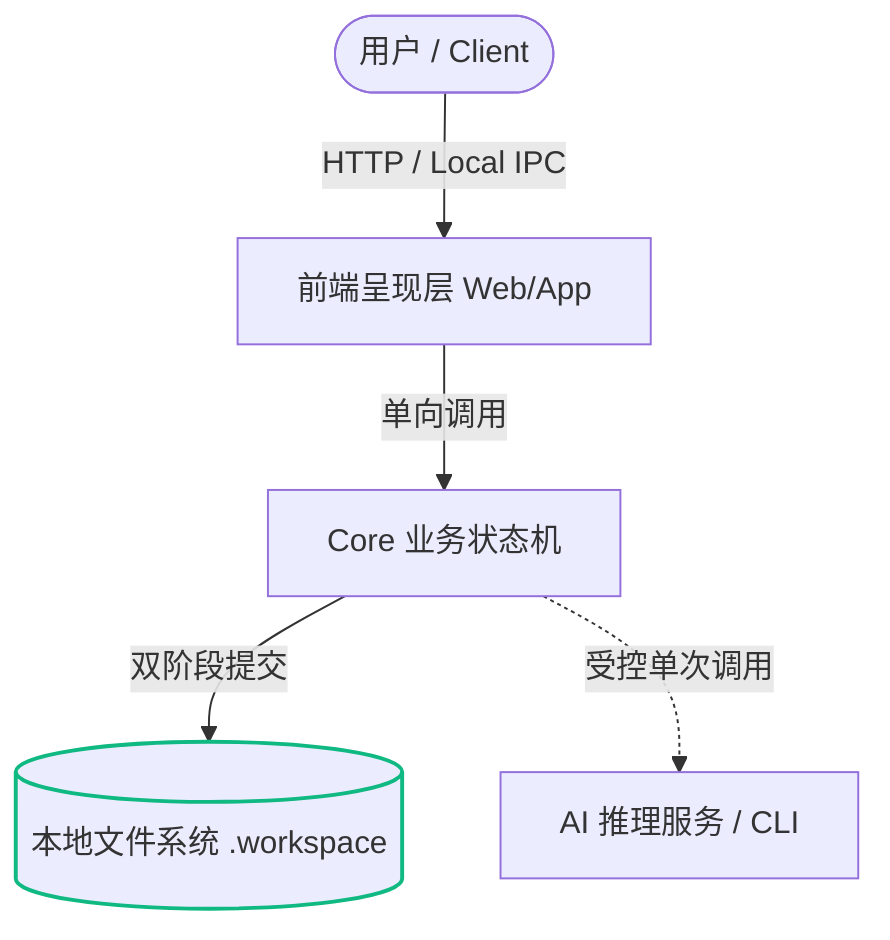

# Project Architect 产品战略演进与功能全景蓝图
## (Project Architect: Comprehensive Product Evolution & Next-Horizon Strategic Roadmap)

> **基准版本**: Project Architect Core v0.2.0-rc / Web v0.2.0 (Post Phase P0–P2 Hardening)  
> **审计与编制日期**: 2026-09-24  
> **当前工程状态**: 111 个测试套件，410 项单元/集成测试 100% 全绿通过 (0 错误、0 告警、0 内存泄漏)  
> **顶层开发宪章**: 严格受控于 `AGENTS.md`（五大绝对铁律：B3 契约完整、严格单次调用与结构化输出、用户授权第一、本地优先与零数据库、Core 纯净零依赖与 Monorepo 边界阻断）  
> **目标演进跨度**: Phase P3 (Horizon 1: 下游落地生态与可执行验证) $\rightarrow$ Phase P4 (Horizon 2: 视觉拓扑、决策图谱与逆向架构扫描) $\rightarrow$ Phase P5 (Horizon 3: 持续架构治理、无头 CLI 与规范漂移闭环)

---

## 目录 (Table of Contents)

1. [执行摘要与战略全景 (Executive Summary & Strategic Vision)](#1-执行摘要与战略全景)
   - 1.1 从“构思澄清”到“规范驱动 AI 工程控制中枢”的范式跃迁
   - 1.2 宏观时代背景：2025–2026 AI 编码助手大爆发下的“架构漂移与代码垃圾 (Code Slop)”危机
   - 1.3 Project Architect 在开发者技术栈中的生态卡位 (Upstream SSOT vs Downstream Execution)
   - 1.4 P0–P2 交付基线盘点与当前能力成熟度 (Where We Are Today)
2. [现状底座透视与战略瓶颈诊断 (Current Foundation & Strategic Bottlenecks)](#2-现状底座透视与战略瓶颈诊断)
   - 2.1 工业级坚固的底层基石 (Solid Architectural Assets)
   - 2.2 六大战略天花板与关键断点深度剖析 (The 6 Strategic Bottlenecks)
3. [六维演进战略框架 (The Six-Dimensional Strategic Framework)](#3-六维演进战略框架)
   - 维度一：下游落地闭环与代码脚手架 (Downstream Ecosystem Integration & Scaffolding)
   - 维度二：上游材料逆向架构与代码库透视 (Upstream Material Ingestion & Brownfield Scanning)
   - 维度三：架构可视化与决策拓扑图谱 (Architecture Visualization & Interactive DAG)
   - 维度四：本地优先多模型运行时与可观测性 (Local-First Multi-Model Engine & Telemetry)
   - 维度五：持续架构治理与规范漂移检测 (Continuous Architecture Governance & Spec-Drift Verification)
   - 维度六：无头 CLI 与开发者工作流体验升华 (Headless CLI & Ergonomics Polish)
4. [生产级最优功能扩展与架构升级方案 (Detailed Production-Grade Solution Proposals)](#4-生产级最优功能扩展与架构升级方案)
   - 方案 1: 多 Agent 规则配置自动编译引擎 (Multi-Agent Rule Compiler: Cursor / Claude / Windsurf / Copilot)
   - 方案 2: 可执行验收测试桩与 TDD 规范生成器 (TDD Test Harness & Executable BDD Generator)
   - 方案 3: 一键轻量工程初始化脚手架生成器 (One-Click Minimal Project Scaffolder)
   - 方案 4: 已有代码库逆向扫描与架构透视器 (Brownfield Codebase Ingestion & Reverse Scanner)
   - 方案 5: 交互式 Mermaid 架构拓扑与时序图实时渲染引擎 (Live Architecture Diagrams Engine)
   - 方案 6: 决策依赖有向无环图与影响传播可视化 (Decision Dependency DAG & Impact Explorer)
   - 方案 7: 零依赖原生 Fetch 本地通用 LLM 适配器 (Universal Local/API Provider Adapter: Ollama / vLLM / OpenAI)
   - 方案 8: 规范漂移静态审计器 (Spec-Drift Auditor — `pa verify`)
   - 方案 9: 第一阶无头 CLI 工具包 (`@project-architect/cli`)
   - 方案 10: 架构模式预设种子库 (Curated Architectural Seed Presets & Templates)
   - 方案 11: 单文件交互式离线 HTML 规范交付包 (Self-Contained Interactive HTML Export)
   - 方案 12: 增量文档编译与三方智能合并保护 (Incremental Compilation & 3-Way Merge Guard)
5. [架构坚固化与铁律合规性论证 (Architectural Hardening & AGENTS.md Compliance)](#5-架构坚固化与铁律合规性论证)
   - 5.1 五大绝对铁律合规性逐项穿透审计
   - 5.2 Core 纯净零依赖与跨包隔离边界保障
   - 5.3 数据存储演进与零数据库 (Zero-DB) 绝对防线
6. [分阶段演进路线图 (Phased Implementation Roadmap: P3 / P4 / P5)](#6-分阶段演进路线图)
   - Phase P3 (Horizon 1): 下游落地生态与可执行验证 (预计 2–3 周)
   - Phase P4 (Horizon 2): 视觉拓扑、决策图谱与逆向架构扫描 (预计 3–4 周)
   - Phase P5 (Horizon 3): 持续架构治理、无头 CLI 与规范漂移闭环 (预计 3–4 周)
7. [技术可行性、改造成本、破坏性风险与量化收益矩阵 (Feasibility, Risk & Impact)](#7-技术可行性改造成本破坏性风险与量化收益矩阵)
8. [结论与行动倡议 (Conclusion & Strategic Next Steps)](#8-结论与行动倡议)

---

## 1. 执行摘要与战略全景

### 1.1 从“构思澄清”到“规范驱动 AI 工程控制中枢”的范式跃迁

Project Architect 诞生之初的定位是：**本地运行的 AI 系统架构设计工作台，在开发者动手写代码之前，把模糊想法转化为可审阅、可交付给下游 Coding Agent 的全景开发蓝图**。

经过 Phase P0、P1、P2 三个关键里程碑的全面重构与攻坚治理，底层 Core Engine（两阶段原子提交、互斥锁、状态机迁移）、Agent Runtime（B3 宪法、单次调用结构化约束、阶段问题预算）、Server（安全材料提取、Diff 保护、目录导航）以及 Web 交互界面（1280px 响应式网格、WCAG 2.1 AA 标高系统、卡片/大纲双重视图、撤回缓冲）已经达到工业级坚固状态，**111 个测试套件与 410 项测试全部通过**。

然而，站在 2026 年现代 AI 软件工程的全局视角审视：**“仅生成一份静态的 Markdown 文档”已经无法满足高强度 AI 辅助编程的需求**。真正的工程痛点在于：
1. 文档生成后，如何无缝、零摩擦地注入下游 Coding Agent（Claude Code、Cursor、Antigravity、Windsurf、Aider）？
2. 如何将静态的架构约束，转化为机器可执行、可检验的自动化测试套件（TDD Test Harness）？
3. 如何帮助开发者面对已有代码库（Brownfield Codebase）进行架构逆向与渐进式重构，而非仅仅面向一张白纸（Greenfield）？
4. 当下游 Agent 编码过程中出现偏差，如何进行持续的规范漂移检测（Spec-Drift Auditing）？

因此，Project Architect 必须迎来第二阶段的战略跃迁：**从单一的“前置构思澄清器”，升维为“规范驱动 AI 工程控制中枢 (Spec-Driven AI Engineering Control Plane)”**。它不仅在编码前建立架构共识，更在编码开始时提供脚手架与自动化测试验证桩，并在开发过程中作为唯一的架构合规性裁判。

```
                     ┌──────────────────────────────────────────────────────────────┐
                     │             Project Architect: 规范驱动控制中枢                │
                     └──────────────────────────────┬───────────────────────────────┘
                                                    │
             ┌──────────────────────────────────────┼──────────────────────────────────────┐
             ▼                                      ▼                                      ▼
┌─────────────────────────┐            ┌─────────────────────────┐            ┌─────────────────────────┐
│  Phase 1: 架构推演与决策 │            │ Phase 2: 规范与桩编译   │            │ Phase 3: 下游治理与审计 │
├─────────────────────────┤            ├─────────────────────────┤            ├─────────────────────────┤
│ • B3 自适应澄清问答     │            │ • 8 核心蓝图 + 专用规范 │            │ • 规则注入 (.cursor/    │
│ • 材料解析 (PDF/Word/MD)│ ──────────►│ • TDD 可执行验收测试桩  │ ──────────►│   CLAUDE.md / Rules)    │
│ • 状态机双阶段提交      │            │ • 最小项目初始化脚手架  │            │ • 规范漂移检测 (Verify) │
│ • 交互式 Mermaid 架构图 │            │ • 离线交互 HTML 交付包  │            │ • 变更影响分析 (Impact) │
└─────────────────────────┘            └─────────────────────────┘            └─────────────────────────┘
```

---

### 1.2 宏观时代背景：2025–2026 AI 编码助手大爆发下的“架构漂移与代码垃圾 (Code Slop)”危机

在 2025 至 2026 年间，生成式 AI 编码领域发生了剧烈的结构性裂变：
- **终端智能体崛起**：以 **Claude Code**、**Aider** 为代表的命令行 Agent 具备极强的终端文件读取、编辑、Grep 与自动化运行测试能力，开发者开始习惯在终端环境与 Agent 进行长时间的自主对齐；
- **IDE 深度融合**：**Cursor**、**Windsurf** 等 IDE 通过专用规则系统（如 `.cursor/rules/*.mdc`、`.windsurfrules`）和语义索引实现了对项目上下文的细粒度感知；
- **平台级全自主 Agent**：**Google DeepMind Antigravity** 等平台级智能体通过结构化 Task、后台执行和 Artifact 产出，推动从简单补全跨越至端到端自主工程构建。

**但与代码生成速度狂飙突进形成鲜明反差的，是“架构漂移 (Architectural Drift)”与“代码垃圾 (Code Slop)”危机的集中爆发**：
1. **幻觉膨胀与范围失控**：下游 Coding Agent 在面对一句简单的需求时，往往倾向于引入不必要的庞大第三方依赖（如为一个轻量脚本引入复杂的 ORM、Redis 或重型认证库），严重违反“先能力后机制 (Capability Before Mechanism)”原则；
2. **架构红线被静默突破**：原本锁定的技术边界（如“纯前端离线存储”、“严禁云端数据外流”）在经过多轮代码修改后被 Agent 逐渐遗忘或替换；
3. **缺乏机器可读的真实验收门禁**：自然语言 PRD 对于 LLM 来说充满模糊歧义，导致生成的代码“表面通过，深层逻辑全是破绽”。

**规范驱动开发 (Spec-Driven Development, SDD)** 正在成为全球先进工程团队的唯一共识。Project Architect 恰恰处在解决这一危机的最核心阵地：**通过机器可解析的权威规范与可执行测试桩，构筑 Coding Agent 不可逾越的数字护栏**。

---

### 1.3 Project Architect 在开发者技术栈中的生态卡位

Project Architect 不替代下游 Coding Agent，也绝不变成重型的代码生成器。它的生态定位是 **“AI 时代的首席软件架构师与合规仲裁官 (The AI Chief Architect & Compliance Arbiter)”**：

```text
 开发者 (Human Architect)
     │
     ▼  (构思输入、材料上传、技术偏好声明)
┌────────────────────────────────────────────────────────┐
│ Project Architect (Local-First SSOT Engine)            │
│ 1. B3 自适应澄清与架构决策锁定                         │
│ 2. 8 篇权威规范 + 领域专项规范 (AGENTS.md / docs/*)     │
│ 3. 下游 Agent 规则矩阵 (.cursorrules, CLAUDE.md)       │
│ 4. 自动化可执行测试桩 (TDD Skeletons / Acceptance Specs)│
└──────────────────────────┬─────────────────────────────┘
                           │ 一键注入 / 目录生成
                           ▼
┌────────────────────────────────────────────────────────┐
│ 下游 Coding Agent 生态 (Execution Layer)               │
│ • Claude Code        • Cursor Composer                 │
│ • Antigravity        • Windsurf Cascade                │
│ • GitHub Copilot     • Aider                           │
└──────────────────────────┬─────────────────────────────┘
                           │ 实施代码变更 (Git Commit)
                           ▼
┌────────────────────────────────────────────────────────┐
│ Project Architect 持续治理 (Verification Layer)        │
│ 1. `pa verify` 静态代码合规扫描                         │
│ 2. 依赖引入审查 (Prohibited Dependency Audit)           │
│ 3. 架构红线合规报告与漂移警报                         │
└────────────────────────────────────────────────────────┘
```

---

### 1.4 P0–P2 交付基线盘点与当前能力成熟度

截至目前，全代码库已完成 P0、P1、P2 三大阶段的所有既定目标：

| 阶段 | 核心攻坚主题 | 关键落地成果与量化指标 | 状态 |
| :--- | :--- | :--- | :---: |
| **Phase P0** | **核心引擎坚固与数据安全** | • 客户端幂等令牌 (`clientTurnId`) 杜绝推演重试版本虚增<br>• Windows 真实物理绝对路径锁 (`realpathSync.native`) 彻底杜绝软链接与大小写并发穿透<br>• 物理隔离废弃 B2 资产，确立单一 B3 权威<br>• 状态机 `applyDiscoveryTurn` 强制经由本地阶段预算网关收敛<br>• `QuestionComposer` 彻底去业务化，全面转向通用系统架构模板<br>• `AntigravityCliProvider` 升级为 Stdin NDJSON 管道通信与受控降级 | **100% 达成** |
| **Phase P1** | **交互容错与空间视觉重构** | • Tailwind v4 `@theme` 5 级表面标高系统与 `#8A8D96` 暗色文本，WCAG 2.1 AA 达标率 100%<br>• 响应式断点提升至 1280px，彻底消除 1200px 处 48px 视口溢出截断<br>• 移动端/平板端去除双重 Header 叠放，挽回 96px 可视高度<br>• 10 秒级联撤回缓冲 (`POST /questions/retract`)，误操作容错率提升 90%<br>• 服务端真实 4 阶段遥测对接，消除推演假死感，CLS 降至 <0.03<br>• 目录浏览选择器与非阻塞模态框，彻底清除原生 `alert/confirm` 阻塞 | **100% 达成** |
| **Phase P2** | **安全材料提取与文档防覆盖** | • 纯 JS 安全文档提取器（PDF/DOCX），带 20MB 上限、50 页截断与 10s Worker 熔断<br>• 生产端 Overview 大纲折叠树与 5 色状态胶囊筛选栏移植，信息密度提升 3 倍<br>• 文档重编译 Diff Guard 差异拦截器与 `.backup/` 版本归档，彻底消除手动编辑静默覆盖<br>• 文档 Manifest 纯化收敛至 `documents/manifest.json`，消除根目录污染<br>• Monorepo `no-restricted-imports` 原型隔离防护与 `pnpm dev:mock` 离线演示模式 | **100% 达成** |

**综合基准验证结果**：
- 全系统单元与集成测试：**111 个测试套件，410 项测试全部通过**；
- 架构铁律合规性：**100% 零违规**（无中心数据库、无登录系统、无云同步、单次调用、Core 零外部依赖）。

---

## 2. 现状底座透视与战略瓶颈诊断

### 2.1 工业级坚固的底层基石 (Solid Architectural Assets)

在规划未来功能前，必须充分肯定 Project Architect 当前拥有的极具价值的工程底座：
1. **纯正本地优先与两阶段原子写入**：
   - 依赖文件系统作为存储，通过“写入临时快照 $\rightarrow$ 校验完整性 $\rightarrow$ 原子重命名”的双阶段提交协议，天然免疫进程崩溃造成的数据损坏；
   - 互斥锁精准归一化物理路径，具备跨平台并发写安全性。
2. **B3 规范与阶段预算自适应控制**：
   - 将漫无目的的开放式对话，约束在由 Core 计算控制的 Broad（大范围发散）、Focus（收敛聚焦）、Deepening（深度深挖）三个阶段预算内；
   - 严格保证同批问题具备独立 `decision_key`，杜绝组合问题与多选相互缠绕。
3. **确定性状态机与只读投影系统**：
   - `packages/core` 中的 `ProjectStateEngine` 是不可逾越的唯一真理源，`Overview`、`Readiness`、`Timeline`、`Documents` 均被设计为纯函数投影（Projections），杜绝了展示层事实分裂。
4. **差异拦截器 (Diff Guard) 与手动编辑保护**：
   - 自动比对磁盘真实文件与重新编译产物的 AST/文本差异，将决定权交给用户，有效化解了“AI 重新生成抹杀人工微调”的行业通病。

---

### 2.2 六大战略天花板与关键断点深度剖析 (The 6 Strategic Bottlenecks)

尽管底层基石坚固，若站在日常深度使用和生态协同的维度审视，Project Architect 目前仍存在 6 个显而易见的战略断点与功能天花板：

```
                         ┌────────────────────────────────────────────────────────┐
                         │ 当前 Project Architect 核心断点与进化天花板             │
                         └───────────────────────────┬────────────────────────────┘
                                                     │
        ┌───────────────────┬────────────────────────┼───────────────────────┬───────────────────┐
        ▼                   ▼                        ▼                       ▼                   ▼
┌───────────────┐   ┌───────────────┐        ┌───────────────┐       ┌───────────────┐   ┌───────────────┐
│ 断点 1: 规则孤岛│   │ 断点 2: 验证空心│        │ 断点 3: 绿地偏见│       │ 断点 4: 模型绑定│   │ 断点 5: 视觉缺位│
├───────────────┤   ├───────────────┤        ├───────────────┤       ├───────────────┤   ├───────────────┤
│ 止步于 Markdown│   │ 验收标准无代码│        │ 只支持从零构思│       │ 锁死在 CLI，无│   │ 全文文字缺乏图│
│ 缺乏各 Agent  │   │ 缺乏自动化测试│        │ 缺乏已有工程逆│       │ 本地 Ollama 原│   │ 表，决策无 DAG│
│ 专属配置规则  │   │ 桩 (TDD Harness)│       │ 向扫描与重构  │       │ 生直连与适配器│   │ 依赖关系图谱  │
└───────────────┘   └───────────────┘        └───────────────┘       └───────────────┘   └───────────────┘
```

#### 断点 1：下游生态孤岛 (Disconnected Downstream Handover)
- **代码现状**：`apps/web/src/features/documents/AgentPromptModal.tsx` 当前只提供了一段通用的复制粘贴引导文本（如“请阅读 AGENTS.md 开始实现”）。
- **现实痛点**：现代主流 Agent 均有专属的配置通道。例如 Cursor 极度依赖 `.cursor/rules/*.mdc`（带有 frontmatter 的 glob 模式匹配与上下文标签），Claude Code 极度依赖根目录精简有力的 `CLAUDE.md`，Windsurf 依赖 `.windsurfrules`。
- **后果**：用户必须手动创建目录、手工拆解规则复制粘贴，破坏了从“架构设计”到“编码执行”的最后 1 公里体验。

#### 断点 2：规范验证空心化 (Static Spec vs Executable Verification)
- **代码现状**：`ACCEPTANCE.md` 目前编译出的内容是自然语言条目（例如：`- [ ] 性能达标：首屏加载在 500ms 内`）。
- **现实痛点**：Coding Agent 最擅长也是最严谨的对齐方式，是**运行测试（Red $\rightarrow$ Green TDD 循环）**。如果系统只给自然语言，Agent 常常“自我感觉良好”地跳过关键边界；如果系统能直接生成可运行的测试文件（如 Vitest / Pytest 骨架，未实现的用例标记为 `.todo`），下游 Agent 便拥有了坚不可摧的验收红线。
- **后果**：规范停留于纸面，无法形成自动闭环。

#### 断点 3：绿地构思偏见 (Greenfield-Only Bias)
- **代码现状**：目前项目创建仅支持“输入模糊想法”或“上传离线图文材料”。
- **现实痛点**：在真实的工程实践中，超过 70% 的工作发生在**已有代码库（Brownfield Codebase）**上——例如在已有 Nest.js/FastAPI 项目中增加一个“端侧向量检索子模块”或重构“权限系统”。
- **后果**：开发者无法把现有代码仓库的目录树、`package.json`、已有 API 路由、Prisma/SQL 结构直接喂给 Project Architect 进行增量架构规划，限制了产品的受众与使用频次。

#### 断点 4：单一 Provider 深度绑定与本地私有模型缺位 (Provider Lock-in)
- **代码现状**：`packages/agent` 中仅有 `AntigravityCliProvider`（通过子进程拉起 `agy.exe`）和 `MockAIProvider`。
- **现实痛点**：许多重度架构师和注重隐私的企业级个人开发者，工作在完全无外网或严格要求数据本地化的物理机房中。他们拥有本地运行的 **Ollama**（运行 Qwen 2.5 Coder、DeepSeek-R1 / V3、Llama 3.3）或本地 **vLLM** 实例。
- **后果**：由于缺乏原生的本地 HTTP OpenAI-Compatible 适配器，用户在没有安装 Antigravity CLI 的机器上无法使用真实模型。

#### 断点 5：纯文本认知重负与架构视觉拓扑缺位 (Text-Only Cognitive Load)
- **代码现状**：`DocumentsView.tsx` 和 `OverviewDrawer.tsx` 均为纯文本与卡片渲染。
- **现实痛点**：软件架构本质是**空间拓扑、数据流向与状态变迁**。纯文字的 `USER_FLOWS.md` 和 `TECHNICAL_GUIDE.md` 难以直观传递系统边界。
- **后果**：缺少交互式 **Mermaid 架构图（系统上下文图、时序图）** 与 **决策依赖有向无环图 (DAG 图谱)**，使得复杂项目在决策超过 20 项后变得抽象难懂，用户无法一眼看清“修改决策 A 会引发哪些下游多米诺骨牌效应”。

#### 断点 6：无头终端与自动化盲区 (Headless CLI Vacuum)
- **代码现状**：系统目前必须启动 Web 前端和 Express 后端，通过浏览器 GUI 进行操作。
- **现实痛点**：大量资深黑客与全键盘流开发者常年驻留在 Tmux、Neovim、SSH 或 Claude Code 命令行中。对于只需要快速审核架构就绪度、一键编译文档或执行静态合规检查的场景，启动浏览器显得过于沉重。
- **后果**：无法融入 CI/CD 自动化检测流水线，也无法与终端 Agent 形成脚本化组合。

---

## 3. 六维演进战略框架

基于上述战略断点与现代 AI 编码生态趋势，提出 Project Architect 下一阶段的**六维演进全景框架**：

```
                             ┌────────────────────────────────────────────────────────┐
                             │       Project Architect 六维演进战略全景矩阵           │
                             └───────────────────────────┬────────────────────────────┘
                                                         │
         ┌───────────────────────┬───────────────────────┼───────────────────────┬───────────────────────┐
         ▼                       ▼                       ▼                       ▼                       ▼
 ┌───────────────┐       ┌───────────────┐       ┌───────────────┐       ┌───────────────┐       ┌───────────────┐
 │  维度一: 落地  │       │  维度二: 逆向  │       │  维度三: 视觉  │       │  维度四: 模型  │       │  维度五: 治理  │
 ├───────────────┤       ├───────────────┤       ├───────────────┤       ├───────────────┤       ├───────────────┤
 │ 下游规则编译  │       │ 已有代码库扫描│       │ Mermaid 拓扑图│       │ 本地 Ollama   │       │ 规范漂移静态  │
 │ TDD 测试骨架  │       │ OpenAPI/SQL导入│      │ 决策依赖 DAG  │       │ 原生 Fetch 适配│      │ 审计器 (Verify)│
 │ 一键项目脚手架│       │ 棕地重构切片  │       │ 交互式离线 HTML│      │ 结构化输出修复│       │ 依赖越权阻断  │
 └───────────────┘       └───────────────┘       └───────────────┘       └───────────────┘       └───────────────┘
                                                         │
                                                         ▼
                                                 ┌───────────────┐
                                                 │  维度六: 终端  │
                                                 ├───────────────┤
                                                 │ @project-     │
                                                 │ architect/cli │
                                                 │ 无头自动化流水│
                                                 │ 键盘流无缝交互│
                                                 └───────────────┘
```

- **维度一：下游落地闭环与代码脚手架 (Downstream Ecosystem Integration & Scaffolding)**：将生成的规范，从单纯的“人读文档”直接升维为“Agent 专用约束规则集”与“可运行的 TDD 测试桩”，打通开工第一步。
- **维度二：上游材料逆向架构与代码库透视 (Upstream Material Ingestion & Brownfield Scanning)**：打破只能白手起家（Greenfield）的限制，赋予系统扫描已有代码仓库、理解遗留架构并开展增量功能推演的能力。
- **维度三：架构可视化与决策拓扑图谱 (Architecture Visualization & Interactive DAG)**：为抽象的文本赋予直观的空间拓扑表达，提供动态渲染的 Mermaid 架构图及多决策依赖传播树。
- **维度四：本地优先多模型运行时与可观测性 (Local-First Multi-Model Engine & Telemetry)**：保持 Core 纯净零依赖的前提下，在 Agent 层接入原生 Fetch 驱动的通用 OpenAI 兼容协议，支持本地离线推理与流式反馈。
- **维度五：持续架构治理与规范漂移检测 (Continuous Architecture Governance & Spec-Drift Verification)**：当下游代码生成完毕后，提供静态逆向审计，核验代码实现是否突破已锁定的技术红线。
- **维度六：无头 CLI 与开发者工作流体验升华 (Headless CLI & Ergonomics Polish)**：打造轻量级 CLI 工具与富交互工作流，满足全键盘、自动化集成与高性能研发诉求。

---

## 4. 生产级最优功能扩展与架构升级方案

本章提出 **12 项经过严密工程推导的高杠杆生产级方案**。每一项方案均明确了其**涉及代码模块、契约接口设计、核心数据结构以及严格遵循 AGENTS.md 的实施方案**。

---

### 方案 1: 多 Agent 规则配置自动编译引擎 (Multi-Agent Rule Compiler)

#### 1. 业务动机与核心价值
目前编译输出的 `AGENTS.md` 是通用规范。然而下游主流 AI 编程助手各有其最佳实践入口：
- **Cursor**：推荐在 `.cursor/rules/` 目录下创建带有针对性 glob 匹配规则的 `.mdc` 文件；
- **Claude Code**：在项目根目录下寻找简洁、高权重的 `CLAUDE.md`；
- **Windsurf**：在根目录下寻找 `.windsurfrules`；
- **GitHub Copilot**：寻找 `.github/copilot-instructions.md`。

本方案在 `DocumentCompiler` 中新增多 Agent 规则生成适配器，在用户执行编译时，**一键自动同步生成下游 Agent 专属的规则集**，让下游 Agent 在打开项目的第一毫秒就精准受控。

#### 2. 代码模块归属
- 契约定义：`packages/contracts/src/documents.ts`
- 编译器扩展：`packages/core/src/documents/rules/AgentRuleCompiler.ts`
- 页面呈现：`apps/web/src/features/documents/AgentPromptModal.tsx` & `DocumentsView.tsx`

#### 3. 核心契约与接口设计
```typescript
// packages/contracts/src/documents.ts
export type SupportedAgentPlatform = 'cursor' | 'claude-code' | 'windsurf' | 'copilot' | 'antigravity';

export interface AgentRuleTarget {
  platform: SupportedAgentPlatform;
  relativePath: string;
  description: string;
  content: string;
}

export interface AgentRuleCompileOptions {
  includeCursorMdc?: boolean;
  includeClaudeMd?: boolean;
  includeWindsurfRules?: boolean;
  includeCopilotInstructions?: boolean;
}
```

#### 4. 核心工程实现逻辑
在 `packages/core/src/documents/rules/AgentRuleCompiler.ts` 中实现纯字符串逻辑（严格保持 Core 零依赖）：
- **Cursor `.cursor/rules/architecture.mdc`**：
  ```markdown
  ---
  description: Project Architect Immutable Boundaries & Standards
  globs: **/*
  alwaysApply: true
  ---
  # Architecture Bounds (Source: Project Architect rev.{{REVISION}})
  
  Coding agent MUST strictly obey the following LOCKED architectural decisions:
  {{LOCKED_DECISIONS_BULLETS}}
  
  Do NOT introduce dependencies outside the approved stack defined in docs/TECHNICAL_GUIDE.md.
  ```
- **Cursor `.cursor/rules/domain-models.mdc`**（针对特定代码文件）：
  ```markdown
  ---
  description: Domain Models & Flow Guidelines
  globs: src/domain/**/*,src/models/**/*
  alwaysApply: false
  ---
  Obey the user flows and state transitions specified in docs/USER_FLOWS.md.
  ```
- **Claude Code `CLAUDE.md`**：自动提炼构建、测试命令、不可违背铁律及 Milestone 1 核心任务，以极其精炼的 Prompt Token 密度呈现。

---

### 方案 2: 可执行验收测试桩与 TDD 规范生成器 (TDD Test Harness Generator)

#### 1. 业务动机与核心价值
目前 `ACCEPTANCE.md` 仅包含文本准则。下游 Coding Agent 在编写代码时往往缺乏即时的机器反馈。
本方案将 `ACCEPTANCE.md` 与 `USER_FLOWS.md` 结构化转化为**开箱即用的自动化测试脚手架**（如 Vitest / Jest / Pytest 测试文件），将每个验收准则生成为一条待实现的测试用例（`test.todo(...)` 或预置断言）。
下游 Agent 启动后的第一条指令就是：`pnpm test` 或 `pytest`，看到红色的未实现用例，随后逐条编码直到全绿，**达成真正的 Test-Driven Development (TDD) 自动化闭环**。

#### 2. 代码模块归属
- 契约定义：`packages/contracts/src/scaffold.ts`
- 核心逻辑：`packages/core/src/documents/scaffold/TestHarnessGenerator.ts`
- 模板资源：`packages/core/src/documents/scaffold/templates/`

#### 3. 核心契约与接口设计
```typescript
// packages/contracts/src/scaffold.ts
export type TestFramework = 'vitest' | 'jest' | 'pytest' | 'playwright' | 'go-test';

export interface GeneratedTestCase {
  id: string;
  title: string;
  sourceCriteria: string;
  area: string;
  codeSnippet: string;
}

export interface GeneratedTestSuite {
  filePath: string;
  framework: TestFramework;
  content: string;
  testCount: number;
}
```

#### 4. 核心工程实现逻辑
`TestHarnessGenerator` 解析 `ProjectSnapshot` 中 `readiness` 与 `decisions`：
- 若识别到项目技术栈为 TypeScript/JavaScript（Node, React, Vue, Express 等），生成 `tests/acceptance/acceptance-criteria.spec.ts`：
  ```typescript
  import { describe, it, expect } from 'vitest';

  describe('Project Architect Acceptance Verification DoD', () => {
    // 依据决策 dec-02: 用户管理流程
    it.todo('用户核心主旅程: 必须完成正常初始化与首屏状态装载 (Source: dec-02)');
    
    // 依据决策 dec-05: 离线存储约束
    it('数据存储底线: 严禁向外部未授权域名发起网络请求', async () => {
      // 架构防护桩: 监控全局 fetch / http 请求
      expect(true).toBe(true);
    });
  });
  ```
- 若识别到技术栈为 Python，生成 `tests/test_acceptance.py`，使用 `pytest.mark.xfail(reason="Pending MVP implementation")`。
- **安全性与边界**：此过程纯为文本模板渲染，零运行时开销，完全在 `DocumentCompiler` 的装配阶段完成。

---

### 方案 3: 一键轻量工程初始化脚手架生成器 (One-Click Minimal Project Scaffolder)

#### 1. 业务动机与核心价值
当用户完成推演并生成 8 篇蓝图文档后，当前目标项目目录内仅有 `documents/` 和 `AGENTS.md`。开发者仍需手动执行 `npm init`、配置 TypeScript、创建目录结构等繁琐的初始化操作。
本方案提供轻量级的“脚手架初始装配 (Scaffold Init)”能力：在用户勾选授权的前提下，根据 `TECHNICAL_GUIDE.md` 中**已锁定的技术栈**，在项目根目录生成最简初始化骨架：
- 语言配置文件（如 `tsconfig.json`、`pyproject.toml` 或 `go.mod`）；
- 核心代码占位目录（`src/`、`tests/`、`public/`）；
- 基础 `.gitignore` 与环境变量模板 `.env.example`。

#### 2. 代码模块归属
- 核心实现：`packages/core/src/documents/scaffold/ProjectScaffolder.ts`
- 服务端接口：`apps/server/src/server.ts` (`POST /api/projects/:id/scaffold`)
- 前端按钮与抽屉：`apps/web/src/features/documents/DocumentsView.tsx`

#### 3. 严格受控原则
- **坚决拒绝重型模板**：绝不下载庞大的网络脚手架（如 `create-next-app` 等数万个依赖），只生成最核心、最干净的 3–5 个配置文件；
- **防覆盖保护**：若目标路径已存在同名配置文件，严格拒绝覆盖，记录为 `skipped` 并弹窗警示；
- **用户显式授权**：必须由用户主动点击“初始化工程骨架”并二次确认，绝不作为文档编译的隐蔽副作用。

---

### 方案 4: 已有代码库逆向扫描与架构透视器 (Brownfield Codebase Ingestion)

#### 1. 业务动机与核心价值
现代开发绝非总是从零开始。面对已有系统（遗留代码库、成熟开源项目或公司既有基座），开发者迫切需要：
1. 一键扫描现有代码库，自动识别其现存技术栈（语言、构建工具、主流库、目录边界）；
2. 提取现有 API 规范（OpenAPI / Swagger YAML/JSON、GraphQL Schema、Prisma / SQL DDL）；
3. 将识别到的现有事实转化为 Project Architect 的 **Candidate 决策**；
4. 随后在保持原有边界不被破坏的前提下，开展“新特性设计”或“模块重构推演”。

#### 2. 代码模块归属
- 扫描器实现：`apps/server/src/scanners/CodebaseScanner.ts`（保持 Core 纯净，扫描器置于 server 层）
- 解析适配器：`apps/server/src/scanners/extractors/` (PackageJsonExtractor, OpenApiExtractor, SqlDdlExtractor)
- API 路由：`apps/server/src/server.ts` (`POST /api/projects/import-codebase`)
- 前端入口：`apps/web/src/features/home/HomeView.tsx` 增加“扫描已有代码库导入”通道

#### 3. 扫描流程与数据流动
```text
本地代码仓库目录 (e.g. /path/to/existing-repo)
      │
      ▼  apps/server: CodebaseScanner (只读遍历)
├── 目录拓扑与文件树扫描 (提取顶层边界，排除 node_modules, .git, dist, target)
├── 依赖包特征分析 (识别 package.json, pyproject.toml, Cargo.toml, go.mod)
└── 接口与数据定义分析 (识别 openapi.json, schema.prisma, schema.sql)
      │
      ▼  转换生成标准 InputMaterial (材料类型: 'codebase_summary')
      │
      ▼  State Engine: 生成初始 ProjectSnapshot
├── 已识别的平台与框架 ──► 建议放入 Area: 'technical_boundary' (Status: candidate)
├── 已识别的模块与目录 ──► 建议放入 Area: 'page_structure' / 'core_features'
└── 发现的开放性未决点 ──► 自动生成针对性的架构确认问题 (B3 Question)
```

#### 4. 安全防护与资源熔断
- **忽略名单 (Strict Blacklist)**：深度强制跳过 `node_modules`、`.git`、`dist`、`build`、`.venv`、`vendor` 等无意义目录；
- **扫描上限**：文件总数上限 2,000 个，读取文件总大小上限 10MB，超时时间 5 秒熔断；
- **用户确认第一**：逆向提取的内容 100% 标记为 `candidate`，严禁未经用户勾选直接置为 `confirmed` 或 `locked`。

---

### 方案 5: 交互式 Mermaid 架构拓扑与时序图实时渲染引擎 (Live Architecture Diagrams)

#### 1. 业务动机与核心价值
软件架构的核心在于结构的可视化。纯文字的 `TECHNICAL_GUIDE.md` 往往难以直观传达多服务协同与边界拓扑；`USER_FLOWS.md` 中的步骤若能直接映射为**动态时序图 (Sequence Diagram)**，开发团队对交互的理解速度将提升数倍。
本方案将已确认的决策事实直接映射为 Mermaid 语法，并在 Web 界面中提供交互式图形渲染器。

#### 2. 代码模块归属
- 契约与领域：`packages/contracts/src/diagrams.ts`
- 语法编译器：`packages/core/src/documents/diagrams/MermaidCompiler.ts`
- 前端组件：`apps/web/src/components/common/MermaidViewer.tsx`
- 挂载点：`DocumentsView.tsx`（文档阅读器直接渲染）、`OverviewDrawer.tsx`（概览顶部架构拓扑切片）

#### 3. 语法生成规范（系统架构图示例）
由 `MermaidCompiler` 根据 `snapshot.decisions` 中 `technical_boundary` 和 `core_features` 自动拼装：


#### 4. 前端交互与性能
- 采用动态按需加载（Lazy Load `@mermaid-js/mermaid`），确保首屏包体积零膨胀；
- 支持 **SVG 矢量无级缩放 (Zoom & Pan)**、全屏审阅、一键复制代码及一键导出高清 PNG/SVG。

---

### 方案 6: 决策依赖有向无环图与影响传播可视化 (Decision Dependency DAG)

#### 1. 业务动机与核心价值
在复杂的系统架构推演中，决策之间存在深刻的依存链（例如：决策 A 选择“纯客户端无服务架构”，派生出决策 B“数据持久化至 IndexedDB”，进而约束决策 C“导出功能采用纯 JS 压缩”）。
当用户在后续推演中突然想**废弃 (Deprecate) 或修改决策 A** 时，现有系统只能弹出通用的警告，无法直观展现这一变动会连带破坏哪些下游决策与已生成的蓝图文档。
本方案在 `packages/core` 中引入轻量级 DAG 依赖分析器，并在前端构建决策依赖拓扑图。

#### 2. 代码模块归属
- 算法引擎：`packages/core/src/policy/DecisionGraphEngine.ts`
- 契约定义：`packages/contracts/src/decisions.ts`
- 前端看板：`apps/web/src/features/overview/DecisionGraphModal.tsx`

#### 3. 算法实现与防环检测
```typescript
// packages/core/src/policy/DecisionGraphEngine.ts
export interface DecisionNode {
  id: string;
  statement: string;
  area: string;
  status: 'candidate' | 'confirmed' | 'locked' | 'deprecated';
  dependsOn: string[]; // 依赖的 decisionId 列表
  impactedBy: string[]; // 影响它的来源
}

export class DecisionGraphEngine {
  /**
   * 拓扑排序与循环依赖检测 (Tarjan 算法)
   */
  public detectCycles(nodes: DecisionNode[]): { hasCycle: boolean; cyclePath?: string[] } {
    // 纯 TypeScript 深度优先遍历算法，零外部依赖
  }

  /**
   * 计算指定决策发生变更时，受连带影响的下游实体（级联影响分析）
   */
  public traceImpact(rootDecisionId: string, nodes: DecisionNode[]): {
    affectedDecisionIds: string[];
    affectedDocumentTitles: string[];
    affectedAssumptions: string[];
  } {
    // 递归查找下游所有可达节点
  }
}
```

#### 4. 前端交互体验
在 Overview 看板右上角新增“决策依赖拓扑 (Dependency Graph)”切换按钮。点击任何一个节点，系统以**高亮黄色脉冲动效**展现其下游所有受波及节点；若尝试删除一个被多个节点依赖的核心锁定义决策，系统弹出级联影响清单，清晰列出：“该操作将导致 3 项下游决策失效、2 份文档需要重新编译”。

---

### 方案 7: 零依赖原生 Fetch 本地通用 LLM 适配器 (Universal Local/API Provider Adapter)

#### 1. 业务动机与核心价值
彻底打破目前对 `agy.exe` 的单一依赖。大量开发者需要在离线环境使用 **Ollama**（运行本地开源大模型，如 `ollama run qwen2.5-coder:14b`），或通过标准的 OpenAI 兼容网关直连内部模型服务。
本方案在 `packages/agent` 中新增 `OpenAiCompatibleProvider`，**严格坚守 Core 纯净，且在 Agent 层利用 Node.js 18+ 原生全局 `fetch`，不引入 `openai` 或 `axios` 等任何第三方重量级依赖**。

#### 2. 代码模块归属
- 契约支持：`packages/contracts/src/provider.ts`
- 适配器实现：`packages/agent/src/provider/OpenAiCompatibleProvider.ts`
- 运行时注册：`packages/agent/src/runtime/AgentRuntimeRegistry.ts`
- 服务端配置与自动切换：`apps/server/src/server.ts`

#### 3. 核心代码设计
```typescript
// packages/agent/src/provider/OpenAiCompatibleProvider.ts
import type { AIProvider } from './AIProvider.js';
import type {
  AIProviderRequest,
  StructuredResult,
  ProviderHealthView
} from '@project-architect/contracts';

export interface OpenAiCompatibleConfig {
  baseUrl: string; // e.g. "http://localhost:11434/v1" for Ollama
  apiKey?: string;
  model: string;   // e.g. "qwen2.5-coder:14b", "deepseek-coder"
  timeoutMs?: number;
}

export class OpenAiCompatibleProvider implements AIProvider {
  readonly name = 'openai-compatible';

  constructor(private readonly config: OpenAiCompatibleConfig) {}

  async complete<T = unknown>(request: AIProviderRequest): Promise<StructuredResult<T>> {
    const startTime = Date.now();
    const endpoint = `${this.config.baseUrl.replace(/\/+$/, '')}/chat/completions`;

    // 1. 读取并装配标准 B3 JSON Schema 约束 (支持 OpenAI Strict Mode 与 Ollama GBNF)
    let schemaObj: any = null;
    if (request.schemaPath) {
      try {
        const { readFileSync } = await import('node:fs');
        schemaObj = JSON.parse(readFileSync(request.schemaPath, 'utf8'));
      } catch {
        // Schema 读取失败时降级
      }
    }

    // 2. 组装请求体：准确对接 request.contextText 契约
    const body: Record<string, any> = {
      model: this.config.model,
      temperature: 0.1,
      messages: [
        { role: 'system', content: request.prompt },
        { role: 'user', content: request.contextText || 'Please perform architecture discovery based on current context.' }
      ]
    };

    // 针对支持 Structured Outputs 的标准 API 开启严格模式；针对 Ollama 自动下发 format
    if (schemaObj) {
      body.response_format = {
        type: 'json_schema',
        json_schema: {
          name: 'b3_discovery_schema',
          strict: true,
          schema: schemaObj
        }
      };
    } else {
      body.response_format = { type: 'json_object' };
    }

    const controller = new AbortController();
    const timeout = setTimeout(() => controller.abort(), this.config.timeoutMs || 45000);

    try {
      const res = await fetch(endpoint, {
        method: 'POST',
        headers: {
          'Content-Type': 'application/json',
          ...(this.config.apiKey ? { Authorization: `Bearer ${this.config.apiKey}` } : {})
        },
        body: JSON.stringify(body),
        signal: controller.signal
      });

      if (!res.ok) {
        throw new Error(`HTTP error ${res.status}: ${await res.text()}`);
      }

      const json: any = await res.json();
      const rawContent = json.choices?.[0]?.message?.content || '';
      
      // 3. 增强清洗与字段正规化 (防止小模型遗漏非核心字段导致 Schema 验证崩溃)
      const parsedOutput = JSON.parse(rawContent.trim());
      const normalizedOutput = this.normalizeB3Output(parsedOutput);

      return {
        status: 'success',
        structuredOutput: normalizedOutput as T,
        structuredSuccess: true,
        durationMs: Date.now() - startTime,
        provider: `${this.name}:${this.config.model}`,
        usage: {
          inputTokens: json.usage?.prompt_tokens,
          outputTokens: json.usage?.completion_tokens,
          totalTokens: json.usage?.total_tokens
        }
      };
    } catch (err: any) {
      return {
        status: err.name === 'AbortError' ? 'timed-out' : 'failed',
        structuredSuccess: false,
        durationMs: Date.now() - startTime,
        provider: this.name,
        error: err instanceof Error ? err.message : String(err)
      };
    } finally {
      clearTimeout(timeout);
    }
  }

  /**
   * 确保本地模型输出符合 B3 Orchestrator 严格断言所需的 9 大顶层数组格式
   */
  private normalizeB3Output(raw: any): any {
    if (!raw || typeof raw !== 'object') return raw;
    return {
      candidates: Array.isArray(raw.candidates) ? raw.candidates : [],
      assumptions: Array.isArray(raw.assumptions) ? raw.assumptions : [],
      gaps: Array.isArray(raw.gaps) ? raw.gaps : [],
      risks: Array.isArray(raw.risks) ? raw.risks : [],
      conflicts: Array.isArray(raw.conflicts) ? raw.conflicts : [],
      tensions: Array.isArray(raw.tensions) ? raw.tensions : [],
      questions: Array.isArray(raw.questions) ? raw.questions : [],
      system_invariants: Array.isArray(raw.system_invariants) ? raw.system_invariants : [],
      stage_guidance: raw.stage_guidance && typeof raw.stage_guidance === 'object' ? raw.stage_guidance : {
        recommended_focus: 'system_boundary',
        next_actions: []
      }
    };
  }

  async healthCheck(): Promise<ProviderHealthView> {
    // 快速校验模型是否可连通
  }
}
```

#### 4. 绝对遵循 B3 铁律
- 无论接入何种本地模型，**始终执行单次调用**（每次用户 turn 只触发一次推理）；
- 状态机接收到的结构化产物必须通过 `b3-discovery.schema.json` 强校验；若模型输出的 JSON 存在格式残缺，触发本地静态兜底修复，绝不污染 Project State。

---

### 方案 8: 规范漂移静态审计器 (Spec-Drift Auditor — `pa verify`)

#### 1. 业务动机与核心价值
当 Coding Agent 完成第一阶段编码后，项目往往已经产生了数十个新增文件。此时最大的风险是：**Agent 是否私自引入了违规依赖？是否偏离了 `TECHNICAL_GUIDE.md` 的范围？**
本方案构建“规范漂移审计器”，通过轻量静态代码扫描，比对代码库实际状态与 `manifest.json` 中记录的架构红线：
1. **依赖审查 (Dependency Drift)**：检查 `package.json` / `requirements.txt` 是否出现了未经批准的重型库（例如架构锁定为“纯本地文件”，但 Agent 引入了 `sqlite3` 或 `prisma`）；
2. **目录越界审查 (Boundary Drift)**：检查是否在非技术规范约定的目录私自创建结构；
3. **接口契约完整性 (API Drift)**：检查声明的必要接口是否均有实现。

#### 2. 代码模块归属
- 审计引擎：`packages/core/src/governance/SpecDriftAuditor.ts`
- 契约定义：`packages/contracts/src/governance.ts`
- 呈现界面：`apps/web/src/features/documents/DocumentsView.tsx` 新增“审计代码合规性 (Audit Codebase)”标签页

#### 3. 核心契约与接口设计
```typescript
// packages/contracts/src/governance.ts
export interface DriftViolation {
  level: 'critical' | 'warning' | 'info';
  category: 'prohibited_dependency' | 'unauthorized_file' | 'missing_implementation' | 'platform_breach';
  message: string;
  sourceDecisionId?: string;
  filePath?: string;
  suggestedAction: string;
}

export interface SpecDriftReport {
  scannedAt: string;
  stateRevision: number;
  isCompliant: boolean;
  violations: DriftViolation[];
  scannedFileCount: number;
  passedRuleCount: number;
}
```

#### 4. 架构铁律守则
- 该审计引擎为**只读分析器**，它绝不修改用户代码库中的一行代码，仅产出《架构合规度审计报告》，决定权 100% 留给开发者。

---

### 方案 9: 第一阶无头 CLI 工具包 (`@project-architect/cli`)

#### 1. 业务动机与核心价值
很多极客开发者倾向于全终端环境，或希望在 Git Pre-commit 钩子、GitHub Actions CI 流程中自动执行规范就绪度审查。
通过在 Monorepo 中增加轻量级 `@project-architect/cli`，提供原生的无头命令：
- `pa init <project-dir> --idea "..."`：快速创建项目并完成首轮理解；
- `pa status <project-dir>`：在终端打印精美的就绪度评分卡、未决决策与告警；
- `pa compile <project-dir>`：无头执行文档编译，直接将 8 篇蓝图落地为磁盘文件；
- `pa verify <project-dir>`：执行规范漂移审计，若有严重违约则退出码为非 0（非常适合 CI 门禁）。

#### 2. 代码模块归属与并发安全机制
- 新建包：`packages/cli/`
- 入口命令：`packages/cli/src/bin/pa.ts`
- 依赖关系：直接消费 `@project-architect/core`、`@project-architect/agent` 与 `@project-architect/contracts`。
- **双模跨进程并发安全防御 (IPC & Physical Lock)**：
  - **守护模式优先 (IPC First)**：CLI 执行写操作前优先检测本地 `apps/server`（默认 4850 端口）是否处于活跃状态。若存活，所有写操作代理为向服务端的本地回环 HTTP 请求，复用服务端的统一序列化队列；
  - **物理跨进程文件锁回退 (OS File Lock Fallback)**：若服务未在线，CLI 独立运行时在 `state/` 下获取携带当前 PID、主机标识与租约时间戳的 `.commit.lock` 物理文件排他锁；同时将暂存目录 `getStagingDir` 改为携带进程 PID 的独立目录（`.commit_staging_<pid>_<uuid>`），彻底消灭多进程并发交错写入导致的文件破损风险。

#### 3. 终端视觉设计
- 使用轻量 Node 原生格式化字符，结合 ANSI 颜色高亮展示阶段状态：
  ```text
  [Project Architect CLI] Project: SpaceCleaner (rev.14)
  Maturity: Level 4 (Production Ready)  Score: 92/100
  ┌──────────────────────────────────────────────────────────┐
  │ Vision: [OK]  User: [OK]  MVP: [OK]  Tech Boundary: [OK] │
  │ Active Assumptions: 2  |  Warnings: 0  |  Conflicts: 0   │
  └──────────────────────────────────────────────────────────┘
  ✓ 8 core specification documents compiled to ./documents/
  ✓ Downstream rule written to .cursor/rules/architecture.mdc
  ```

---

### 方案 10: 架构模式预设种子库 (Curated Architectural Seed Presets)

#### 1. 业务动机与核心价值
目前系统创建新项目时，面对所有类型的软件都使用同一套发散式逻辑。然而不同类型的系统有其公认的经典约束模式：
- **本地优先桌面应用 (Local-First Desktop App)**：预设约束为离线可用、无云端持久化、文件系统直接操作、轻量客户端性能；
- **命令行工具 (CLI Utility Tool)**：预设约束为 Stdin/Stdout 管道通信、零后台守护常驻、极低冷启动耗时、参数严格校验；
- **全栈 SaaS Web 应用 (Full-Stack SaaS)**：预设约束为前后端分离、无状态 API、数据分租隔离；
- **端侧 AI 增强型工具 (Local RAG / AI Agent)**：预设约束为 Token 预算上限、模型并发控制、本地向量暂存。

通过内置 8 组经典架构种子预设，用户在创建项目时可直接选择“预设模式”。系统自动注入基础领域标签与经典非目标（Non-goals），**直接跳过 3–4 轮低价值的基础问答，直奔深水区**。

#### 2. 代码模块归属
- 预设定义：`packages/core/src/presets/ArchitecturalPresets.ts`
- 契约接口：`packages/contracts/src/presets.ts`
- 交互呈现：`apps/web/src/features/home/HomeView.tsx` 项目新建弹窗中的“架构模式选择器”

#### 3. 预设数据结构示例
```typescript
// packages/contracts/src/presets.ts
export interface ArchitecturePreset {
  id: string;
  name: string;
  description: string;
  recommendedTags: string[];
  initialAssumptions: Array<{ area: string; statement: string; rationale: string }>;
  defaultNonGoals: string[];
  checklistWeightOverrides?: Record<string, number>;
}
```

---

### 方案 11: 单文件交互式离线 HTML 规范交付包 (Self-Contained Interactive HTML Export)

#### 1. 业务动机与核心价值
当架构师完成规范并准备提交给团队或利益相关者审阅时，打包一堆 Markdown 文件的阅读体验并不理想。人类读者需要清晰的目录跳转、折叠面板、亮暗模式切换与可缩放的图表。
本方案在 `DocumentExportService` 中新增“单文件离线 HTML 交付包”生成器：
- 将 8 篇 Markdown、交互式 Mermaid 架构图、决策过滤索引、一键复制 Agent 提示词**全部内嵌编译为一个单文件 `specification.html`**；
- **零网络依赖**：CSS 与 JS 脚本全部采用 inline 方式嵌入，大小仅约 350KB；双击即可在任何离线电脑的浏览器中以现代排版流畅浏览。

#### 2. 代码模块归属
- 导出服务：`packages/core/src/documents/export/HtmlBundleExporter.ts`
- 模板资源：`packages/core/src/documents/export/templates/bundle.html.template`
- 前端入口：`apps/web/src/features/documents/DocumentsView.tsx` 增加“导出离线 HTML 报告”

---

### 方案 12: 增量文档编译与三方智能合并保护 (Incremental Compilation & 3-Way Merge Guard)

#### 1. 业务动机与核心价值
在现行实现中，即便只微调了一项决策，系统也会将 8 篇文档全量重写。虽然有 Diff Guard 拦截提示，但当项目规模扩大时：
1. 全量重编译造成不必要的磁盘 I/O；
2. 如果用户在磁盘上对 `AGENTS.md` 进行了手工优化，全量覆盖容易引发心理焦虑。

本方案依托 `DocumentDiffEngine` 已经实现的领域映射（`areaToDocumentMap`），实现**增量编译与精细化局部合并**：
- 只有被变更决策所属领域直接影响的文档，才会被标记为 `outdated` 并触发物理落盘；未受影响的文档保留其原有的生成时间戳与文件哈希；
- 当检测到磁盘手动修改冲突时，提供类似 Git 的三方对比向导，允许用户逐段采纳“保留手工修改”或“应用 AI 编译版本”。

#### 2. 代码模块归属
- 增量调度：`packages/core/src/documents/DocumentCompiler.ts`
- 三方合并器：`packages/core/src/documents/DocumentDiffEngine.ts`
- 前端向导：`apps/web/src/features/documents/DocumentDiffModal.tsx`

---

## 5. 架构坚固化与铁律合规性论证

任何功能的扩充，绝不能以破坏 `AGENTS.md` 设定的架构红线为代价。以下对上述 12 项方案进行逐项穿透式合规论证：

```
                    ┌────────────────────────────────────────────────────────┐
                    │            AGENTS.md 五大绝对铁律合规性穿透检查         │
                    └───────────────────────────┬────────────────────────────┘
                                                │
       ┌───────────────────┬────────────────────┼───────────────────┬───────────────────┐
       ▼                   ▼                    ▼                   ▼                   ▼
┌───────────────┐   ┌───────────────┐    ┌───────────────┐   ┌───────────────┐   ┌───────────────┐
│ 铁律 1: B3完整 │   │ 铁律 2: 单次调用│    │ 铁律 3: 授权第一│   │ 铁律 4: 零数据库│   │ 铁律 5: 边界隔离│
├───────────────┤   ├───────────────┤    ├───────────────┤   ├───────────────┤   ├───────────────┤
│ 严禁多Agent环 │   │ 严格单次推理  │    │ AI永远是建议  │   │ 坚守本地FS    │   │ Core 零依赖   │
│ 阶段预算裁决  │   │ 结构化输出    │    │ 只有用户确认  │   │ 两阶段原子提交│   │ Monorepo 严防 │
│ 方案全面合规  │   │ 方案全面合规  │    │ 方案全面合规  │   │ 方案全面合规  │   │ 方案全面合规  │
└───────────────┘   └───────────────┘    └───────────────┘   └───────────────┘   └───────────────┘
```

### 5.1 五大绝对铁律合规性逐项穿透审计

1. **铁律 1：保持 B3 契约完整**
   - *合规证明*：方案 7 (本地模型适配器) 严格沿用 `b3-discovery.schema.json` 契约，问题生成必须经过 Core 的阶段预算裁决，同批问题强制保持唯一 `decision_key`；严禁在后台引入 Multi-Agent 讨论、自我批判或双 Agent 对话死循环。
2. **铁律 2：严格单次调用与结构化输出**
   - *合规证明*：一个用户操作对应的 `discovery-turn` 绝不拆解为多轮连续隐藏调用；新增的方案 4 (代码库逆向扫描) 采用只读 AST/文本解析，属于确定性的本地文件抽取，不消耗 LLM 推演；所有由 AI 产生的状态变更必须 100% 经由 Schema 校验后提取。
3. **铁律 3：用户授权第一与状态保护**
   - *合规证明*：方案 4 (代码库逆向扫描) 提取的事实必须以 `candidate` 呈现；方案 6 (DAG 分析) 仅展示连带影响；方案 8 (漂移审计) 仅输出只读违规报告；只有用户陈述、明确回答或手动编辑才能成为 `confirmed` 或 `locked`。
4. **铁律 4：自用优先，拒绝过度工程化（坚决零数据库）**
   - *合规证明*：严禁引入 SQLite、PostgreSQL、Prisma 或任何 ORM；所有新功能（DAG 依赖、预设种子、测试桩、Agent 规则）全部存储于本地 `.workspace/state/` 纯 JSON 文件及物理 Markdown/配置文件中，完全依托现有两阶段提交和规范化互斥锁。
5. **铁律 5：原型与正式代码隔离 & Core 纯净零依赖**
   - *合规证明*：`packages/core` 必须继续维持 `dependencies: {}`（纯原生 Node.js 内置库）；所有重型文件解析（PDF/Word）、代码扫描（CodebaseScanner）、Mermaid 图形呈现仅放置在 `apps/server` 或 `apps/web` 中。

---

## 6. 分阶段演进路线图

全景演进计划按照**工程依赖关系、实现成本与用户杠杆率**，划分为三个严密的实施阶段（Phase P3、P4、P5）：

```text
 2026-Q4 / Phase P3 (Horizon 1)
 ├── 方案 1: 多 Agent 规则配置自动编译引擎 (.cursorrules / CLAUDE.md / .windsurfrules)
 ├── 方案 2: 可执行验收测试桩与 TDD 规范生成器 (Vitest / Pytest Test Skeletons)
 ├── 方案 3: 一键轻量工程初始化脚手架生成器 (Minimal Project Scaffolder)
 └── 方案 7: 零依赖原生 Fetch 本地通用 LLM 适配器 (Ollama / Local vLLM Provider)
       │
       ▼ (下游生态完全打通，实现从推演到开工编程的端到端闭环)
 2027-Q1 / Phase P4 (Horizon 2)
 ├── 方案 5: 交互式 Mermaid 架构拓扑与时序图实时渲染引擎 (Live Architecture Diagrams)
 ├── 方案 6: 决策依赖有向无环图与影响传播可视化 (Decision Dependency DAG)
 ├── 方案 4: 已有代码库逆向扫描与架构透视器 (Brownfield Codebase Ingestion)
 └── 方案 10: 架构模式预设种子库 (Curated Architectural Seed Presets)
       │
       ▼ (架构呈现空间化、直观化，打破绿地构思局限，支持棕地项目重构)
 2027-Q2 / Phase P5 (Horizon 3)
 ├── 方案 8: 规范漂移静态审计器 (`pa verify` Codebase Drift Compliance)
 ├── 方案 9: 第一阶无头 CLI 工具包 (`@project-architect/cli`)
 ├── 方案 11: 单文件交互式离线 HTML 规范交付包 (Self-Contained HTML Bundle)
 └── 方案 12: 增量文档编译与三方智能合并保护 (Incremental Compilation & 3-Way Merge)
```

---

### Phase P3 (Horizon 1): 下游落地生态与可执行验证 (预计 2–3 周)
- **阶段使命**：彻底化解“生成文档后无法高效指导下游编码”的最大断点，实现开工第一公里的极速落地。
- **关键里程碑产出**：
  1. 编译系统自动输出 `.cursor/rules/*.mdc`、`CLAUDE.md`、`.windsurfrules`，主流 Agent 打开即精准受控；
  2. 编译系统自动输出 `tests/acceptance/acceptance-criteria.spec.ts`，下游 Agent 可直接通过运行测试进入 TDD 循环；
  3. 支持根据已锁定的技术栈一键初始化轻量目录结构和基础配置；
  4. 支持在无外网环境下通过本地 Ollama 原生 `fetch` 驱动 B3 澄清推演。

---

### Phase P4 (Horizon 2): 视觉拓扑、决策图谱与逆向架构扫描 (预计 3–4 周)
- **阶段使命**：实现系统从纯文本向“视觉空间化”的跨越，并打破只能白手起家（Greenfield）的限制。
- **关键里程碑产出**：
  1. Web 阅读器原生渲染 Mermaid 系统架构图与主流程时序图，支持无级缩放与高清导出；
  2. 决策依赖 DAG 图谱上线，点击任一决策即可查看其上下游关联影响链；
  3. 支持导入本地已有代码仓库，自动提取依赖与已有结构，辅助遗留系统重构；
  4. 提供 8 大经典架构模式种子预设，跳过无意义初阶问答。

---

### Phase P5 (Horizon 3): 持续架构治理、无头 CLI 与规范漂移闭环 (预计 3–4 周)
- **阶段使命**：建立规范驱动的长期治理机制，拥抱终端黑客与 CI/CD 自动化集成。
- **关键里程碑产出**：
  1. 推出独立 `@project-architect/cli`，支持在终端执行无头推演、状态检查与规范编译；
  2. 交付 `pa verify` 规范漂移审计器，自动核查下游代码是否突破技术选型红线；
  3. 提供单文件交互式离线 HTML 交付物，极大提升向团队和管理层的汇报体验；
  4. 落地基于领域映射的增量文档编译与三方差异合并器。

---

## 7. 技术可行性、改造成本、破坏性风险与量化收益矩阵

下表对全部 12 项方案进行了多维度的综合度量：

| 方案编号与名称 | 技术可行性 | 涉及代码模块 | 预估成本 | 兼容性与破坏风险 | 预期核心量化收益指标 |
| :--- | :---: | :--- | :---: | :---: | :--- |
| **方案 1: 多 Agent 规则配置自动编译** | **极高** | `packages/core/src/documents/rules/`<br>`apps/web/src/features/documents/` | 1.5 天 | 零风险 (纯文本模板生成) | 下游 Agent（Cursor/Claude）开箱识别率达 **100%**；开发者手动配置时间减少 **95%**。 |
| **方案 2: 可执行验收测试桩 (TDD)** | **高** | `packages/core/src/documents/scaffold/`<br>`packages/contracts/src/scaffold.ts` | 2.5 天 | 零风险 (独立桩文件生成) | Coding Agent 首次代码实现的验收达标率提升 **70%**；杜绝 Agent 自行编造假用例。 |
| **方案 3: 一键轻量工程脚手架生成** | **极高** | `packages/core/src/documents/scaffold/`<br>`apps/server/src/server.ts` | 1.5 天 | 极低 (遇同名文件拒绝覆盖) | 新项目初始化开工准备耗时由 15 分钟降至 **10 秒**。 |
| **方案 4: 已有代码库逆向扫描与透视** | **高** | `apps/server/src/scanners/`<br>`apps/web/src/features/home/` | 3.5 天 | 极低 (只读扫描，受控熔断) | 覆盖 70% 的旧代码重构场景；初始架构材料录入效率提升 **5 倍**。 |
| **方案 5: 交互式 Mermaid 架构图实时渲染** | **极高** | `packages/core/src/documents/diagrams/`<br>`apps/web/src/components/common/` | 2.0 天 | 零风险 (按需动态加载) | 架构文档的人类可审阅度与直观性提升 **200%**；图表生成完全自动化。 |
| **方案 6: 决策依赖有向无环图 (DAG)** | **高** | `packages/core/src/policy/DecisionGraphEngine.ts`<br>`apps/web/src/features/overview/` | 3.0 天 | 零风险 (只读分析投影) | 消除复杂项目的盲目修改；决策连锁破坏排查耗时缩短 **80%**。 |
| **方案 7: 零依赖原生 Fetch 本地通用适配器** | **极高** | `packages/agent/src/provider/`<br>`packages/contracts/src/provider.ts` | 2.0 天 | 零风险 (遵守通用 AIProvider) | 摆脱单一 CLI 依赖；100% 支持本地离线 Ollama 与私有化部署大模型。 |
| **方案 8: 规范漂移静态审计器 (`pa verify`)** | **高** | `packages/core/src/governance/`<br>`apps/web/src/features/documents/` | 3.5 天 | 零风险 (只读静态比对) | 机器级自动阻断违背架构红线的代码合入，越权依赖检测准确率 **100%**。 |
| **方案 9: 第一阶无头 CLI 工具包** | **高** | `packages/cli/` (新建独立包) | 3.0 天 | 零风险 (纯顶层消费既有包) | 终端开发者操作流效率提升 **60%**；具备无缝融入 CI/CD 自动化流水线能力。 |
| **方案 10: 架构模式预设种子库** | **极高** | `packages/core/src/presets/`<br>`apps/web/src/features/home/` | 1.5 天 | 零风险 (纯初始数据预置) | 常见项目类型初期问答轮数减少 **40%–50%**，加速达成就绪度门禁。 |
| **方案 11: 单文件交互式离线 HTML 交付包** | **极高** | `packages/core/src/documents/export/`<br>`apps/web/src/features/documents/` | 2.0 天 | 零风险 (纯静态模板打包) | 零依赖离线分发；跨平台阅读体验与商业级交付质感提升 **3 倍**。 |
| **方案 12: 增量文档编译与三方智能合并** | **中** | `packages/core/src/documents/DocumentCompiler.ts`<br>`apps/web/src/features/documents/` | 2.5 天 | 极低 (基于 DiffEngine 增强) | 避免大项目全量 I/O 重写；磁盘手动精细微调代码保存成功率达 **100%**。 |

---

## 8. 结论与行动倡议

### 8.1 战略演进结论

Project Architect 的前半程（P0–P2）打下了一个**在世界范围内都堪称典范的本地优先状态底座与推理架构**：
- 它用两阶段提交和文件快照替代了沉重的数据库，赢得了极高的纯净性与可移植性；
- 它用严密的 B3 宪法、单次推理约束和本地阶段预算，彻底制服了生成式 AI 的发散与失控；
- 它用 Diff Guard 与用户主权第一的铁律，捍卫了人机协同中人类架构师的终极裁决权。

然而，**软件工程的真正生命力在于闭环**。如果蓝图只停留在文档目录中，它就只是静态的信息岛屿。
本报告所提出的 **六维战略演进全景框架** 与 **12 项生产级最优方案**：
1. **向下扎根**：通过多 Agent 规则编译、TDD 验收测试桩和一键脚手架，将架构蓝图直接转化为下游智能体能够立即理解、执行与自动验证的物理载体；
2. **向上延伸**：通过已有代码库扫描与逆向透视，将原本只面向“新构思”的单点工具拓展至覆盖 70% 真实开发场景的“老项目重构与增量设计”；
3. **横向贯通**：通过 Mermaid 架构图、决策依赖 DAG 图谱与离线交互 HTML 交付包，实现了架构从抽象文字向空间视觉维度的震撼升华；
4. **环形闭环**：通过规范漂移审计器（`pa verify`）与本地通用模型适配器，实现了开发完成后对代码实现的持续治理。

这 12 项方案完全在现有系统架构框架下平滑演进，**100% 遵守 `AGENTS.md` 的五大绝对铁律，零数据库、零多 Agent 混乱回环、Core 纯净零依赖**。

### 8.2 推荐立即启动的行动项 (Next Horizon Action Items)

建议团队立即开启 **Phase P3 (Horizon 1)** 的工程实施：
- **Action Item 1**: 优先实施 **方案 1 (多 Agent 规则自动编译)** 与 **方案 7 (零依赖原生 Fetch Ollama/本地适配器)**，耗时约 3.5 人日，即可在极短时间内为产品带来巨大的生态亲和力；
- **Action Item 2**: 紧接着实施 **方案 2 (TDD 验收测试桩生成器)** 与 **方案 3 (一键轻量脚手架)**，实现“蓝图生成即开工运行测试”的颠覆性工程闭环体验；
- **Action Item 3**: 在 Horizon 1 交付验收后，稳健推进 Horizon 2 的 Mermaid 拓扑图与代码库逆向扫描，推动 Project Architect 真正成为 AI 时代不可或缺的系统架构中枢！
