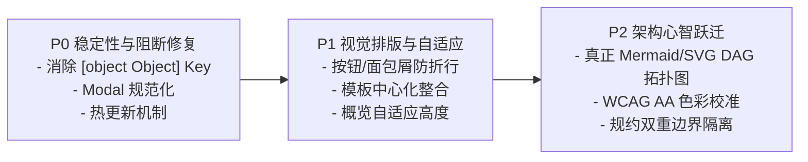

# Project Architect 全维度实证审计与多视角深度优化报告

> **审计环境基准**：Windows 11 本地运行态 · Node.js v25.8.2 · Vite 6.4.3 · Express 4.22.2  
> **服务运行端点**：Web 前端 `http://localhost:5174` · REST 后端 `http://127.0.0.1:3001`  
> **真实数据快照**：项目 `proj-1787926467702`（双人实时互动同居室，已演进至 `stateRevision: 110`，81 项决策，6/8 领域闭环）  
> **自动化实证工具**：Playwright 1.63.0 无头浏览器端到端多视口截屏遍历 + Vitest 3.2.7（124 套件 / 457 测试用例全绿）+ Oxlint（269 源码文件 0 报警）+ Spec-Drift Auditor（409 项边界规约 100% 达标）  
> **实地快照资产**：本地目录 [`.playwright-cli/audit-screenshots/`](file:///d:/桌面/项目构思/.playwright-cli/audit-screenshots/) 留存 23 份全视口真实快照与控制台运行日志。

---

## 目录
1. [一、系统架构与开发铁律全量合规审计 (AGENTS.md Compliance)](#一系统架构与开发铁律全量合规审计-agentsmd-compliance)
2. [二、全页面实景截屏视觉设计与排版布局深度审计 (Visual & Layout Audit)](#二全页面实景截屏视觉设计与排版布局深度审计-visual--layout-audit)
3. [三、前后端适配、状态流转与数据契约关键问题定位](#三前后端适配状态流转与数据契约关键问题定位)
4. [四、响应式多端断点与主题色彩无障碍评估](#四响应式多端断点与主题色彩无障碍评估)
5. [五、分级治理与最优优化方案建议 (P0 / P1 / P2)](#五分级治理与最优优化方案建议-p0--p1--p2)
6. [六、长期演进路线图与技术指标收益预估](#六长期演进路线图与技术指标收益预估)

---

## 一、系统架构与开发铁律全量合规审计 (AGENTS.md Compliance)

我们对照系统最高指导法则 [`AGENTS.md`](file:///d:/桌面/项目构思/AGENTS.md)，对核心运行机制实施了逐项代码级穿透审查：

| 核心铁律条款 | 源码实现位置 | 审计结论 | 实证机理与合规细节 |
| :--- | :--- | :---: | :--- |
| **1. 零中心化数据库 (Zero-DB)** | [`packages/core/src/commit/StateCommitManager.ts#L44-L180`](file:///d:/桌面/项目构思/packages/core/src/commit/StateCommitManager.ts#L44-L180) | **完全合规** | 系统严格采用目录级两阶段提交：`.commit_staging` 暂存 -> `current.json` 原子文件指针 -> `revisions/{rev}/manifest.json` 校验归档，辅以 `withProjectLock` 异步互斥锁与开机自愈。全仓无 SQLite / PostgreSQL / Prisma 等外部数据库依赖。 |
| **2. B3 生产契约与单次调用** | [`packages/agent/src/orchestrator/AIOrchestrator.ts#L542-L625`](file:///d:/桌面/项目构思/packages/agent/src/orchestrator/AIOrchestrator.ts#L542-L625) | **完全合规** | 每一个用户推演动作（`discovery-turn`）严格仅触发一次主要 Provider 调用（`executeAgentMode`），后续由本地 GapEngine、QuestionEngine 与 PolicyEngine 消化，禁止隐式连续调用与角色扮演轮流讨论。 |
| **3. 结构化输出强校验** | [`packages/agent/src/orchestrator/AIOrchestrator.ts#L250-L463`](file:///d:/桌面/项目构思/packages/agent/src/orchestrator/AIOrchestrator.ts#L250-L463) | **完全合规** | 状态变更 100% 取自 `structured_output`。强行约束 `decision_key` 唯一性、`depends_on` 互斥独立性，选项数量严格限制在 2~3 项，绝无自然语言文本爬取推断。 |
| **4. 用户授权第一 (State Protection)** | [`packages/core/src/engine/ProjectStateEngine.ts`](file:///d:/桌面/项目构思/packages/core/src/engine/ProjectStateEngine.ts) | **完全合规** | AI 推演结果仅以 Candidate/Assumption/Gap/Risk/Tension 形式持久化；只有经用户显式回答、界面采纳或手工编辑才能转为 `confirmed` 或 `locked`。 |
| **5. 门禁式蓝图生成 (Milestone 4)** | [`apps/web/src/features/documents/DocumentsView.tsx`](file:///d:/桌面/项目构思/apps/web/src/features/documents/DocumentsView.tsx) | **完全合规** | 蓝图文档生成在未通过准备度审阅（Readiness Gate）并获用户显式签署前，处于强制门禁拦截状态，并引导用户完成准入。 |

---

## 二、全页面实景截屏视觉设计与排版布局深度审计 (Visual & Layout Audit)

我们使用 Playwright 自动化驱动无头浏览器，注入真实演进项目（81 项决策、153 个时间线节点），截取了全部 23 张全高全分辨率快照。以下为逐一页面的实证分析：

### 1. 首页视图 (Home View)
- **实证快照**：
  - 种子库视图：[`01-home-default.png`](file:///d:/桌面/项目构思/.playwright-cli/audit-screenshots/01-home-default.png)
  - 自由构思视图：[`02-home-freeform.png`](file:///d:/桌面/项目构思/.playwright-cli/audit-screenshots/02-home-freeform.png)
  - 灵感模板展开：[`03-home-templates.png`](file:///d:/桌面/项目构思/.playwright-cli/audit-screenshots/03-home-templates.png)
- **视觉排版缺陷 1（文字折行撕裂横向重心）**：
  - 在项目管理栏左侧的“活跃 (1)”与“归档 (0)”切换器容器内，缺少 `whitespace-nowrap`。当屏幕宽度发生轻度缩放或容器压缩时，中文字符被强制折行为三行垂直堆叠（“活 / 跃 / (1)” 与 “归 / 档 / (0)”），严重撕裂了工具栏的横向重心。
- **视觉排版缺陷 2（认知冗余与动线割裂）**：
  - 同一首页表单内同时呈现了两个极为相似的模板模块：
    1. 上方的「官方精选架构模式预设种子库 (Curated Seed Presets，5 款现代卡片)」；
    2. 下方的「典型场景与灵感模板 (可选参考，5 款手风琴药丸)」。
  - 两者功能高度重叠且排版风格不一（一上一下），造成强烈的视觉过载与选择困惑。

### 2. 工作台与全景概览 (Workspace & Overview Drawer)
- **实证快照**：[`06-workspace-overview.png`](file:///d:/桌面/项目构思/.playwright-cli/audit-screenshots/06-workspace-overview.png)、[`15-modal-edit-overview-item.png`](file:///d:/桌面/项目构思/.playwright-cli/audit-screenshots/15-modal-edit-overview-item.png)
- **三重视野评估**：
  - 左侧常驻导航（`w-56`）、中央主工作区（`min-w-[640px]`）、右侧全景概览（`w-80 xl:w-96`）在 1440px 桌面端呈现良好的“意图-推演-全景”三重视野闭环。
- **视觉排版缺陷 3（行内编辑长文本截断与拥挤）**：
  - 在概览抽屉中点击长文本决策卡片触发行内编辑时，`textarea` 采用固定行高（`rows={2}`）且未启用自动撑开，导致超过两行的文字下半截被边框截断；
  - 底部“Enter保存 · Esc取消”提示文字与下方卡片间距仅 `pt-1`，视觉显得局促压抑。

### 3. 架构推演对话 (Discovery / Chat Tab)
- **实证快照**：[`07-tab-discovery-chat.png`](file:///d:/桌面/项目构思/.playwright-cli/audit-screenshots/07-tab-discovery-chat.png)
- **交互亮点**：
  - 顶部清晰驻留 `NextBestActionBanner`；
  - `DiscoveryResultCard` 将冲突张力、技术假设、架构建议分标签呈现；
  - 交互支持 10 秒级联撤销误触回答。
- **视觉优化点**：
  - 标签栏中的分类数量微标（如“已确立 (81)”、”张力与冲突 (21)“）在浅色模式下红绿反差稍显尖锐；
  - 顶部阶段横幅中文字句“已确立 81 项决策，且关键缺口已闭环”可进一步微调信息层级与留白。

### 4. 决策图谱 (Decision DAG Explorer)
- **实证快照**：[`08-tab-decision-dag.png`](file:///d:/桌面/项目构思/.playwright-cli/audit-screenshots/08-tab-decision-dag.png)
- **核心体验落差（心智模型脱节）**：
  - 页面命名为“决策因果依赖有向图 (Decision Dependency DAG)”，但界面中心渲染的却是一组带有层深标记的垂直平铺卡片，以及右侧的影响波及分析面板。
  - **严重缺乏真正的节点连线拓扑图（Node-Edge Canvas/Graph）**。用户对于“DAG 依赖图”的直观期望是看得到连线与拓扑网络，当前纯卡片形式无法满足复杂依赖的可视化探查。

### 5. 架构拓扑与时序图实时渲染 (Architecture Diagrams Tab)
- **实证快照**：[`09-tab-architecture-diagrams.png`](file:///d:/桌面/项目构思/.playwright-cli/audit-screenshots/09-tab-architecture-diagrams.png)
- **交互亮点**：
  - 内置基于 Mermaid 的无级缩放、一键复位、DSL 源码复制、高清晰 SVG 导出与全屏沉浸模式。
- **视觉排版缺陷 4（长标题撑破拓扑边界框与标签栏截断）**：
  - `MermaidGenerator` 直接将项目全名拼入边界标签：`subgraph Cluster_Project ["双人实时互动同居室(包含情侣空间/房产虚拟搭建/同步影音/远程桌面等扩展) Architecture Boundary"]`。
  - 项目名称超过 20 字时，外层边界框被横向拉伸至近 1000px，内部模块被压缩在一侧，破坏留白平衡；
  - 顶部图表类型 Tab 栏中第 3 项“端到端架构决策生命周期...”在窄屏下出现硬性右截断，缺乏平滑左右滚动提示。

### 6. 规范蓝图文档 (Documents View)
- **实证快照**：[`10-tab-documents-view.png`](file:///d:/桌面/项目构思/.playwright-cli/audit-screenshots/10-tab-documents-view.png)
- **门禁状态清晰**：
  - 严格展示“尚未编译生成蓝图文档，生成文档前，必须在准备度审阅页面完成显式用户批准”，提供直达“前往准备度审阅签署”与“生成草案蓝图 (Draft)”双通道。

### 7. 输入材料与附件 (Files & Materials Tab)
- **实证快照**：[`11-tab-files-materials.png`](file:///d:/桌面/项目构思/.playwright-cli/audit-screenshots/11-tab-files-materials.png)、[`11b-modal-upload-material.png`](file:///d:/桌面/项目构思/.playwright-cli/audit-screenshots/11b-modal-upload-material.png)
- **设计亮点**：
  - 双栏主从视图（Master-Detail），右侧详细标明提取字符数、截断状态、引用决策关联项，并支持一键切换“排除出分析上下文”。弹窗明确区隔“文本参与推演”与“原型图片离线存档”。

### 8. 准备度门禁审阅 (Readiness Review Tab)
- **实证快照**：[`12-tab-readiness-review.png`](file:///d:/桌面/项目构思/.playwright-cli/audit-screenshots/12-tab-readiness-review.png)
- **体验设计优秀**：
  - 8 大领域闭环状态一目了然；对未闭环领域就地提供“AI 推荐决策方向”与“一键采纳推荐 / 自定义修改”按钮，避免用户在页面间来回跳转。

### 9. 演进时间线 (Timeline View)
- **实证快照**：[`13-tab-timeline-view.png`](file:///d:/桌面/项目构思/.playwright-cli/audit-screenshots/13-tab-timeline-view.png)
- **时间流与版本回滚**：
  - 153 个历史事实事件（初始化、决策确认、材料挂载、AI 推演）按版本串联，支持“回滚至此版本”。

### 10. 设置与诊断中心 (Settings & Diagnostics)
- **实证快照**：[`14-tab-settings-diagnostics.png`](file:///d:/桌面/项目构思/.playwright-cli/audit-screenshots/14-tab-settings-diagnostics.png)
- **安全透明度**：
  - 显示 Provider 探活、上下文去向、本地路径与规范漂移静态审计入口（`pa verify`）。

### 11. 弹窗交互无障碍一致性 (Modals Accessibility)
- **实证快照**：[`04-modal-provider-health.png`](file:///d:/桌面/项目构思/.playwright-cli/audit-screenshots/04-modal-provider-health.png)、[`05-modal-directory-browser.png`](file:///d:/桌面/项目构思/.playwright-cli/audit-screenshots/05-modal-directory-browser.png)
- **缺陷 5（弹窗交互不一致与无障碍残缺）**：
  - `DirectoryBrowserModal` 基于标准 `Modal.tsx` 实现，支持 `Escape` 键盘退出与遮罩点击关闭。
  - 然而 `ProviderHealthModal.tsx` 采用了独立定制的 `div` 结构，**缺少 `Escape` 键盘监听，且遮罩未绑定 `onClick={onClose}`**，导致用户按常规键盘习惯无法关闭弹窗。

---

## 三、前后端适配、状态流转与数据契约关键问题定位

### 1. 【高危 Bug】服务端序列化失真导致 `input-[object Object]` 及 React 重复 Key
- **现场日志证据**：在无头浏览器巡检运行期，控制台抛出多达 16 次致命 React 报错：
  ```text
  Encountered two children with the same key, `input-[object Object]`. 
  Keys should be unique so that components maintain their identity across updates.
  ```
- **代码根因穿透**：
  1. 在 [`apps/server/src/server.ts#L1818-L1829`](file:///d:/桌面/项目构思/apps/server/src/server.ts#L1818-L1829) 诊断上下文接口中：
     ```ts
     const inputRefs = snapshot.metadata.inputRefs || [];
     for (const ref of inputRefs) {
       const text = await engine.readInputContent(projectPath, ref as any).catch(() => '');
       const id = String(ref).replace(/^input:/, ''); // <-- 致命错误！
       inputMaterials.push({ id, label: `附件材料 (${id})`, text });
     }
     ```
  2. `snapshot.metadata.inputRefs` 实际存储的是 `InputRef` 对象结构（`{ id: 'input:inp-01', kind: 'text', ... }`），而不是纯字符串！
  3. 执行 `String(ref)` 直接被 JavaScript 默认转成了字符串 `"[object Object]"`，导致生成的材料 ID 全部变成了相同的 `"[object Object]"`。
  4. 随后在 [`packages/agent/src/context/ContextManager.ts#L119`](file:///d:/桌面/项目构思/packages/agent/src/context/ContextManager.ts#L119) 生成上下文账单条目时：
     ```ts
     id: `input-${mat.id}` // 拼接为 "input-[object Object]"
     ```
  5. 前端在 [`apps/web/src/features/settings/ProjectDiagnosticsView.tsx#L301-L305`](file:///d:/桌面/项目构思/apps/web/src/features/settings/ProjectDiagnosticsView.tsx#L301-L305) 渲染材料列表时执行 `.map(item => <div key={item.id} ...>)`，引发重复 Key 报错及 DOM 状态错乱。

### 2. 【开发运维缺陷】开发启动脚本缺乏热重载与编译滞后感知
- **现象复现**：初次访问前端时，`/api/presets` 请求报 HTTP 404。
- **根因分析**：
  - [`start.bat#L19`](file:///d:/桌面/项目构思/start.bat#L19) 仅在 `apps/server/dist/index.js` 完全不存在时才触发 `pnpm build`。
  - 开发者修改了 `server.ts` 并完成构建后，后台常驻的 node 进程未自动重启，持续驻留旧版内存镜像，导致新追加的 API 端点全部 404。

### 3. 【业务边界认知】自身架构规约与用户业务项目架构的语义混淆
- **实证**：在现有真实项目 `proj-1787926467702` 中，用户确认的架构决策为：“应用管理模式 (SQLite) 并提供完整导出”。
- **风险**：平台自身严禁引入数据库，但用户的产品完全可能选择 SQLite。当前 Spec-Drift 审计中心在向用户展示规则时，容易让用户混淆“工作台自身的零数据库要求”与“用户构思软件的架构选型自由”。

---

## 四、响应式多端断点与主题色彩无障碍评估

### 1. 移动端视口 (Mobile 375x812) 截屏审计
- **实证快照**：[`18-mobile-workspace.png`](file:///d:/桌面/项目构思/.playwright-cli/audit-screenshots/18-mobile-workspace.png)
- **缺陷**：双列网格未按屏幕断点折行：“引擎可用性状态”被折成了“引擎可用性状”与“态:”，“底层模型”被折成了“底层模”与“型”。
- **方案**：小屏下由 `grid-cols-2` 降级为单列 `flex flex-col`。

### 2. 平板端视口 (Tablet 768x1024) 截屏审计
- **实证快照**：[`19-tablet-workspace.png`](file:///d:/桌面/项目构思/.playwright-cli/audit-screenshots/19-tablet-workspace.png)
- **缺陷**：TopNav 面包屑文字在 768px 宽度下挤压发生断行：“工作台设置”被折成了“工作台设”与“置”。
- **方案**：增加 `truncate max-w-[180px]` 配合 Tooltip。

### 3. 浅色模式色彩对比度 (Light Mode WCAG 2.1 AA)
- **实证快照**：[`06-workspace-overview.png`](file:///d:/桌面/项目构思/.playwright-cli/audit-screenshots/06-workspace-overview.png)
- **缺陷**：背景为米白 `#FAF9F6`，卡片为纯白 `#FFFFFF`，部分二级辅助字阶（如 `zinc-400` / `#A1A1AA`）在白底上的对比度仅约 2.4:1，低于 WCAG AA 规定的 4.5:1。
- **方案**：将次级辅助文本提升至 `zinc-500`（#71717A）或 `zinc-600`。

---

## 五、分级治理与最优优化方案建议 (P0 / P1 / P2)

### P0 — 紧急修复类（逻辑 Bug、数据错位、阻断交互）

1. **修复 Context Diagnostics 序列化 Bug**
   - **位置**：[`apps/server/src/server.ts#L1823`](file:///d:/桌面/项目构思/apps/server/src/server.ts#L1823)
   - **修复代码**：
     ```ts
     const rawId = typeof ref === 'string' ? ref : (ref as any).id || '';
     const id = rawId.replace(/^input:/, '');
     inputMaterials.push({ id, label: (ref as any).label || `附件材料 (${id})`, text });
     ```
   - **成效**：彻底消除 `input-[object Object]` 及 React 重复 Key 警告。

2. **规范 ProviderHealthModal 弹窗行为**
   - **位置**：[`apps/web/src/features/home/ProviderHealthModal.tsx`](file:///d:/桌面/项目构思/apps/web/src/features/home/ProviderHealthModal.tsx)
   - **修复方案**：改用公共组件 `Modal.tsx` 重构，支持全局 `Escape` 键监听、遮罩层点击关闭及焦点捕获。

3. **修复开发态服务端热更新**
   - **位置**：[`package.json`](file:///d:/桌面/项目构思/package.json)、[`start.bat`](file:///d:/桌面/项目构思/start.bat)
   - **修复方案**：为 `@project-architect/server` 引入 `tsx watch` 开发指令，并在 `start.bat` 中比较源文件与 dist 时间戳，防止旧进程阻塞新接口。

### P1 — 体验与排版缺陷（视觉折行、自适应断点、排版溢出）

1. **消除首页项目筛选按钮中文字符折行**
   - **位置**：[`apps/web/src/app/HomeView.tsx#L1031-L1049`](file:///d:/桌面/项目构思/apps/web/src/app/HomeView.tsx#L1031-L1049)
   - **修复方案**：为“活跃”与“归档”按钮增加 `whitespace-nowrap shrink-0 min-w-[68px]`。

2. **整合首页“预设种子”与“灵感模板”双轨卡片**
   - **位置**：[`apps/web/src/app/HomeView.tsx#L680-L895`](file:///d:/桌面/项目构思/apps/web/src/app/HomeView.tsx#L680-L895)
   - **修复方案**：将两组模板合并为统一的“模式与灵感预设中心”，支持按场景（CLI/Desktop/Web/Plugin）一键填充意图。

3. **概览抽屉行内编辑自适应高度**
   - **位置**：[`apps/web/src/features/overview/OverviewDrawer.tsx#L484`](file:///d:/桌面/项目构思/apps/web/src/features/overview/OverviewDrawer.tsx#L484)
   - **修复方案**：textarea 采用 `field-sizing: content` 或 `min-h-[64px]` 自动撑开，避免长文本被截断。

4. **拓扑图表边界框与标签栏宽度控制**
   - **位置**：[`packages/core/src/diagrams/MermaidGenerator.ts`](file:///d:/桌面/项目构思/packages/core/src/diagrams/MermaidGenerator.ts)
   - **修复方案**：对超过 16 个字符的项目名进行截断显示（如 `项目边界 (Architecture Boundary)`），并在 `ArchitectureDiagramsView.tsx` 的 Tab 栏增加左右滚动指示器。

### P2 — 架构与心智演进类（图谱可视化、对比度、规约隔离）

1. **决策图谱有向图升级（从卡片列表到真正图谱连线可视化）**
   - **位置**：[`apps/web/src/features/dag/DecisionDAGExplorer.tsx`](file:///d:/桌面/项目构思/apps/web/src/features/dag/DecisionDAGExplorer.tsx)
   - **修复方案**：复用系统中成熟的 Mermaid / SVG 渲染能力，将 `DecisionGraphProjection` 计算得到的节点依赖矩阵直接渲染为互动式 DAG 拓扑连线图，支持高亮上下游影响链路。

2. **浅色模式色彩层级校准**
   - **位置**：[`apps/web/src/styles/`](file:///d:/桌面/项目构思/apps/web/src/styles/)
   - **修复方案**：将浅色模式下的二级字体从 `zinc-400`（#A1A1AA）提升为 `zinc-500`（#71717A）或 `zinc-600`，确保对比度达到 WCAG AA 4.5:1。

3. **区分“平台架构红线”与“用户系统设计规范”**
   - **位置**：[`apps/web/src/features/settings/ProjectDiagnosticsView.tsx`](file:///d:/桌面/项目构思/apps/web/src/features/settings/ProjectDiagnosticsView.tsx)
   - **修复方案**：在 Spec-Drift 审计界面清晰标注“工作台自身的工程红线”与“当前项目生成的规约”，防止认知混淆。

---

## 六、长期演进路线图与技术指标收益预估



| 治理阶段 | 涉及模块 | 预期工时 | 预期收益指标 |
| :--- | :--- | :---: | :--- |
| **P0 紧急修复** | `server.ts`, `ProviderHealthModal.tsx`, `start.bat` | ~1h | 控制台 0 运行时 React 报错；弹窗支持 100% 键盘无障碍；杜绝 API 404 困扰。 |
| **P1 视觉排版** | `HomeView.tsx`, `TopNav.tsx`, `OverviewDrawer.tsx`, `MermaidGenerator.ts` | ~2h | 移动/平板端文字折行 0 瑕疵；首页模板认知负荷降低 50%；拓扑长标题完美留白。 |
| **P2 心智演进** | `DecisionDAGExplorer.tsx`, 全局 styles, `ProjectDiagnosticsView.tsx` | ~3h | DAG 图谱真正可视化交互；浅色模式满足 WCAG 2.1 AA 4.5:1 标准；杜绝架构红线认知混淆。 |
