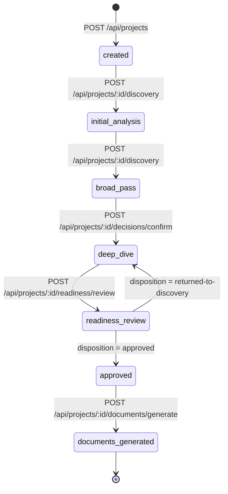

# Project Architect V1 — API 接口规范 (API Contract V1)

> 2026-10-04：正式规划、结构化答题、审批、运行恢复与开发包接口以 [PLANNING_API.md](PLANNING_API.md) 为准。以下保留项目/材料/历史 API 及旧接口背景；生产 discovery 写接口已停用，自由回答不再自动确认，旧准备度不能批准新蓝图。

旧历史回滚写入口 `POST /api/projects/:id/rollback` 已退休：所有运行模式（包括 Mock 与注入 orchestrator）统一返回 HTTP 410、`LEGACY_WORKFLOW_RETIRED` 和 `recoverable: false`。请求在项目读取、崩溃恢复和目标 revision 处理前拒绝，不接受重试或过期确认来恢复状态，不产生新 revision。`GET /api/projects/:id/timeline` 与历史文件继续保留；回收站完整目录 `/restore`、两阶段 Commit 崩溃恢复和 PlanningRun 恢复不受影响。

> **文档状态**：已冻结 (Phase 4.9.1 Contract Freeze)  
> **适用对象**：Frontend (Web/Desktop) 与 Local Backend Server 交互的唯一官方权威契约。  
> **实现依据**：`packages/contracts/src/api.ts` 与 `apps/server/src/server.ts`。  
> **通信协议**：HTTP REST (JSON over HTTP)，仅限本地回环访问 (`localhost`, `127.0.0.1`, `vscode-webview://`)。

---

## 1. 核心设计原则与交互规范

### 1.1 单向数据流与乐观并发版本保护 (`expectedRevision`)
- **Project State**（`packages/core`）是全系统的唯一事实来源（SSOT）。
- **所有写操作强制版本保护**：任何修改状态的写请求（包括上传材料、确认决策、锁定决策、修改概览、回答问题、运行推演、提交审批、生成文档）必须携带 `expectedRevision: number`。
- **并发冲突拦截**：若请求中的 `expectedRevision` 与服务端当前 `stateRevision` 不一致，服务端立即拒绝写入并返回 `409 Conflict` (`STATE_REVISION_CONFLICT`)。
- **单调自增版本号**：每次状态成功提交后，`stateRevision` 单调递增 +1，并在响应的顶层 `stateRevision` 及 `snapshot.metadata.stateRevision` 中返回最新版本快照。

### 1.2 统一响应结构 (`ApiResponse<T>`)
所有 API 响应均封装为统一的 `ApiResponse<T>` 格式：

```typescript
export interface ApiResponse<T> {
  success: boolean;               // 操作是否成功
  data?: T;                       // 成功时的业务数据
  stateRevision?: number;         // 当前最新的状态版本号
  error?: ApiErrorPayload;        // 失败时的错误信息
}

export interface ApiErrorPayload {
  code: ErrorCode;                // 标准错误枚举
  message: string;                // 用户友好的错误描述
  recoverable: boolean;           // 前端是否可通过重试或纠正参数恢复
  details?: Record<string, unknown>; // 安全脱敏的结构化错误上下文
  requestId?: string;             // 追踪标识
}
```

### 1.3 HTTP 状态码与错误语义规范

| HTTP 状态码 | 对应 ErrorCode | 触发场景与业务含义 |
| :---: | :--- | :--- |
| **`200 OK`** | *(无)* | 请求成功，`success: true`，返回数据载荷与最新 `stateRevision`。 |
| **`400 Bad Request`** | `STATE_VALIDATION_FAILED`<br>`INVALID_TYPED_REF`<br>`INPUT_TOO_LARGE`<br>`INPUT_UNSUPPORTED`<br>`INPUT_EXTRACTION_FAILED` | 请求体格式错误、缺少必填字段、字段类型不符、上传文件超限（>20MB 或 >10个）、不支持的文件扩展名或 TypedRef 格式非法。 |
| **`403 Forbidden`** | `STATE_VALIDATION_FAILED` | 跨域安全拦截（CORS blocked）：请求来源非合法本地回环或 VSCode Webview。 |
| **`404 Not Found`** | `PROJECT_NOT_FOUND` | 指定的 `projectId` 不存在或未注册于工作区。 |
| **`409 Conflict`** | `STATE_REVISION_CONFLICT`<br>`DIFF_DETECTED` | 乐观并发冲突（`expectedRevision` 不匹配），或重新编译时检测到磁盘已有文档存在人工修改且未指定 `forceOverwrite: true`。前端应展示 Diff 并提示用户。 |
| **`422 Unprocessable`** | `READINESS_NOT_APPROVED`<br>`DECISION_LOCKED` | 业务门禁拦截：未获用户 `approved` 授权试图生成文档，或试图直接修改已处于 `locked` 状态的决策。 |
| **`502 Bad Gateway`** | `PROVIDER_PROCESS_FAILED`<br>`PROVIDER_NOT_AVAILABLE`<br>`STRUCTURED_OUTPUT_MISSING`<br>`SCHEMA_VALIDATION_FAILED` | AI 推理 Provider 进程异常退出、CLI 不存在、输出缺失结构化 JSON 或 Schema 校验失败。 |
| **`504 Gateway Timeout`** | `PROVIDER_TIMEOUT` | AI 推理 Provider 执行超时（默认 >90s）。 |
| **`500 Internal Error`** | `STATE_COMMIT_FAILED`<br>`STATE_RECOVERY_REQUIRED`<br>`DOCUMENT_GENERATION_FAILED` | 服务端未预期的内部文件系统快照提交或状态自愈异常。 |

### 1.4 安全与隐私保护铁律
1. **零路径泄漏**：API 响应与错误详情中**严禁包含**宿主机绝对文件路径（如 `D:\...` 或 `/Users/...`）、内部快照目录结构或内部临时文件名。
2. **零 Prompt / Raw Envelope 泄漏**：Provider 失败时，错误响应只返回脱敏的错误类别、时长与 token 诊断，**严禁返回**原始 Prompt 全文、原始 Provider 响应 Envelope 或 Node.js 调用栈（`stack`）。
3. **工作区边界隔离 (Workspace Boundary)**：系统仅操作受配置控制的 `workspaceRoot/projects/` 目录；所有项目访问以 `projectId` 为唯一寻址标识，拦截一切目录穿越（`../`）与符号链接逃逸。

---

## 2. 完整 API 接口清单 (Endpoints Specification)

### 2.1 项目生命周期 (Project Lifecycle)

#### 1. 创建项目 `POST /api/projects`
- **用途**：初始化新项目目录，建立首个快照（`stateRevision: 1`）并记录到本地工作区注册表。
- **Request Body** (`CreateProjectRequest`):
  ```json
  {
    "name": "Local Audio Tagger",
    "idea": "一个运行在 Windows 本地的音频文件元数据清洗与自动分类工具",
    "projectId": "proj-audio-tagger", // 可选：指定符合命名规范的 ID；不传则自动生成
    "projectTags": ["Desktop", "Local-First"] // 可选
  }
  ```
- **Response** (`ApiResponse<CreateProjectResponse>`):
  ```json
  {
    "success": true,
    "data": {
      "projectId": "proj-audio-tagger",
      "projectPath": "projects/proj-audio-tagger",
      "snapshot": { /* 初始 ProjectSnapshot */ }
    },
    "stateRevision": 1
  }
  ```

#### 2. 打开项目 `POST /api/projects/open`
- **用途**：打开工作区中已存在的项目，执行自愈检查并加载最新状态快照。
- **Request Body** (`OpenProjectRequest`):
  ```json
  {
    "projectId": "proj-audio-tagger"
  }
  ```
- **Response** (`ApiResponse<OpenProjectResponse>`):
  ```json
  {
    "success": true,
    "data": {
      "snapshot": { /* 最新 ProjectSnapshot */ }
    },
    "stateRevision": 5
  }
  ```

#### 3. 获取最近项目列表 `GET /api/projects`
- **用途**：从工作区受保护的 `.projects-registry.json` 中读取最近打开的项目列表。
- **Response** (`ApiResponse<ListRecentProjectsResponse>`):
  ```json
  {
    "success": true,
    "data": {
      "projects": [
        {
          "projectId": "proj-audio-tagger",
          "name": "Local Audio Tagger",
          "stage": "deep_dive",
          "updatedAt": "2026-08-23T10:00:00.000Z"
        }
      ]
    }
  }
  ```

#### 4. 获取项目完整快照 `GET /api/projects/:id`
- **用途**：获取指定项目的完整规范快照（包括 Overview 投影、Decisions、Assumptions、Gaps、Questions、Readiness 等）。
- **Response** (`ApiResponse<{ snapshot: ProjectSnapshot }>`):
  ```json
  {
    "success": true,
    "data": {
      "snapshot": { /* ProjectSnapshot */ }
    },
    "stateRevision": 5
  }
  ```

#### 5. 获取 Overview 视图模型 `GET /api/projects/:id/overview`
- **用途**：获取供右侧看板呈现的纯派生只读投影（`ProjectOverviewView`），严格区分 Candidate、Confirmed、Locked 状态，不泄漏未授权内容。
- **Response** (`ApiResponse<ProjectOverviewView>`):
  ```json
  {
    "success": true,
    "data": {
      "sourceStateRevision": 5,
      "projectId": "proj-audio-tagger",
      "projectName": "Local Audio Tagger",
      "projectStage": "deep-dive",
      "updatedAt": "2026-08-23T10:00:00.000Z",
      "overallMaturity": "mostly-clear",
      "sections": [ /* OverviewSectionView[] */ ],
      "totalConfirmedDecisions": 4,
      "totalLockedDecisions": 2,
      "totalCandidates": 3
    },
    "stateRevision": 5
  }
  ```

#### 6. 获取 Readiness 准备度视图模型 `GET /api/projects/:id/readiness`
- **用途**：获取供准备度评估看板呈现的纯派生投影（`ReadinessView`），包含 Level 1~5 评级、雷达区域与阻断问题。
- **Response** (`ApiResponse<ReadinessView>`):
  ```json
  {
    "success": true,
    "data": {
      "sourceStateRevision": 5,
      "projectId": "proj-audio-tagger",
      "level": 4,
      "score": 85,
      "status": "ready-with-warnings",
      "isReadyForDocs": true,
      "userDisposition": "pending",
      "areas": [ /* ReadinessAreaView[] */ ],
      "blockingIssues": [ /* ReadinessIssueView[] */ ],
      "warnings": [ /* string[] */ ],
      "activeAssumptions": [ /* AssumptionItemView[] */ ],
      "canGenerateDocs": false
    },
    "stateRevision": 5
  }
  ```

#### 7. 获取 Documents 交付物列表视图模型 `GET /api/projects/:id/documents`
- **用途**：获取供交付物列表呈现的只读投影（`DocumentListView`），含文档状态及 `isStale` 过期标记。
- **Response** (`ApiResponse<DocumentListView>`):
  ```json
  {
    "success": true,
    "data": {
      "sourceStateRevision": 5,
      "projectId": "proj-audio-tagger",
      "hasCompiledDocs": true,
      "compiledAt": "2026-08-23T10:00:00.000Z",
      "isManifestStale": false,
      "items": [ /* DocumentItemView[] */ ]
    },
    "stateRevision": 5
  }
  ```

#### 8. 获取 Timeline 演进时间线视图模型 `GET /api/projects/:id/timeline`
- **用途**：获取供活动历史呈现的纯派生时间线（`TimelineView`），聚合 DecisionTrace、AgentRunTrace 与快照历史。
- **Response** (`ApiResponse<TimelineView>`):
  ```json
  {
    "success": true,
    "data": {
      "sourceStateRevision": 5,
      "projectId": "proj-audio-tagger",
      "totalEvents": 8,
      "events": [ /* TimelineEvent[] */ ]
    },
    "stateRevision": 5
  }
  ```

#### 9. 服务健康检查 `GET /api/health`
- **用途**：检测本地 API Server 服务存活性。
- **Response**: `{"status": "ok", "time": "2026-08-23T10:00:00.000Z"}`


---

### 2.2 输入材料管理 (Input Materials)

#### 1. 上传/添加输入材料 `POST /api/projects/:id/inputs`
- **用途**：向项目添加文本笔记、需求文件或原型图片。后端安全保存并执行受控提取。
- **边界约束**：
  - 单文件大小上限：20 MB；
  - 单项目累计材料上限：10 个文件；
  - 支持扩展名白名单：`.txt`, `.md`, `.pdf`, `.docx`, `.png`, `.jpg`, `.jpeg`, `.webp`；
  - 诚实性标记：图片标为 `analysisAvailability: 'unavailable'`，不解析伪造内容；无法提取的 PDF 标为 `failed` 且不注入 Context。
- **Request Body** (`AddInputRequest`):
  ```json
  {
    "filename": "initial_requirements.md",
    "kind": "text", // "text" | "file" | "image"
    "content": "# Audio Tagger Reqs\nMust run strictly offline without network permissions.",
    "expectedRevision": 5
  }
  ```
- **Response** (`ApiResponse<AddInputResponse>`):
  ```json
  {
    "success": true,
    "data": {
      "inputRef": {
        "id": "input:inp-1787450123456",
        "kind": "text",
        "label": "initial_requirements.md",
        "storageRef": "inputs/inp-1787450123456/source.md",
        "status": "ready",
        "analysisAvailability": "available",
        "createdAt": "2026-08-23T10:00:00.000Z"
      }
    },
    "stateRevision": 6
  }
  ```

---

### 2.3 状态流转与决策治理 (State Actions & Governance)

#### 1. 确认候选决策 `POST /api/projects/:id/decisions/confirm`
- **用途**：用户显式确认某个由 AI 推荐的 Candidate 决策，将其提升为 `confirmed` 状态，并精确解决其关联的 Gap。
- **Request Body** (`ConfirmDecisionRequest`):
  ```json
  {
    "targetRef": "decision:dec-1787450123456-abcd",
    "expectedRevision": 6
  }
  ```
- **Response** (`ApiResponse<{ snapshot: ProjectSnapshot }>`):
  ```json
  {
    "success": true,
    "data": {
      "snapshot": { /* 最新快照，对应决策 status 变更为 'confirmed' */ }
    },
    "stateRevision": 7
  }
  ```

#### 2. 锁定决策 `POST /api/projects/:id/decisions/lock`
- **用途**：用户锁定关键不可动摇的架构或边界约束。锁定后 AI 严禁推翻或弱化。
- **Request Body** (`LockDecisionRequest`):
  ```json
  {
    "decisionRef": "decision:dec-1787450123456-abcd",
    "expectedRevision": 7
  }
  ```
- **Response** (`ApiResponse<{ snapshot: ProjectSnapshot }>`):
  ```json
  {
    "success": true,
    "data": {
      "snapshot": { /* 最新快照，对应决策 status 变更为 'locked' */ }
    },
    "stateRevision": 8
  }
  ```

#### 3. 解锁决策 `POST /api/projects/:id/decisions/unlock`
- **用途**：用户主动解除决策锁定状态，恢复为普通 `confirmed` 状态。
- **Request Body** (`UnlockDecisionRequest`):
  ```json
  {
    "decisionRef": "decision:dec-1787450123456-abcd",
    "expectedRevision": 8
  }
  ```
- **Response** (`ApiResponse<{ snapshot: ProjectSnapshot }>`):
  ```json
  {
    "success": true,
    "data": {
      "snapshot": { /* 最新快照，对应决策 status 恢复为 'confirmed' */ }
    },
    "stateRevision": 9
  }
  ```

#### 4. 编辑 Overview 条目 `POST /api/projects/:id/overview/edit`
- **用途**：用户手动直接修改 Overview 中某个 Section 的具体表述，系统生成 `user` 来源的明确决策。
- **Request Body** (`EditOverviewItemRequest`):
  ```json
  {
    "sectionId": "target_user",
    "itemRef": "decision:dec-1787450123456-abcd", // 可选：若为新增则留空
    "newStatement": "面向专业音频处理工程师与高保真音乐收藏者",
    "expectedRevision": 9
  }
  ```
- **Response** (`ApiResponse<EditOverviewItemResponse>`):
  ```json
  {
    "success": true,
    "data": {
      "decisionRef": "decision:dec-1787450123456-efgh",
      "snapshot": { /* 最新快照 */ }
    },
    "stateRevision": 10
  }
  ```

#### 5. 回答结构化问题 `POST /api/projects/:id/questions/answer`
- **用途**：用户回答由推演引擎提出的关键澄清问题，生成高信度决策与完整溯源追踪链。
- **Request Body** (`AnswerQuestionRequest`):
  ```json
  {
    "questionRef": "question:q-01",
    "answer": "采用纯本地 SQLite 存储，不引入任何云端同步服务",
    "expectedRevision": 10
  }
  ```
- **Response** (`ApiResponse<AnswerQuestionResponse>`):
  ```json
  {
    "success": true,
    "data": {
      "snapshot": { /* 最新快照，问题标记为 answered，生成决策 */ },
      "decisionRef": "decision:dec-1787450123456-efgh",
      "traceRef": "trace-1787450123456"
    },
    "stateRevision": 11
  }
  ```

#### 6. 批量跳过建议问题 `POST /api/projects/:id/questions/dismiss`
- **用途**：用户明确跳过当前批次中的一个或多个未回答问题，不创建 Decision 或 trace。
- **Request Body**：`{ "questionRefs": ["question:q-01"], "expectedRevision": 11 }`
- **Response**：`ApiResponse<DismissQuestionsResponse>`，成功后问题状态为 `dismissed`。

---

### 2.4 智能推演运行时 (Discovery Intelligence)

#### 1. 执行单轮推演 `POST /api/projects/:id/discovery`
- **用途**：触发一次受控的 B3 Discovery 推演轮次，并按阶段生成最多 12/8/4/2 个独立问题。
- **约束保障**：单轮推演严格**仅触发 1 次**主要 Provider 调用；100% 通过统一 Schema 结构化提取；AI 输出仅生成 Candidate/Gap/Risk/Tension/Question，严禁越权直接改写事实。
- **Request Body** (`RunDiscoveryTurnRequest`):
  ```json
  {
    "userMessage": "进一步探讨离线音频元数据提取的性能瓶颈与缓存策略",
    "questionAnswer": { // 可选：携带上一轮的问题回答
      "questionRef": "question:q-02",
      "selectedOption": "内存LRU缓存"
    },
    "expectedRevision": 11
  }
  ```
- **Response** (`ApiResponse<RunDiscoveryTurnResponse>`):
  ```json
  {
    "success": true,
    "data": {
      "discoveryResult": { /* 9 大数组结构化结果 */ },
      "snapshot": { /* 自动合并 Candidate 与 Gap 后的最新快照 */ },
      "diagnostics": {
        "durationMs": 1420,
        "totalTokens": 1850
      }
    },
    "stateRevision": 12
  }
  ```

---

### 2.5 完备度评审与文档生成授权链 (Readiness & Documents)

#### 1. 触发完备度评估 `POST /api/projects/:id/readiness/review`
- **用途**：系统根据当前核心决策覆盖度、开放 Gap/Critical Conflict 状态评估 Level 1~5 完备度，将项目阶段转换为 `readiness-review`。
- **Request Body** (`RunReadinessReviewRequest`):
  ```json
  {
    "expectedRevision": 12
  }
  ```
- **Response** (`ApiResponse<RunReadinessReviewResponse>`):
  ```json
  {
    "success": true,
    "data": {
      "snapshot": {
        "level": 4,
        "isReadyForDocs": true,
        "score": 85,
        "criticalGaps": [],
        "warnings": ["未明确定义多平台构建打包策略"],
        "userDisposition": "pending"
      },
      "projectSnapshot": { /* 最新项目快照 */ }
    },
    "stateRevision": 13
  }
  ```

#### 2. 用户授权处置 `POST /api/projects/:id/readiness/approve`
- **用途**：用户对完备度评审报告进行显式处置（批准生成或退回补充）。只有 `disposition: "approved"` 才能解锁后续文档编译。
- **Request Body** (`ApproveDevelopmentPackageRequest`):
  ```json
  {
    "disposition": "approved", // "approved" | "approved-with-warnings" | "approved-with-known-issues" | "approved-with-critical-conflicts" | "return-to-discovery"
    "acknowledgedIssueRefs": ["gap:gap-platform-packaging"], // 用户知晓并逐项确认的 Issue/Conflict Ref
    "expectedRevision": 13
  }
  ```
- **Response** (`ApiResponse<{ snapshot: ProjectSnapshot }>`):
  ```json
  {
    "success": true,
    "data": {
      "snapshot": { /* 阶段更新为 'approved' 的最新快照 */ }
    },
    "stateRevision": 14
  }
  ```

#### 3. 编译生成开发文档包 `POST /api/projects/:id/documents/generate`
- **用途**：将已获用户批准的项目规范编译生成 8 篇规范核心 Markdown 文档及可选的领域专有规范（AI_SPEC、DESKTOP_SPEC 等），清单落盘至 `documents/manifest.json`。
- **门禁拦截**：若项目未处于 `approved` 阶段，或存在未确认的 Critical Conflict，立即返回 `422 Unprocessable` (`READINESS_NOT_APPROVED`)。
- **Diff Guard 差异拦截**：若磁盘上已有同名文档且包含手动修改，默认（`forceOverwrite !== true`）将拦截写入并返回 `409 Conflict` (`DIFF_DETECTED`) 及详细的 Unified Diff 对比。
- **自动备份保障**：当传递 `forceOverwrite: true` 时，系统在覆写前会自动将受影响文件完整备份至 `.backup/documents-<timestamp>/`，并在响应中返回 `backupPath`。
- **Request Body** (`GenerateDocumentsRequest`):
  ```json
  {
    "expectedRevision": 14,
    "forceOverwrite": false // 可选：若为 true 则在存在手动编辑时自动备份并执行覆盖
  }
  ```
- **Response** (`ApiResponse<GenerateDocumentsResponse>`):
  ```json
  {
    "success": true,
    "data": {
      "backupPath": ".backup/documents-2026-08-23T10-05-00-000Z", // 仅在触发覆盖备份时返回
      "manifest": {
        "id": "manifest-proj-audio-tagger-14",
        "projectId": "proj-audio-tagger",
        "sourceRevision": 14,
        "readinessReviewId": "review-14",
        "readinessBasisRevision": 14,
        "generatedAt": "2026-08-23T10:05:00.000Z",
        "documents": [
          { "type": "agents", "path": "AGENTS.md", "title": "AGENTS.md", "status": "generated" },
          { "type": "project", "path": "docs/PROJECT.md", "title": "PROJECT.md", "status": "generated" },
          { "type": "product", "path": "docs/PRODUCT.md", "title": "PRODUCT.md", "status": "generated" },
          { "type": "user-flow", "path": "docs/USER_FLOWS.md", "title": "USER_FLOWS.md", "status": "generated" },
          { "type": "ux-ui", "path": "docs/UX_UI_SPEC.md", "title": "UX_UI_SPEC.md", "status": "generated" },
          { "type": "technical-guide", "path": "docs/TECHNICAL_GUIDE.md", "title": "TECHNICAL_GUIDE.md", "status": "generated" },
          { "type": "development-plan", "path": "docs/DEVELOPMENT_PLAN.md", "title": "DEVELOPMENT_PLAN.md", "status": "generated" },
          { "type": "acceptance", "path": "docs/ACCEPTANCE.md", "title": "ACCEPTANCE.md", "status": "generated" },
          { "type": "desktop-spec", "path": "docs/specs/DESKTOP_SPEC.md", "title": "DESKTOP_SPEC.md", "status": "generated" }
        ],
        "warnings": [],
        "sourceCoverage": {
          "confirmed": 12,
          "locked": 4,
          "assumptions": 1,
          "generatedStructure": 48
        }
      }
    },
    "stateRevision": 15
  }
  ```
- **Diff 拦截错误响应示例** (HTTP 409):
  ```json
  {
    "success": false,
    "error": {
      "code": "DIFF_DETECTED",
      "message": "检测到磁盘上现有文档存在手动修改，已暂停直接覆盖。请确认差异或选择强制覆盖备份。",
      "recoverable": true,
      "details": {
        "diffs": [
          {
            "document": "AGENTS.md",
            "path": "AGENTS.md",
            "hasDiff": true,
            "unifiedDiff": "--- AGENTS.md (disk)\n+++ AGENTS.md (new)\n@@ -1,5 +1,5 @@\n-# Custom Title\n+# Auto Generated Title",
            "diskContent": "...",
            "newContent": "..."
          }
        ]
      }
    }
  }
  ```

#### 4. 安全读取生成文档 `POST /api/projects/:id/documents/read`
- **用途**：读取指定路径的生成文档内容，供前端渲染预览。
- **安全约束**：严格限制在当前项目根目录内，禁止跨目录读取。
- **Request Body** (`ReadDocumentRequest`):
  ```json
  {
    "docPath": "AGENTS.md" // 或 "docs/PROJECT.md"
  }
  ```
- **Response** (`ApiResponse<ReadDocumentResponse>`):
  ```json
  {
    "success": true,
    "data": {
      "content": "# Local Audio Tagger — Coding Agent Guidelines\n\n..."
    }
  }
  ```

---

## 3. 字段废弃与迁移说明 (Deprecated Fields)

| 废弃项 | 替代方案 | 废弃原因与限制 |
| :--- | :--- | :--- |
| `CreateProjectRequest.projectPath` | `CreateProjectRequest.projectId` | **[DEPRECATED]** 绝对路径易引发路径穿越与权限逃逸。前端应使用 `projectId`，后端自动收敛至 `workspaceRoot/projects/<projectId>`。若传递 `projectPath`，后端仅在其实际位于 `projectsDir` 内部时允许，否则返回 400。 |
| `OpenProjectRequest.projectPath` | `OpenProjectRequest.projectId` | **[DEPRECATED]** 统一使用安全 `projectId` 寻址。 |
| `AddInputRequest.contentBase64` | `AddInputRequest.content` | **[DEPRECATED]** 统一为 `content` 字符串字段，文本内容直传 UTF-8 文本，二进制或图片传 Base64。 |

---

## 4. 完整的授权流转状态机 (Lifecycle Flow)



---

## 5. 接口契约与冻结签署 (Sign-off)

- **接口定义文件**：`packages/contracts/src/api.ts`
- **服务端实现**：`apps/server/src/server.ts`
- **契约测试套件**：`tests/reliability/06-api.test.ts` 与 `apps/server/tests/ReliabilityHardening487.test.ts`
- **冻结状态**：**Phase 4.9.1 API Contract Freeze 100% COMPLETE**。前端开发与对接必须严格以此文档为唯一依据。
