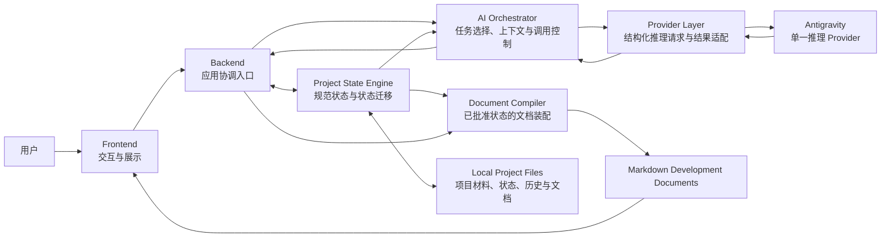
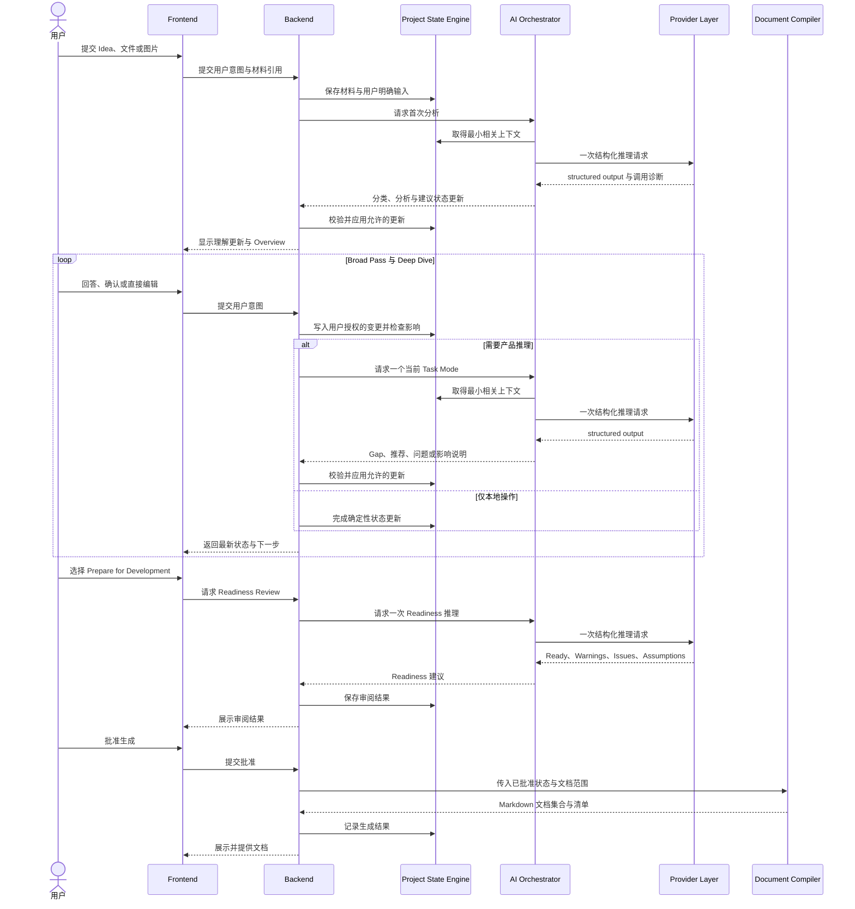

# Project Architect V1：系统总体架构

> 文档状态：Phase 1.2 Blueprint  
> 依据：[01_PRODUCT_BOUNDARY.md](01_PRODUCT_BOUNDARY.md)  
> 范围：模块职责、边界与数据流。  
> 非范围：具体实现方案、界面设计、多 Agent、云服务、企业能力与数据存储设计。

## 1. 架构目标

系统的任务是把用户的材料和确认过程转换为同一份可靠的 Project State，并从该状态生成开发文档。

架构必须保证四件事：

1. 用户是高影响决定的最终权威。
2. AI 的推理结果必须经过结构化校验，不能直接成为事实。
3. 所有用户可见状态和生成文档来自同一份规范 Project State。
4. 每个需要 AI 推理的用户动作最多触发一次主要 Agent 调用。

## 2. 系统整体架构图

图中的箭头表示数据或受控命令流，不代表所有操作都需要 AI。直接编辑、保存、状态展示和文档装配应尽量在本地完成。

## 3. 核心模块

### 3.1 Frontend

**职责**

- 接收用户的 Idea、回答、直接编辑、锁定、批准与导出动作。
- 展示对话、Project Overview、状态标签、Readiness 结果和生成文档。
- 让用户区分 Confirmed、Candidate、Assumption、Unresolved 与 Warning。
- 为结构化问题提供选项，同时始终允许自由输入。

**输入**

- 用户操作与输入材料。
- Backend 返回的状态快照、结构化 Agent 结果和文档清单。

**输出**

- 明确的用户意图事件，例如“提交 Idea”“确认推荐”“编辑 Overview”“锁定决定”“准备开发文档”。

**边界**

- 不直接写入规范 Project State。
- 不决定信息分类、问题优先级或 Readiness。
- 不解析或解释 Provider 的原始结果。

### 3.2 Backend

**职责**

- 作为 Frontend、Project State Engine、AI Orchestrator 和 Document Compiler 的协调入口。
- 将用户意图转为受控操作，并返回统一的操作结果。
- 决定一个操作应由本地规则完成、调用 AI，还是进入文档生成流程。

**输入**

- Frontend 发出的用户意图事件。
- 各核心模块的结果、校验结论和状态变更结果。

**输出**

- 面向 Frontend 的状态快照、提示、结构化问题、Readiness 结果或文档结果。
- 对 State Engine、AI Orchestrator 和 Document Compiler 的明确命令。

**边界**

- 不承担产品推理，不替 AI 生成 Gap、推荐或问题。
- 不绕过 State Engine 修改项目事实。
- 不把一次用户动作拆成隐藏的连续 Agent 调用。

### 3.3 Project State Engine

**职责**

- 维护项目的规范状态：Overview、决定、Assumptions、Gaps、Readiness、对话历史、材料引用与文档记录。
- 执行确定性状态规则：状态标签校验、去重、Locked 保护、用户授权检查、变更记录与版本一致性。
- 将用户明确输入与 AI 建议分开保存，并为 Context Manager 提供最小相关状态。
- 在直接编辑或新回答影响既有决定时，标记影响而非静默覆盖。

**输入**

- 用户明确输入、确认、锁定或直接编辑。
- 经过校验的 Agent 状态更新建议。
- Readiness 结果与文档生成记录。

**输出**

- 规范状态快照、变更结果、待处理影响、相关上下文片段和文档编译输入。

**边界**

- 不自行进行产品判断，不将 AI 推断提升为 Confirmed。
- 不调用 Provider，也不依赖纯文本 Agent 回复作为状态依据。
- 不生成新的产品内容；它只执行可验证的状态规则。

### 3.4 AI Orchestrator

**职责**

- 根据当前项目阶段和用户意图选择 Task Mode（`discovery-turn`、`readiness-review` 或 `document-plan`）。
- 从 Project State Engine 取得当前任务真正需要的上下文，执行上下文预算和优先级筛选。
- 应用冻结的 B2.1 Constitution、对应任务契约和 JSON Schema。
- 发起一次主要 Provider 调用，接收 structured output，并返回状态更新建议。
- 保留调用的诊断信息，供可靠性与成本观察使用。

**输入**

- 用户意图、当前阶段、相关材料、相关状态片段和任务模式。

**输出**

- 已校验的结构化分析、问题、推荐、分类和建议状态更新。
- 调用诊断结果，例如是否成功、耗时和可用的用量信息。

**边界**

- 只使用一个专门的 Project Architect Agent；不创建 Multi-Agent 工作流。
- 每个 AI 推理操作最多一次主要调用；失败不能以隐藏重试改变用户对结果的理解。
- 不直接持久化或覆盖状态；所有变更必须回到 State Engine 校验。
- 不得绕过 B2.1 的产品先于技术、严格 Conflict 与用户授权规则。

### 3.5 Document Compiler

**职责**

- 在 Readiness Review 完成且用户批准后，从规范 Project State 装配 Markdown 开发文档。
- 生成固定核心文档，并根据项目已确认的专项主题生成动态文档。
- 保留生成记录，使项目可识别文档基于哪个状态生成。

**输入**

- 已批准的规范 Project State。
- Readiness 结论、用户批准动作和文档范围。

**输出**

- 文档集合、文档清单和生成记录。

**边界**

- 不重新判断产品需求，不把缺失信息编造成事实。
- 不改变 Confirmed、Locked 或其他规范状态。
- 未决项必须保留为 Warning、Assumption 或明确待确认项，而非在文档中消失。

### 3.6 Provider Layer

**职责**

- 将 AI Orchestrator 的结构化请求交给默认推理 Provider，并返回统一的 Provider 结果。
- 提供请求与响应的结构化契约、原始结果保留、错误信息与可用用量信息。
- 将结果中的 `structured_output` 交给上层，而不是依赖普通文本回复进行状态解析。

**输入**

- Prompt、相关上下文、任务 JSON Schema 和调用约束。

**输出**

- 结构化结果、原始响应封套、错误信息、退出状态、耗时与可用用量数据。

**边界**

- 不选择项目策略，不拼接全量项目历史，不处理 Project State。
- 不把 Provider 的成功退出视为业务成功；结构化结果仍需上层校验。
- 不为单一 Provider 的细节污染 Agent 行为或项目状态语义。

## 4. 模块协作原则

### 4.1 规范状态是唯一事实来源

Project State Engine 是状态的唯一权威。Frontend 的显示、AI 的上下文、Readiness Review 和 Markdown 文档都读取同一份规范状态。

用户输入可形成 Confirmed 证据。Agent 只能返回分类与更新建议。只有 System 按授权和确定性规则应用后，建议才成为状态的一部分。

### 4.2 AI 与程序职责分离

| AI 负责 | 程序负责 |
| --- | --- |
| 理解用户意图与材料。 | 接收动作、管理流程、保存状态。 |
| 推理 Gap、Risk、Tension、Scope Issue 与真实 Conflict。 | 校验结构化结果、标签与状态迁移。 |
| 对产品方向、范围、流程和信任承诺提出推荐与挑战。 | 维护用户授权、Locked 决定、历史和去重。 |
| 选择最高价值的下一问，并说明推荐理由。 | 控制上下文、调用次数、错误处理和结果展示。 |
| 返回可审阅的结构化分析与推荐。 | 基于已批准状态装配和输出 Markdown。 |

程序不假装具有产品判断能力；AI 不拥有最终状态写入权。这一分离使模型输出可审阅、可替换，并避免一次不可靠推理污染项目事实。

### 4.3 一次推理的操作边界

以下动作通常不需要 AI：保存输入、更新明确回答、切换 Locked、展示 Overview、检查固定格式和装配文档。

当动作需要理解或判断时，AI Orchestrator 发起一次主要 Provider 调用。Discovery 阶段统一执行 `discovery-turn`，单次返回全量结构化分析（理解、Gaps、Risks、Tensions、Conflicts 与 Questions）；程序根据当前交互阶段决定前端展示重点（首次输入先展示理解，后续交互聚焦问题与推荐），严禁将分析、Gap 发现与提问拆解为隐蔽的多调用流水线。Readiness 与文档覆盖分析分别使用独立的单次任务 `readiness-review` 与 `document-plan`。

## 5. 从 Idea 到 Markdown 的完整数据流

## 6. 关键架构约束

- **本地优先。** 项目材料、状态、历史和文档属于本地项目，不以企业协作或远程项目管理为前提。
- **结构化输出优先。** 所有影响 Project State 的 Agent 结果都必须通过 JSON Schema 和 `structured_output` 进入系统。
- **状态先于视图。** Overview、聊天摘要和文档都是状态的呈现或派生物，不各自维护独立事实。
- **用户授权先于自动更新。** 高影响项目决定需要用户确认；AI 推荐永远不是自动批准。
- **产品推理先于实现讨论。** 发现产品缺口时，不允许以具体实现方案替代产品决策。
- **Readiness 不越权。** 它解释准备程度和风险，但不代替用户决定是否继续。

## 7. 本阶段结论

V1 的总体架构以一个可审阅的 Project State 为中心：Frontend 收集和呈现，Backend 协调，State Engine 守护事实与授权，AI Orchestrator 负责单次结构化推理，Provider Layer 负责适配，Document Compiler 负责从已批准状态输出开发文档。

这种分工既保留了 B2.1 的产品推理能力，也确保系统本身对状态、校验、保存和编译保持确定性控制。
