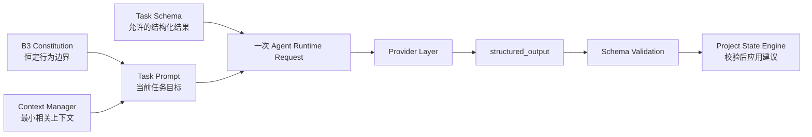

> 2026-10-04 重构：冲突项以 docs/blueprint/13_PLANNING_WORKBENCH.md 为准。旧单 Agent/单调用、通用兜底题、百分比准备度、短时强制超时规则已撤销。自由文本先保存，结构化答案或变更包批准才成为正式事实。以下保留旧设计背景。

# Project Architect V1：Agent Runtime 设计

> 文档状态：Phase 1.3 Blueprint  
> 依据：[01_PRODUCT_BOUNDARY.md](01_PRODUCT_BOUNDARY.md)、[02_SYSTEM_ARCHITECTURE.md](02_SYSTEM_ARCHITECTURE.md)  
> 范围：单一 Agent 的运行组成、任务契约、上下文选择与 Token 控制。  
> B3 变更：自适应多问题集的权威细则见 [12_B3_ADAPTIVE_DISCOVERY.md](12_B3_ADAPTIVE_DISCOVERY.md)。旧 B2.1 描述与其冲突时，以 B3 为准。

## 1. Runtime 目标与不变量

Agent Runtime 让 B3 行为在不同项目阶段稳定运行，同时由 Core 决定问题预算与独立性门控。

每一次需要 AI 推理的操作都遵守以下不变量：

- 使用一个专门的 Project Architect Agent。
- 一个语义任务最多进行一次主要 Antigravity 调用。
- 影响状态的结果必须来自 JSON Schema 对应的 `structured_output`。
- Agent 返回建议状态更新；Project State Engine 才是状态的最终权威。
- Context Manager 只提供当前任务需要的信息，不能默认传递完整历史。

## 2. Agent 组成

Runtime 由 Constitution、Task Prompt、Context Manager 和 Schema 共同组成。四者各自承担一种约束，不能互相替代。

### 2.1 Constitution

Constitution 是所有任务共享的行为上限。生产运行时只加载 B3 Constitution。

它持续约束所有输出字段：

- **Capability Before Mechanism：** 在 Discovery 中描述所需产品能力和约束，不主动提出具体实现机制。
- **Conflict Strict：** Conflict 只能是两个已确认、已锁定或硬约束无法同时满足；风险、成本、复杂度与取舍必须分开分类。
- **Product First：** 优先用户、价值、流程、MVP、信任承诺与体验问题，再考虑技术约束。
- **User Authority：** AI 推断不能自动变成 Confirmed；高影响决定必须由用户确认。
- **Gap-first：** 先识别并排序 Gap，再生成问题；不使用固定问卷。

### 2.2 Task Prompt

Task Prompt 只定义“本次要完成哪一种推理”，不改变 Constitution 的原则。它决定当前任务的输出重点、禁止事项和完成条件。

Task Prompt 不得借任务名称绕开 B3。例如，`question-generation` 不能因要提问而主动把具体实现机制作为候选方案；`document-compilation` 也不能把未确认的推断写成事实。

### 2.3 Context Manager

Context Manager 从规范 Project State 和当前用户动作中选择最小相关输入。它负责相关性、优先级、长度预算和敏感状态的边界，而不是进行产品推理。

### 2.4 Schema

Schema 是 Agent 与程序之间的结构化契约。每个 Task 有自己的输出 Schema；Schema 校验通过不等于状态可以直接写入。

Project State Engine 仍需检查：用户授权、状态标签、Locked 保护、重复项、引用的既有决定和任务允许的状态影响。

## 3. Task 类型与生命周期位置

V1 Runtime 明确将 AI 推理划分为三类独立任务，避免将 Discovery 拆分成虚假的连续调用流水线：

| Task 类型 | 主要阶段 | 目的 | 是否通常面向用户提问 |
| --- | --- | --- | --- |
| `discovery-turn` | Idea 输入 / Broad Pass / Deep Dive / 编辑后影响分析 | **Unified Discovery Turn**：基于 B3 Constitution 与统一 Schema，单次完成当前理解、Candidate、Assumption、Gap、Conflict、Tension、Risk 及独立 Question Set。 | 是（程序按阶段预算呈现） |
| `readiness-review` | Prepare for Development | 独立审阅项目产品定义是否达到开发蓝图准备度，输出 Status、Warnings、Issues 与 Assumptions。 | 仅在需要明确关键未决问题时 |
| `document-plan` | 用户批准 Readiness 后 | 在 Markdown 编译前分析文档覆盖范围与映射建议，推荐动态专项文档清单。 | 否 |

> **关键不变量**：在一次用户交互动作（如提交 Idea、回答问题、补充说明）中，系统仅发起一次主要 Provider 调用（即一次 `discovery-turn`）。程序根据交互阶段决定呈现策略（例如首次输入时先展示 Current Understanding 与 Overview，将生成的 Question 作为下一步状态保留；后续交互则直接聚焦 Question 与推荐），严禁为了“先分析后提问”而在同一动作中发起多次隐藏 AI 调用。

## 4. 各 Task Runtime 契约

### 4.1 `discovery-turn`（Unified Discovery Turn）

`discovery-turn` 是 Discovery 阶段的唯一核心推理任务，遵循 B3 Benchmark 规范。

| 项目 | 设计 |
| --- | --- |
| **输入 Context** | 当前用户输入、相关材料提取摘录（`ready` 状态）、当前阶段、相关 Confirmed / Locked 决定、现有 Open Gap / Risk / Tension / Conflict、适用 Checklist 条目提示。 |
| **Prompt 体系** | B3 Constitution（`constitution-b3.md`）+ Discovery Context + 本地阶段预算。 |
| **Schema 契约** | `b3-discovery.schema.json`，Gap/Question 额外要求 `decision_key` 与 `depends_on`。 |
| **State 影响** | 由 State Engine 进行 B3 Schema、独立性、用户授权与 Locked 保护校验后，映射为候选变更。 |
| **呈现策略** | • **首次输入 (Initial Idea)**：Frontend 优先呈现结构化项目理解 (Confirmed/Candidate/Unknown/Risk) 与 Overview 投影，生成的首个高价值 Question 作为下一步引导保留。 • **后续迭代 (Broad Pass / Deep Dive)**：Frontend 聚焦呈现 Question 卡片、推荐方向与选项影响，并同步更新 Overview。 |

#### B3 自适应问题预算

问题预算为 `initial=12`、`explore=8`、`converge=4`、`readiness=2`。同批只允许互不依赖的唯一决策主题；Low-risk 仍优先保留为显式 Assumption。完整规则见 B3 权威规范。

### 4.2 `readiness-review`

| 项目 | 设计 |
| --- | --- |
| **输入 Context** | Project Overview 核心部分、所有 Confirmed / Locked 决定、未解决的 High / Critical Gap、Conflict、Risk、Active Assumption、当前目标文档范围。 |
| **Prompt 职责** | 以产品定义是否足以形成开发蓝图为标准审阅项目；检查产品目标、用户、核心问题、MVP 边界、核心功能、流程、页面结构、UX 与开发阶段。优先 Warning，只有真正关键的未决事项才标记 Issue。 |
| **Schema 输出** | `status`（`ready` / `ready-with-warnings` / `not-ready`）、`warnings`、`issues`、`assumptions`、`missing_areas`、`recommended_next_action`。 |
| **State 影响** | 写入可追溯的 Readiness Snapshot（`state/readiness.json`）；不修改产品事实，不解除 Locked，也不阻止用户最终决定继续。 |

#### Readiness 处置规则

| Readiness 情况 | 默认结果 | 用户明确处置后 | 文档保留要求 |
| --- | --- | --- | --- |
| 无 Critical Issue | `ready` 或 `ready-with-warnings` | 用户选择 `approved` 或 `approved-with-warnings`。 | 当前 Assumption 与 Warning 写入文档。 |
| High Issue 或未决 High Risk | `not-ready`，建议回到 Discovery | 用户逐项确认后可选择 `approved-with-known-issues`。 | 每项确认的 Issue/Risk 必须保留并进入相关文档。 |
| Open Critical Conflict | `not-ready`，默认阻止文档生成 | 用户逐项确认冲突与后果后可选择 `approved-with-critical-conflicts`。 | 冲突双方约束、后果与未决状态作为文档首要限制项。 |

### 4.3 `document-plan`

| 项目 | 设计 |
| --- | --- |
| **输入 Context** | 用户已批准的状态版本（`stateRevision`）、Readiness Snapshot、固定核心文档清单（8 份）、已确认的专项主题、需在文档中显式保留的 Warning 与 Assumption。 |
| **Prompt 职责** | 仅负责文档覆盖度与映射分析：哪些规范状态进入哪个核心文档、哪些动态专项文档（`docs/specs/`）确有必要生成、哪些未决项需要显式保留标记。不得扩展产品范围或虚构需求。 |
| **Schema 输出** | `document_plan`（核心文档映射、动态专项文档清单、状态引用映射）、`coverage_warnings`、`unresolved_markers`。 |
| **State 影响** | 保存文档生成计划；不改写项目定义。随后由本地 Document Compiler 结合模板注册表装配 Markdown 并输出 `documents/manifest.json`。 |

## 5. Context 管理

### 5.1 Relevant Context Selection

Context Manager 依据当前 Task 选择最小相关证据，选择顺序如下：

1. 当前用户输入、直接编辑或明确批准动作。
2. 当前阶段和本次 Task 的完成条件。
3. 与当前主题直接相关的 Locked 与 Confirmed 决定。
4. 相关的 Critical / High Gap、真实 Conflict、Risk 与 Tension。
5. 与本次问题直接关联的 Candidate、Assumption、已回答内容和已展示问题。
6. 相关的 Checklist 条目与 Overview 摘要。

与当前任务无关的历史对话逐字记录、过期候选、无关 Overview 分区和无关材料默认排除。

### 5.2 任务级上下文范围

| Task | 必须保留 | 默认排除 |
| --- | --- | --- |
| `discovery-turn` | 当前输入、`ready` 材料摘录、相关确认/锁定决定、当前 Gaps/Risks/Tensions、相关 Checklist 提示。 | 完整对话流水、无关历史候选、预设技术方案。 |
| `readiness-review` | 核心 Overview 投影、全部关键决定、未解决高风险/冲突项、活跃 Assumptions、文档清单。 | 原始材料全文、低影响细节、中间推理过程。 |
| `document-plan` | 已批准规范状态快照、Readiness 结论、8 份核心文档定义、已确认专项主题。 | 原始聊天记录、未采用的 Candidate、已拒绝方案。 |

### 5.3 上下文预算规则

Context Manager 必须有整体长度上限，并对数组数量、单条文本长度和材料摘录长度设置上限。预算不足时按以下顺序保留：

1. 当前输入与用户最新授权。
2. Locked / Confirmed 硬约束与真实 Conflict。
3. High / Critical Gap、Risk 与阶段必需信息。
4. 当前 Task 直接依赖的历史回答。
5. 可由规范状态摘要替代的低优先级内容。

压缩必须由本地、确定性的状态摘录完成。不得为了避免遗漏而把完整历史重新放入 Prompt，也不得把未知信息压缩成 Confirmed。

## 6. Token 控制原则

### 6.1 本地处理优先

下列操作应在本地完成，不触发 AI：

- 保存材料、用户回答、直接编辑与批准动作。
- 状态标签和结构化结果校验。
- Locked 检查、去重、变更记录与简单影响标记。
- 已有结构化数据的展示、筛选、排序和 Markdown 装配。
- 根据状态索引选择相关上下文并执行长度截断。

### 6.2 仅为复杂推理调用 AI

只有下列需要理解、判断或推荐的操作调用 AI：

- 首次理解模糊或复杂输入。
- 发现和分类关键 Gap、Risk、Tension、Scope Issue 与 Conflict。
- 评估问题优先级，形成产品级推荐。
- 进行 Readiness 的综合判断。
- 形成文档覆盖建议。

### 6.3 运行控制

- 每个 AI Task 最多一次主要调用，不使用隐藏重试掩盖失败。
- 调用需记录任务、耗时、是否成功、Prompt 长度和可用用量信息。
- 对结构化失败、超时或异常成本，保留原始结果并把失败明确交给上层处理。
- 成本保护使用历史正常范围识别异常，而不通过删减关键产品上下文来制造低成本结果。

## 7. B3 原则在 Runtime 中的执行位置

| 原则 | Runtime 执行位置 | 不允许的绕过方式 |
| --- | --- | --- |
| Capability Before Mechanism | Constitution 约束所有 Task；Schema 和 State 校验保留产品级分类。 | 在 Risk、Tension、Recommendation、Conflict 或文档计划字段中暗示具体机制。 |
| Conflict Strict | `discovery-turn` 与 `readiness-review` 的分类契约；State Engine 保留两个约束的证据。 | 将安全担忧、范围过大、成本或复杂度写入 `conflicts`。 |
| Product First | Task Prompt 的排序目标；Context 优先用户、价值、流程、MVP 与信任承诺。 | 因技术难度高而跳过产品问题，直接询问实现选择。 |
| User Authority | Schema 产生建议；State Engine 只在用户授权后提升事实状态。 | Agent 推荐、推断或默认值自动成为 Confirmed 或 Locked。 |
| Single Agent / Single Call | AI Orchestrator 的调用控制与诊断记录。 | 同一用户动作触发多个隐藏 Task 调用或多个角色协作。 |

## 8. 本阶段结论

Project Architect 的 Agent Runtime 将 B3 作为稳定的行为底座，并以任务契约、阶段预算和最小上下文适应首次理解、Gap 发现、批次提问、Readiness 与文档生成阶段。

它保留一个 Agent、一次主要调用和结构化结果的简单架构；复杂性由程序的状态管理、上下文选择和校验承担，而不是由额外 Agent 或完整历史 Prompt 承担。
