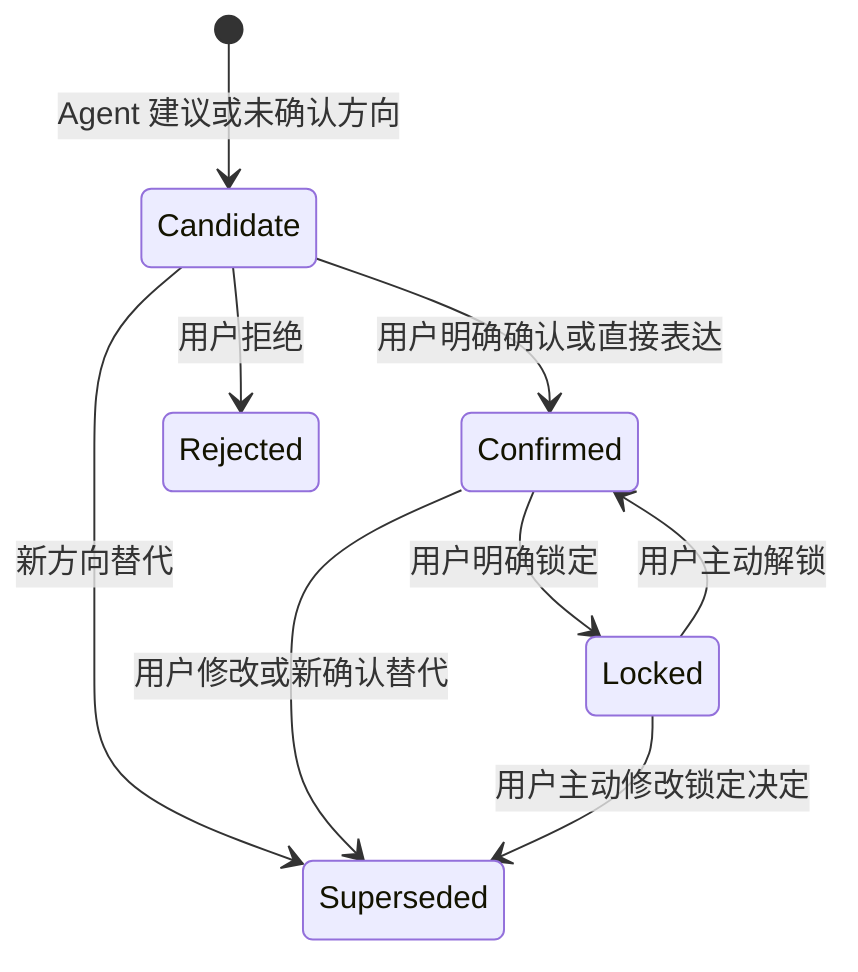
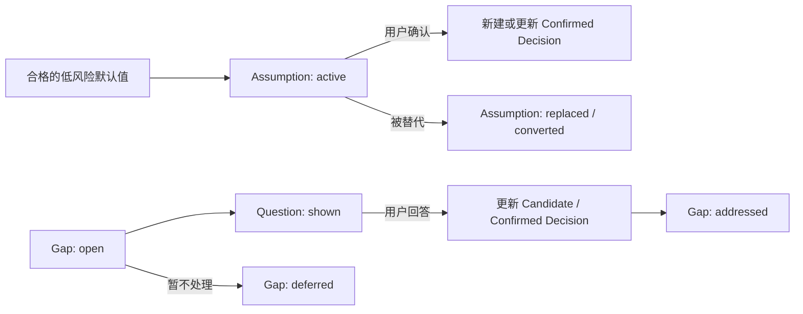
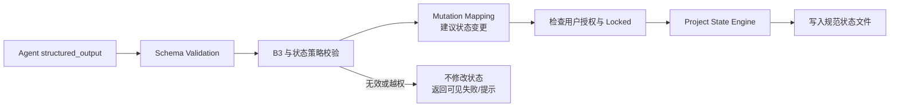
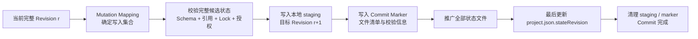

# Project Architect V1：Project State 数据模型

> B3 更新：自适应多问题集与生产运行时以 [12_B3_ADAPTIVE_DISCOVERY.md](12_B3_ADAPTIVE_DISCOVERY.md) 为权威生产契约；旧 B2.1 引用仅为历史背景。
> 文档状态：Phase 1.4 Blueprint  
> 依据：[01_PRODUCT_BOUNDARY.md](01_PRODUCT_BOUNDARY.md)、[02_SYSTEM_ARCHITECTURE.md](02_SYSTEM_ARCHITECTURE.md)、[03_AGENT_RUNTIME.md](03_AGENT_RUNTIME.md)  
> 范围：本地文件状态、状态生命周期、结构化写入与用户确认。  
> 非范围：数据库、ORM、复杂权限与代码实现。

## 1. 模型目标

Project State 是每个项目的规范事实来源。它保存用户输入、用户确认、AI 建议、未决事项、Readiness 和生成记录，并为 Overview、Agent Context 和 Markdown 文档提供同一份依据。

状态模型必须保证：

- 用户明确表达与 AI 推断可以区分。
- Agent 的结构化结果不能直接覆盖项目事实。
- Overview 和文档不各自维护一份独立需求。
- 每个高影响决定都能看出当前状态与用户确认路径。
- 文件可被本地读取、校验、迁移和备份。

## 2. V1 本地目录

每个项目使用独立目录：

```text
project/
├── inputs/
│   └── <input-id>/
│       ├── source.<extension>
│       └── extraction.json
├── project.json
├── state/
│   ├── overview.json
│   ├── decisions.json
│   ├── assumptions.json
│   ├── gaps.json
│   ├── questions.json
│   ├── risks.json
│   └── readiness.json
└── documents/
    ├── manifest.json
    ├── AGENTS.md
    └── docs/
```

`documents/` 的内容是已批准 Project State 的派生产物。它不反向定义项目事实。

输入材料的保存、处理状态和 Context 使用边界由 [10_INPUT_MATERIAL_CONTRACT.md](10_INPUT_MATERIAL_CONTRACT.md) 定义；`project.json` 保存它们的稳定引用与元信息。

## 3. 文件职责

| 文件 | 规范角色 | 主要内容 | 不负责 |
| --- | --- | --- | --- |
| `project.json` | 项目清单与根元数据。 | 项目 ID、名称、阶段、标签、状态版本、输入材料引用。 | 产品决策正文、AI 原始回复。 |
| `state/overview.json` | 面向用户的 Overview 结构与成熟度投影。 | 固定/动态 Section、成熟度、关联状态项。 | 独立复制事实或绕过决定状态。 |
| `state/decisions.json` | 项目决定的规范记录。 | Candidate、Confirmed、Locked、被替代或拒绝的决定及其证据。 | 未经用户确认的 AI 推断变成事实。 |
| `state/assumptions.json` | 显式、低风险、可逆的暂定默认值。 | 当前 Assumption、理由、关联项和解决状态。 | 架构、关键 UX、范围或安全承诺。 |
| `state/gaps.json` | 尚未解决的项目缺口及相关分类。 | Gap、Conflict、Tension、Scope Issue 的状态与关联证据。 | 将一般风险或成本当作 Conflict。 |
| `state/questions.json` | 已生成问题及其回答生命周期。 | 关联事项、问题、推荐、展示状态、用户回答。 | 自动确认用户尚未批准的选项。 |
| `state/risks.json` | 可能的负面影响与处理状态。 | Risk、严重度、影响、缓解方向、接受或延期状态。 | 代替真实 Conflict 或产品决定。 |
| `state/readiness.json` | Readiness 的当前快照和历史记录。 | Ready 状态、Warnings、Issues、缺失区域、用户处置。 | 修改项目事实或阻止用户最终选择。 |
| `documents/manifest.json` | 文档生成记录。 | 生成时间、来源状态版本、文档清单和保留标记。 | 项目状态的唯一来源。 |

## 4. 共同记录约定与统一类型引用 (Typed References)

所有 `state/` 下的状态文件根对象都必须包含：

- `schemaVersion`：该文件的格式版本（整数，从 1 开始）。
- `projectId`：所属项目 ID。
- `updatedAt`：最后一次成功状态写入时间（ISO 8601 字符串）。

### 4.1 统一类型引用约定 (Typed References)

为解决跨文件引用歧义并支持精准追踪（解决 R-05），所有记录间的引用**必须使用带类型前缀的稳定字符串**：

```text
decision:<id>     # 对应 state/decisions.json 中的记录
assumption:<id>   # 对应 state/assumptions.json 中的记录
gap:<id>          # 对应 state/gaps.json 中的 gaps 记录
conflict:<id>     # 对应 state/gaps.json 中的 conflicts 记录
tension:<id>      # 对应 state/gaps.json 中的 tensions 记录
risk:<id>         # 对应 state/risks.json 中的记录
question:<id>     # 对应 state/questions.json 中的记录
input:<id>        # 对应 project.json inputRefs 中的材料记录
```

- **引用而非复制**：记录之间只通过 Typed Ref 相互关联，严禁跨文件深复制全量文本，避免数据漂移。
- **Overview 投影寻址**：`overview.json` 中的 `itemRefs` 仅保存 `decision:<id>` 等 typed refs。前端渲染时由 State Engine 根据 ref 提取决策事实文本与状态。
- **Conflict 证据要求**：`conflict` 的 `decisionRefs` 必须包含至少 2 个 `decision:<id>` 或硬约束来源。
- **Readiness 追溯**：Readiness 中的 Issues/Warnings 关联对应的 `gap:<id>`、`risk:<id>` 或 `conflict:<id>`。

`project.json` 还维护单调递增的 `stateRevision`。一次成功的规范状态变更完成后，该值只增加一次；`documents/manifest.json` 用它标记文档所依据的状态版本。

时间采用 ISO 8601 字符串。状态值使用明确枚举，不依赖自由文本猜测。

## 5. JSON Schema 示例

以下 Schema 为 V1 数据契约示例，展示必要字段与允许值。后续实现可增加格式校验和兼容迁移，但不得改变本章定义的语义。

### 5.1 `project.json`

```json
{
  "type": "object",
  "required": ["schemaVersion", "projectId", "name", "stage", "stateRevision", "updatedAt"],
  "properties": {
    "schemaVersion": { "type": "integer", "minimum": 1 },
    "projectId": { "type": "string", "minLength": 1 },
    "name": { "type": "string", "minLength": 1 },
    "stage": {
      "enum": [
        "created",
        "initial-analysis",
        "broad-pass",
        "deep-dive",
        "readiness-review",
        "approved",
        "documents-generated"
      ]
    },
    "stateRevision": { "type": "integer", "minimum": 0 },
    "projectTags": { "type": "array", "items": { "type": "string" } },
    "inputRefs": {
      "type": "array",
      "items": {
        "type": "object",
        "required": ["id", "kind", "label", "storageRef", "status", "analysisAvailability", "createdAt"],
        "properties": {
          "id": { "type": "string" },
          "kind": { "enum": ["text", "file", "image"] },
          "label": { "type": "string" },
          "storageRef": { "type": "string" },
          "status": { "enum": ["saved", "processing", "ready", "used", "failed", "excluded"] },
          "analysisAvailability": { "enum": ["available", "unavailable"] },
          "createdAt": { "type": "string" }
        }
      }
    },
    "updatedAt": { "type": "string" }
  }
}
```

### 5.2 `state/overview.json`

Overview 保存用户看到的 Section 结构、成熟度和对规范记录的引用。事实文本由关联记录解析，避免 Overview 与决定文件发生漂移。

```json
{
  "type": "object",
  "required": ["schemaVersion", "projectId", "sections", "updatedAt"],
  "properties": {
    "schemaVersion": { "type": "integer", "minimum": 1 },
    "projectId": { "type": "string" },
    "sections": {
      "type": "array",
      "items": {
        "type": "object",
        "required": ["id", "title", "kind", "maturity", "itemRefs"],
        "properties": {
          "id": { "type": "string" },
          "title": { "type": "string" },
          "kind": { "enum": ["fixed", "dynamic"] },
          "maturity": {
            "enum": ["unexplored", "needs-clarification", "mostly-clear", "clear", "locked"]
          },
          "itemRefs": { "type": "array", "items": { "type": "string" } }
        }
      }
    },
    "updatedAt": { "type": "string" }
  }
}
```

固定 Section 覆盖项目概述、产品愿景、目标用户、核心问题、产品目标、MVP 范围、核心功能、用户流程、页面结构、UX、UI 方向、技术概要和开发阶段。动态 Section 仅在项目确有相关主题时出现。

### 5.3 `state/decisions.json`

```json
{
  "type": "object",
  "required": ["schemaVersion", "projectId", "items", "updatedAt"],
  "properties": {
    "schemaVersion": { "type": "integer", "minimum": 1 },
    "projectId": { "type": "string" },
    "items": {
      "type": "array",
      "items": {
        "type": "object",
        "required": ["id", "area", "statement", "status", "origin", "createdAt"],
        "properties": {
          "id": { "type": "string" },
          "area": { "type": "string" },
          "statement": { "type": "string", "minLength": 1 },
          "status": {
            "enum": ["candidate", "confirmed", "locked", "superseded", "rejected"]
          },
          "origin": { "enum": ["user", "agent"] },
          "evidenceRefs": { "type": "array", "items": { "type": "string" } },
          "confirmedBy": { "enum": ["user"] },
          "createdAt": { "type": "string" },
          "updatedAt": { "type": "string" }
        }
      }
    },
    "updatedAt": { "type": "string" }
  }
}
```

`confirmedBy` 只能是 `user`。Agent 可以创建 `candidate`，不能创建 `confirmed` 或 `locked`。

### 5.4 `state/assumptions.json`

```json
{
  "type": "object",
  "required": ["schemaVersion", "projectId", "items", "updatedAt"],
  "properties": {
    "schemaVersion": { "type": "integer", "minimum": 1 },
    "projectId": { "type": "string" },
    "items": {
      "type": "array",
      "items": {
        "type": "object",
        "required": ["id", "statement", "reason", "status", "createdAt"],
        "properties": {
          "id": { "type": "string" },
          "statement": { "type": "string" },
          "reason": { "type": "string" },
          "status": { "enum": ["active", "replaced", "converted", "removed"] },
          "linkedDecisionIds": { "type": "array", "items": { "type": "string" } },
          "createdAt": { "type": "string" },
          "resolvedAt": { "type": "string" }
        }
      }
    },
    "updatedAt": { "type": "string" }
  }
}
```

只有满足低影响、低不可逆性、低不确定性、不锁定架构、不锁定关键 UX、不扩张范围的内容可以写入此文件。

### 5.5 `state/gaps.json`

`gaps.json` 集中保存缺口及其容易被混淆的相邻分类。这样可以保留 Strict Conflict 证据，而不把所有问题叫作 Conflict。

```json
{
  "type": "object",
  "required": ["schemaVersion", "projectId", "gaps", "conflicts", "tensions", "updatedAt"],
  "properties": {
    "schemaVersion": { "type": "integer", "minimum": 1 },
    "projectId": { "type": "string" },
    "gaps": {
      "type": "array",
      "items": {
        "type": "object",
        "required": ["id", "area", "severity", "reason", "status"],
        "properties": {
          "id": { "type": "string" },
          "area": { "type": "string" },
          "severity": { "enum": ["low", "medium", "high", "critical"] },
          "reason": { "type": "string" },
          "impact": { "type": "string" },
          "dependency": { "type": "string" },
          "shouldAskUser": { "type": "boolean" },
          "status": { "enum": ["open", "questioned", "addressed", "deferred"] }
        }
      }
    },
    "conflicts": {
      "type": "array",
      "items": {
        "type": "object",
        "required": ["id", "propositionA", "propositionB", "decisionRefs", "severity", "reason", "status"],
        "properties": {
          "id": { "type": "string" },
          "propositionA": { "type": "string" },
          "propositionB": { "type": "string" },
          "decisionRefs": { "type": "array", "items": { "type": "string" }, "minItems": 2 },
          "severity": { "enum": ["low", "medium", "high", "critical"] },
          "reason": { "type": "string" },
          "status": { "enum": ["open", "resolved", "deferred"] }
        }
      }
    },
    "tensions": {
      "type": "array",
      "items": {
        "type": "object",
        "required": ["id", "description", "reason", "status"],
        "properties": {
          "id": { "type": "string" },
          "description": { "type": "string" },
          "reason": { "type": "string" },
          "status": { "enum": ["open", "addressed", "deferred"] }
        }
      }
    },
    "updatedAt": { "type": "string" }
  }
}
```

### 5.6 `state/questions.json`

```json
{
  "type": "object",
  "required": ["schemaVersion", "projectId", "items", "updatedAt"],
  "properties": {
    "schemaVersion": { "type": "integer", "minimum": 1 },
    "projectId": { "type": "string" },
    "items": {
      "type": "array",
      "items": {
        "type": "object",
        "required": ["id", "issueRef", "importance", "question", "allowFreeInput", "status", "createdAt"],
        "properties": {
          "id": { "type": "string" },
          "issueRef": { "type": "string" },
          "importance": { "enum": ["normal", "high", "critical"] },
          "question": { "type": "string" },
          "reason": { "type": "string" },
          "recommendation": { "type": "string" },
          "options": { "type": "array", "items": { "type": "string" } },
          "allowFreeInput": { "const": true },
          "status": { "enum": ["proposed", "shown", "answered", "dismissed", "superseded"] },
          "answer": { "type": "string" },
          "createdAt": { "type": "string" },
          "answeredAt": { "type": "string" }
        }
      }
    },
    "updatedAt": { "type": "string" }
  }
}
```

### 5.7 `state/risks.json`

```json
{
  "type": "object",
  "required": ["schemaVersion", "projectId", "items", "updatedAt"],
  "properties": {
    "schemaVersion": { "type": "integer", "minimum": 1 },
    "projectId": { "type": "string" },
    "items": {
      "type": "array",
      "items": {
        "type": "object",
        "required": ["id", "description", "severity", "status"],
        "properties": {
          "id": { "type": "string" },
          "description": { "type": "string" },
          "severity": { "enum": ["low", "medium", "high", "critical"] },
          "impact": { "type": "string" },
          "mitigationDirection": { "type": "string" },
          "status": { "enum": ["identified", "accepted", "mitigated", "deferred"] }
        }
      }
    },
    "updatedAt": { "type": "string" }
  }
}
```

### 5.8 `state/readiness.json`

```json
{
  "type": "object",
  "required": ["schemaVersion", "projectId", "current", "history", "updatedAt"],
  "properties": {
    "schemaVersion": { "type": "integer", "minimum": 1 },
    "projectId": { "type": "string" },
    "current": {
      "type": "object",
      "required": ["id", "status", "reviewedAt", "requiredAreas"],
      "properties": {
        "id": { "type": "string" },
        "status": { "enum": ["ready", "ready-with-warnings", "not-ready"] },
        "reviewedAt": { "type": "string" },
        "requiredAreas": { "type": "array", "items": { "type": "string" } },
        "warnings": { "type": "array", "items": { "type": "string" } },
        "issues": { "type": "array", "items": { "type": "string" } },
        "assumptionRefs": { "type": "array", "items": { "type": "string" } },
        "knownIssueAcknowledgements": { "type": "array", "items": { "type": "string" } },
        "criticalConflictAcknowledgements": { "type": "array", "items": { "type": "string" } },
        "userDisposition": {
          "enum": [
            "pending",
            "return-to-discovery",
            "approved",
            "approved-with-warnings",
            "approved-with-known-issues",
            "approved-with-critical-conflicts"
          ]
        }
      }
    },
    "history": { "type": "array", "items": { "type": "object" } },
    "updatedAt": { "type": "string" }
  }
}
```

### 5.9 `documents/manifest.json`

```json
{
  "type": "object",
  "required": ["schemaVersion", "projectId", "sourceStateRevision", "generatedAt", "files"],
  "properties": {
    "schemaVersion": { "type": "integer", "minimum": 1 },
    "projectId": { "type": "string" },
    "sourceStateRevision": { "type": "integer", "minimum": 0 },
    "generatedAt": { "type": "string" },
    "files": { "type": "array", "items": { "type": "string" } },
    "unresolvedMarkers": { "type": "array", "items": { "type": "string" } }
  }
}
```

## 6. 状态生命周期

### 6.1 决定生命周期



- `Candidate` 不是事实；它只表示可见的待选方向。
- `Confirmed` 只能来自用户输入、用户回答、直接编辑或明确批准。
- `Locked` 只能由用户显式设置，AI 不主动重开讨论。
- `Superseded` 与 `Rejected` 保留历史关系，避免无痕覆盖。

### 6.2 Assumption、Gap 与 Question 生命周期



Assumption 被用户确认时，不应直接改名为 Confirmed。System 必须创建或更新关联 Decision，并将 Assumption 标为 `converted`，从而保留其原本是暂定默认值的历史。

### 6.3 Conflict 与 Risk 生命周期

- Conflict 只有在存在两条可引用的 Confirmed、Locked 或硬约束时才能创建。
- 用户选择解决路径后，System 更新相关 Decision，并将 Conflict 标为 `resolved` 或 `deferred`。
- Risk 可以被接受、缓解或延期，但不能通过改标签变成已解决 Gap。
- Tension 可以被记录和处理，无需伪装成 Conflict。

## 7. AI 输出如何进入 State



进入状态前必须完成以下检查：

1. **结构校验：** 输出符合当前 Task 的 JSON Schema，且来自 `structured_output`。
2. **分类校验：** 具体实现机制不能以其他字段绕过 Capability Before Mechanism；Conflict 必须引用两条可验证约束。
3. **来源校验：** Agent 推断只能写入 Candidate、Assumption、Gap、Risk 或 Tension 的允许位置，不能直接成为 Confirmed 或 Locked。
4. **状态校验：** 检查引用存在、记录未重复、状态转换合法、Locked 未被静默覆盖。
5. **写入校验：** 只有所有检查通过，才写入相关状态文件并更新 `updatedAt`。

无效结果不会部分更新 Project State。系统保留调用诊断供问题追踪，但不把无效 Agent 输出当作项目事实。

## 8. 用户确认机制

用户确认是状态升级的唯一授权路径。

| 用户动作 | System 行为 | 允许的状态变化 |
| --- | --- | --- |
| 回答结构化问题或自由输入 | 将回答关联到 `questions.json`，并记录用户证据。 | 相关 Candidate 可变为 Confirmed；相关 Gap 可被标记 addressed。 |
| 点击确认 AI 推荐 | 记录明确批准与关联证据。 | Candidate → Confirmed。 |
| 直接编辑 Overview | 将编辑解释为用户声明，更新关联规范记录并保留影响提示。 | Candidate → Confirmed，或 Confirmed / Locked 被用户主动替代。 |
| 点击锁定 | 记录用户锁定意图。 | Confirmed → Locked。 |
| 拒绝、删除或选择其他方向 | 保留原记录和替代关系。 | Candidate → Rejected / Superseded；Assumption → Removed / Replaced。 |
| 批准 Readiness 或文档生成 | 记录用户处置，不篡改产品事实。 | Readiness `userDisposition` 更新；允许文档生成。 |

直接编辑并不自动表示 Locked。只有用户明确执行锁定动作，决定才进入 `locked` 状态。

当用户的新输入与 Confirmed 或 Locked 内容不一致时，System 保留新旧记录和影响提示。Agent 可以解释差异与建议下一步，但不能自行选择保留哪一项。

## 9. State Commit Contract

一次 State Commit 是对规范 Project State 的完整、可恢复更新。它解决多份 JSON 文件同时变化时的部分写入问题，不引入数据库或复杂事务系统。

### 9.1 Commit 不变量

- 当前有效状态由 `project.json.stateRevision` 指向。
- 一次成功 Commit 只将 `stateRevision` 增加一次。
- Agent 结果、用户编辑和 Readiness 更新都必须先变成完整候选状态，再进入 Commit。
- 读取项目之前必须完成未完成 Commit 的恢复检查。
- 无法恢复时项目以最后一个完整 Revision 只读打开；系统不得猜测性合并文件。

### 9.2 Commit 流程



1. State Engine 从当前完整 Revision 创建候选状态，并由 Mutation Mapping 列出受影响文件。
2. 系统先校验候选状态的所有相关 Schema、跨文件引用、来源、状态生命周期和 Locked 规则。
3. 系统把候选文件、旧文件备份和目标 Revision 的文件清单写入本地 staging 与 Commit Marker。
4. 系统推广所有目标状态文件；`project.json.stateRevision` 最后更新，作为新 Revision 的可见提交点。
5. 只有提交点写入成功后，系统才清理 staging、备份与 Marker。

### 9.3 启动恢复

启动时，State Engine 检查是否存在 Commit Marker：

- **没有 Marker：** 读取 `project.json.stateRevision` 指向的当前状态。
- **Marker 存在且提交点未更新：** 使用备份恢复最后一个完整 Revision，并丢弃未提交 staging。
- **Marker 存在且提交点已更新，且文件清单完整：** 视为已提交，完成清理。
- **Marker 与文件清单不一致：** 恢复最后一个完整 Revision；恢复失败时以只读模式打开并报告问题。

任何 Provider 或 Schema 失败都发生在 Commit 之前，因此不应产生 Commit Marker 或部分状态更新。

## 10. 本阶段结论

V1 通过清晰、独立的本地 JSON 文件保存项目状态：`decisions.json` 维护事实与授权，`overview.json` 提供用户视图，`gaps.json` 与 `risks.json` 保留未决和风险，`questions.json` 连接提问与回答，`readiness.json` 记录准备度，`documents/` 保存可追溯的派生文档。

该模型使自适应 Discovery Agent 的结构化推理能够安全进入项目状态，同时把最终控制权保留给用户。
