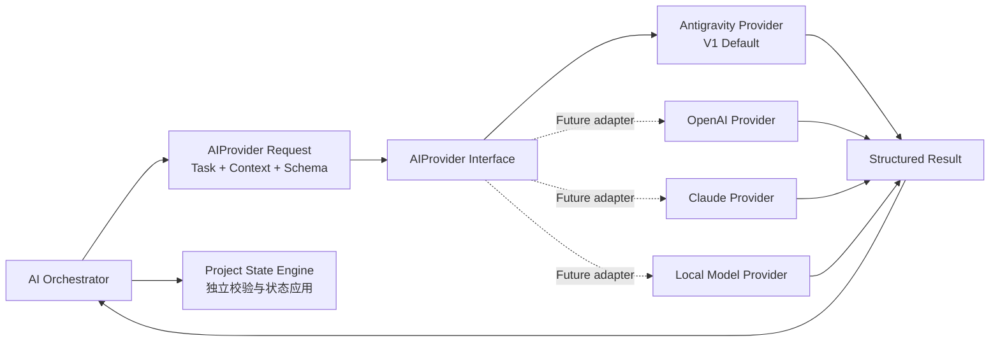

# Project Architect V1：AI Provider 架构

> 文档状态：Phase 1.5 Blueprint  
> 依据：[02_SYSTEM_ARCHITECTURE.md](02_SYSTEM_ARCHITECTURE.md)、[03_AGENT_RUNTIME.md](03_AGENT_RUNTIME.md)  
> 范围：Provider 抽象、统一输入输出、Antigravity 默认适配与未来替换边界。  
> 非范围：Provider 代码实现、模型选择策略、网络服务设计或 Prompt 重写。

## 1. 目标

AI Provider Layer 将 Agent Runtime 的一次结构化推理请求交给具体推理能力，并把结果以统一形式返回给 AI Orchestrator。

V1 默认使用 Antigravity CLI。Project Architect 的产品语义、Task、Project State 和 B2.1 行为不依赖 Antigravity 的专有响应格式。

Provider 抽象必须保证：

- 上层只处理统一的 Structured Result。
- 影响 Project State 的结果来自已声明 Schema 的结构化输出。
- 传输成功、结构化成功和业务状态可写入是三个不同层次的结论。
- 一次 Runtime 请求对应一次主要 Provider 调用。
- 原始响应和可用诊断数据可被保留，不因适配而丢失。

## 2. Provider 在总体架构中的位置



Provider Layer 只负责“请求如何执行、结果如何规范化”。AI Orchestrator 负责选择 Task 与上下文；Project State Engine 负责判断结果是否可进入状态。

## 3. AIProvider Interface

AIProvider 是一个逻辑接口，提供一个核心操作：将一个 `AIProvider Request` 完整执行一次，并返回一个 `Structured Result`。

```text
complete(request) → structured result
```

这不是具体代码定义，而是所有 Provider Adapter 必须遵守的行为契约。

### 3.1 `AIProvider Request`

| 输入 | 说明 | 来源 | Provider 不应修改 |
| --- | --- | --- |
| `task` | 当前 Task 类型、版本、完成条件和调用约束。 | AI Orchestrator。 | 不自行改为其他 Task。 |
| `context` | Context Manager 选择的最小相关用户输入、状态摘要、材料摘录和阶段信息。 | Context Manager / State Engine。 | 不补充完整历史或无关材料。 |
| `schema` | 当前 Task 的 JSON Schema，用于要求结构化输出。 | Agent Runtime。 | 不弱化字段语义或用普通文本替代。 |
| `prompt` | 冻结 Constitution 与当前 Task Prompt 组合后的请求文本。 | AI Orchestrator。 | 不注入改变 B2.1 行为的额外策略。 |
| `callConstraints` | 单次调用、超时、取消、诊断与成本保护约束。 | AI Orchestrator。 | 不隐藏重试或自行扩大调用规模。 |
| `requestId` | 一次调用的可追溯标识。 | Backend。 | 不复用于其他用户动作。 |

`context` 必须已经满足 Relevant Context Selection。Provider 不能因为更容易调用而要求完整 Project State 或完整聊天历史。

### 3.2 `Structured Result`

| 输出 | 说明 | 使用者 |
| --- | --- | --- |
| `status` | `success`、`failed`、`timed-out` 或 `cancelled`。 | Backend / AI Orchestrator。 |
| `structuredOutput` | Provider 返回的结构化结果；失败时为空。 | Schema Validation 与 State Engine。 |
| `structuredSuccess` | 是否获得可解析的结构化结果。 | Runtime 可靠性判断。 |
| `rawEnvelope` | Provider 原始结果封套，供诊断与审阅。 | 调试、Benchmark、问题追踪。 |
| `diagnostics` | 退出状态、错误摘要、标准错误输出等可用信息。 | Backend 与用户可见故障提示。 |
| `usage` | 可用的输入、输出、思考、缓存和总用量数据。不可用时明确标记 unavailable。 | 成本与性能观察。 |
| `durationMs` | 从请求开始到 Provider 结束的耗时。 | 性能观察与超时处理。 |
| `provider` | Provider 名称及适配器版本标识。 | 追溯与未来迁移。 |

`structuredSuccess` 只表示结果可被读取；它不表示 Agent 分类正确，也不表示 State Engine 必须应用结果。

## 4. Antigravity Provider：V1 默认实现

Antigravity Provider 是 V1 唯一启用的默认 Adapter。其职责是把统一 Request 转换为一次 Antigravity CLI 调用，再还原为统一 Structured Result。

### 输入映射

- 接收已经组合好的 Constitution、Task Prompt 和最小 Context。
- 传递当前 Task 的 inline JSON Schema。
- 按单次调用约束执行 headless 请求。
- 为调用建立可追溯 `requestId` 与任务标识。

### 结果映射

- 捕获标准输出、标准错误、退出状态和耗时。
- 解析原始 JSON 响应封套。
- 读取 `structured_output` 作为状态相关的结构化结果。
- 保留原始响应和所有 Provider 返回的可用 usage 数据。
- 结构化结果缺失、不可解析或调用失败时，返回失败的 Structured Result，不伪造空成功结果。

状态相关逻辑**不得**依赖普通 `response` 文本进行解析。普通文本即使存在，也不能取代 `structured_output`。

### V1 已验证的契约

Antigravity Provider 已验证可支持 headless 调用、JSON 输出、inline JSON Schema、`structured_output`、标准错误输出与退出状态捕获。V1 仍需将每次调用的结构化成功与 Provider 调用成功分开记录。

## 5. 为什么不能绑定 Antigravity

Antigravity 是当前默认 Provider，不是 Project Architect 的产品定义。绑定到单一 Provider 会带来以下风险：

- **可用性风险：** 本地环境、安装状态、版本变化或 Provider 故障不应迫使项目状态模型改变。
- **能力差异风险：** 不同 Provider 的结构化输出、上下文容量、用量指标和取消行为不同；这些差异应被 Adapter 吸收。
- **成本与性能选择：** 用户未来可能需要在推理质量、速度、隐私偏好和成本之间选择不同能力。
- **可测试性风险：** Agent 行为应由 Constitution、Task、Context 和 Schema 定义，而不是由某个 CLI 的文本格式定义。
- **产品演进风险：** 支持未来 Provider 时，不应重写 Project State、Question Engine、Readiness 或 Document Compiler。

因此，Antigravity 只拥有“执行请求与返回结果”的实现责任。它不拥有项目状态语义、用户授权、分类规则或文档规则。

## 6. 未来 Provider 的接入边界

未来可以增加 OpenAI、Claude 或 Local Model Adapter，但只有满足统一契约后才能用于会影响 Project State 的任务。

| Provider 类型 | 可接入条件 | 必须保持不变 |
| --- | --- | --- |
| OpenAI | 能接收 Task、最小 Context 和 Schema，并返回可校验结构化结果。 | B2.1 Constitution、Task 语义、状态校验与用户授权。 |
| Claude | 能提供一次任务调用、结构化结果和足够诊断信息。 | 同一 Task Schema 与单次调用约束。 |
| Local Model | 能在本地执行并满足结构化输出、错误报告与成本/性能观察的最小要求。 | Project State 语义、Context 最小化和结构化结果规则。 |

如果一个候选 Provider 无法稳定提供结构化结果，它不能直接用于状态变更 Task。它至多能作为未来的非状态辅助能力，不能降低 V1 的可靠性边界。

## 7. Provider Layer 的职责边界

| Provider Layer 负责 | Provider Layer 不负责 |
| --- | --- |
| 执行一次具体 Provider 调用。 | 选择产品阶段、Task 或下一问。 |
| 传递 Prompt、Context、Schema 与调用约束。 | 组装完整历史或决定上下文优先级。 |
| 规范化 structured output、原始封套、错误和可用用量数据。 | 判断 Gap、Conflict、Risk、Assumption 或 Readiness。 |
| 保留调用诊断并明确失败。 | 直接写 Project State 或将推荐升级为 Confirmed。 |
| 隔离 Provider 差异。 | 通过重试、多角色或替代输出掩盖失败。 |

Provider 成功只说明执行层完成；状态变更仍须经过 Runtime Schema Validation、B2.1 行为校验、用户授权检查和 State Engine 的状态转换规则。

## 8. 失败与降级原则

- CLI 或 Provider 失败时，Project State 保持不变。
- 超时、取消、结构化输出缺失和 Schema 不合规必须分别记录，不能统一伪装成“没有新发现”。
- V1 不使用隐藏重试；用户可看到失败并明确决定是否再次发起该操作。
- Provider 返回的 usage 缺失时，使用 `unavailable`，不得估算。
- Provider 不能以普通文本内容替代缺失的 `structuredOutput`。

## 9. 本阶段结论

V1 以 Antigravity CLI 作为已验证的默认 Provider，同时通过 `AIProvider Request → Structured Result` 契约保持 Provider 可替换性。

这种抽象让 AI Orchestrator 专注于任务和上下文，Provider Layer 专注于一次调用与结果规范化，Project State Engine 专注于校验、保存和用户授权。未来增加 OpenAI、Claude 或 Local Model 时，不应改变 Project Architect 的核心行为和状态语义。
