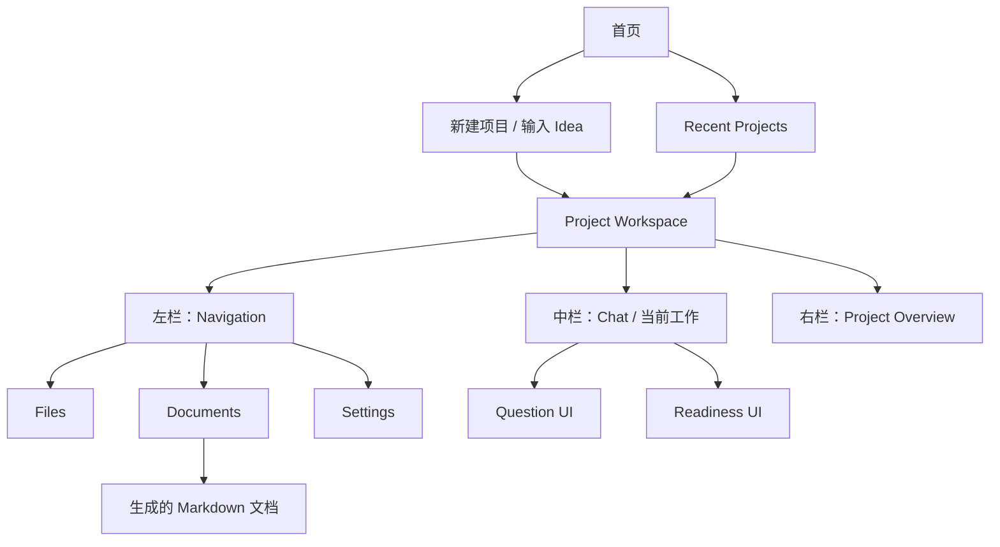
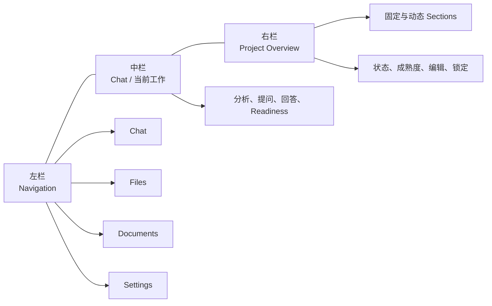
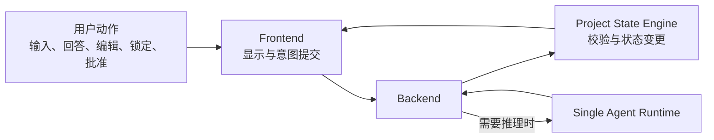

# Project Architect V1：Frontend Workspace Blueprint

> 文档状态：Phase 1.6 Blueprint  
> 依据：[01_PRODUCT_BOUNDARY.md](01_PRODUCT_BOUNDARY.md)、[02_SYSTEM_ARCHITECTURE.md](02_SYSTEM_ARCHITECTURE.md)、[04_PROJECT_STATE_MODEL.md](04_PROJECT_STATE_MODEL.md)  
> 范围：首页、Workspace 信息结构、关键界面职责和状态呈现。  
> 非范围：视觉稿、组件实现、样式系统、复杂 Dashboard 与企业协作界面。

## 1. 前端目标

Frontend 的目标不是展示很多项目管理数据，而是让一个个人开发者持续完成一件事：把当前项目想清楚。

界面必须让用户在任意时刻回答三个问题：

1. 这个项目当前已经明确了什么？
2. 现在最值得我决定或回答什么？
3. 距离生成开发文档还缺什么？

因此，V1 使用轻量首页和单项目三栏 Workspace。默认呈现当前工作所需的信息，不把用户带入复杂的报表、任务管理或协作视图。

## 2. 信息架构

主页负责开始或恢复项目；Workspace 负责项目定义过程。用户不会在首页完成复杂管理工作。

## 3. 首页

首页是一个轻量起点，只包含三类内容。

### 3.1 Project Architect

- 显示产品名称和一句清晰说明：帮助用户在编码前把项目想清楚。
- 不展示全局 KPI、团队动态、看板、图表或复杂模板市场。

### 3.2 Idea 输入

Idea 输入是首页的主操作。

它支持：

- 输入一段文本 Idea。
- 附加已有文件或图片作为项目材料。
- 明确提交后创建新项目，并进入 Workspace。

提交后，系统先执行首次理解分析。界面应优先呈现已知信息、Candidate、未知信息和 Risk；首轮不把用户直接带入连续问答。

### 3.3 Recent Projects

Recent Projects 只帮助用户恢复自己的项目。

每个项目条目显示最小必要信息：

- 项目名称。
- 当前阶段。
- 最近更新时间。
- 简短的准备度或未决状态提示。

点击条目直接恢复其 Workspace。V1 不增加项目分组、成员、权限、统计或跨项目任务聚合。

## 4. Workspace 总体结构

Workspace 固定为三栏，围绕“对话推进 + 状态可见”工作，而不是围绕文档目录或任务表工作。

- 左栏保持窄且可折叠，服务于位置切换。
- 中栏是默认焦点，承担用户与 Agent 的实际工作。
- 右栏默认可见，展示 Project State 的可读投影；用户可在需要专注阅读时折叠它。

三栏不代表三个独立产品模块。它们使用同一份 Project State：Chat 推进状态，Overview 呈现状态，Documents 使用已批准状态生成。

## 5. 左栏：Navigation

左栏负责 Workspace 内的位置切换，不承担项目管理。

| 导航项 | 职责 | 用户能做什么 | 不负责 |
| --- | --- | --- | --- |
| **Chat** | 回到当前项目定义对话。 | 查看分析、回答问题、继续 Deep Dive、发起 Readiness。 | 展示另一份独立的项目事实。 |
| **Files** | 查看本项目已提供的材料。 | 查看材料名称、类型、添加时间和是否已用于理解。 | 变成复杂文件管理器或知识库。 |
| **Documents** | 查看已生成的开发文档。 | 打开、查看、导出文档与生成记录。 | 在文档中直接绕过 Project State 修改需求。 |
| **Settings** | 管理本地项目和应用级偏好。 | 查看当前 Provider 可用状态及基础操作偏好。 | 提供团队、组织或复杂权限设置。 |

Navigation 必须支持折叠。折叠时仍保留当前区域标识，避免用户失去位置感。

## 6. 中栏：Chat 与当前工作

中栏不是普通聊天窗口。它是按项目阶段组织的决策工作区。

### 6.1 Chat 的职责

- 展示用户输入、材料处理结果、AI 分析、推荐、问题和用户回答。
- 在首次分析后呈现“当前理解”，而不是立即显示问卷。
- 在 Broad Pass 和 Deep Dive 阶段呈现当前最高价值的问题。
- 在 Readiness 阶段呈现审阅结果和下一步操作。
- 允许用户以自然语言补充、纠正或直接修改项目定义。

### 6.2 消息与工作单元

中栏应使用不同的工作单元表达不同语义：

| 工作单元 | 显示目的 | 用户应理解的含义 |
| --- | --- | --- |
| 用户输入 | 保存用户的原始表达或回答。 | 这是用户提供的证据。 |
| 首次理解 | 展示 Confirmed、Candidate、Unresolved 与 Risk。 | 这是系统当前理解，不是最终定义。 |
| Gap / Warning | 解释缺失、风险、范围问题或真实 Conflict。 | 这是需要关注的原因，不必都立即回答。 |
| Recommendation | 展示 AI 建议及其理由。 | 建议不等于已经决定。 |
| Question | 聚焦当前最值得用户回答的问题。 | 用户可以选项回答或自由输入。 |
| Readiness Result | 汇总 Ready、Warnings、Issues 与 Assumptions。 | 这是继续生成文档前的审阅，不是自动阻止。 |

### 6.3 输入区

输入区始终支持自由表达，而不仅是回答当前选项。用户可以：

- 回答当前问题。
- 修正 AI 的理解。
- 提供新的约束或材料。
- 要求解释 Recommendation。
- 明确确认、拒绝或更改已有方向。

Frontend 将这些动作作为用户意图提交给 Backend；它不在界面中自行把用户文字分类为 Confirmed、Candidate 或 Locked。

## 7. 右栏：Project Overview

Overview 是用户理解项目当前状态的核心窗口。它应持续可见、简短、可展开，而不是一个复杂需求管理系统。

### 7.1 Overview 内容

右栏呈现固定核心 Section：

- 项目概述、产品愿景、目标用户、核心问题、产品目标。
- MVP 范围、核心功能、用户流程、页面结构。
- UX、UI 方向、技术概要、开发阶段。

按项目情况显示动态 Section，例如 AI 能力、安全、隐私、同步、插件或权限。

每个 Section 显示：

- 当前内容摘要。
- 信息状态：Confirmed、Candidate、Assumption、Unresolved 或 Warning。
- 成熟度：未探索、需要明确、基本明确、已明确或已定。
- 若有关联项，显示 Gap、Risk 或 Conflict 的轻量提示。

### 7.2 编辑与锁定

用户可以在 Overview 中直接编辑内容，也可以回到 Chat 通过自然语言修改。

- 直接编辑提交后，System 更新关联的规范状态，并检查影响。
- 如果编辑影响 Confirmed 或 Locked 决定，界面显示影响提示与下一步建议。
- 用户可以将 Confirmed 决定明确标为 Locked。
- Locked 表示 AI 不主动重新讨论；用户本人仍可解锁或替换。

Overview 不能直接把 Agent 建议改成 Confirmed，也不能因为用户查看某项就自动锁定它。

## 8. Question UI

Question UI 服务于“少而关键”的 Gap-first 提问，而不是问卷收集。

每张问题卡至少包含：

- Importance：Normal、High 或 Critical。
- 当前问题。
- High / Critical 的“为什么现在问”。
- 推荐方向与推荐原因。
- 可选选项及各自影响。
- 始终可用的自由输入。

Question UI 的行为规则：

- Critical / High 问题默认聚焦一个问题；必要时才显示一个直接依赖问题。
- 普通问题可在同一主题下成组显示，但 V1 Runtime 最多返回两个；界面不固定填充问题数量，也不能通过 UI 放宽该预算。
- 用户选择推荐选项后，仍应有明确提交或确认动作；选中不等于已确认。
- 已回答、已拒绝或已被替代的问题不再作为当前问题重复展示。
- 真实 Conflict 使用清晰的“两条约束无法同时满足”说明；Risk、Tension 和 Scope Issue 使用各自标签。

## 9. Readiness UI

用户选择 **Prepare for Development** 后，Chat 中栏进入 Readiness Review 工作单元。右栏继续保留 Overview，方便用户对照审阅结果。

Readiness UI 必须显示：

- 总体状态：Ready、Ready with Warnings 或 Not Ready。
- 已满足的核心区域。
- Warnings：可继续但应知晓的内容。
- Issues：仍需要用户明确处理的关键事项。
- 当前 Assumptions：哪些暂定默认值会进入文档。
- 推荐下一步：回到 Discovery、处理一个关键问题，或请求用户批准。

用户的主要动作取决于审阅级别：

- **Return to Discovery**：回到当前最重要的未决事项。
- **Approve with Warnings**：适用于无 Critical Issue 的 Warning。
- **Generate with Known Issues**：仅在用户逐项确认 High Issue 或 High Risk 后出现；每项会保留在文档中。
- **Generate with Critical Conflict**：默认隐藏。只有用户逐项确认每个开放 Critical Conflict 及其后果后才出现；文档会将冲突置于首要限制项。
- **Approve for Document Generation**：在 Ready 或 Ready with Warnings 状态下生成文档。

Readiness UI 不应制造难以理解的评分仪表盘，也不应在没有解释的情况下阻止用户继续。

## 10. Document UI

Documents 位于左栏导航下，用于查看已经从已批准状态生成的 Markdown 文档。

Document UI 显示：

- 核心文档和按项目主题生成的专项文档。
- 每个文档的生成时间与来源状态版本。
- 文档中保留的 Warning、Assumption 或未决标记。
- 查看和导出入口。

V1 中，生成文档是 Project State 的派生输出。用户若要改变产品事实，应回到 Chat 或 Overview 更新状态，再重新执行 Readiness 和生成流程。Document UI 不承担独立的需求编辑器职责。

## 11. 前端状态与程序边界

Frontend 只呈现状态并提交用户意图。它不执行产品推理，也不绕过 Project State Engine。

UI 不自行决定：

- 哪个 Gap 优先。
- 什么属于 Conflict、Risk、Tension 或 Assumption。
- 何时将 AI 推断提升为 Confirmed。
- 是否跳过 Readiness。

这些决定由 Agent Runtime、State Engine 和用户授权共同完成；Frontend 负责让其可见、可理解且可操作。

## 12. 自用优先的设计原则

- **一个项目，一条主线。** 默认关注当前项目和下一步，不设计跨项目运营面板。
- **内容优先。** 信息层级由项目状态和当前问题决定，不用装饰性模块占用注意力。
- **渐进展开。** 默认显示摘要；只有在用户需要时展开证据、风险、历史和动态 Section。
- **清楚优于炫技。** 使用明确状态文字和动作名称，不依赖复杂图表或隐晦图标表达项目准备度。
- **用户可纠正。** 每个 AI 结论都应能被查看、编辑、确认、拒绝或延后。
- **避免复杂 Dashboard。** Recent Projects、Overview 和 Readiness 只展示下一步需要的信息，不变成任务追踪系统。

## 13. 本阶段结论

V1 Frontend 使用一个轻量首页和三栏 Workspace：左栏负责位置，Chat 负责项目推进，Overview 负责状态可见。Question、Readiness 和 Document UI 都围绕同一份 Project State 工作。

这种结构适合个人开发者自用：它把注意力放在当前项目定义和下一步决定上，而不是项目管理仪表盘。
