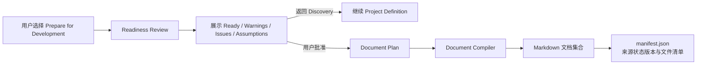

# Project Architect V1：Document Compilation System

> 文档状态：Phase 1.7 Blueprint  
> 依据：[02_SYSTEM_ARCHITECTURE.md](02_SYSTEM_ARCHITECTURE.md)、[03_AGENT_RUNTIME.md](03_AGENT_RUNTIME.md)、[04_PROJECT_STATE_MODEL.md](04_PROJECT_STATE_MODEL.md)  
> 范围：Markdown 文档的生成时机、数据来源、模板机制和 `AGENTS.md` 入口职责。  
> 非范围：完整 Markdown 模板正文、具体实现代码或自动 Coding。

## 1. 目标

Document Compilation System 将用户已批准的 Project State 转换为可交给 Coding Agent 的 Markdown 文档集合。

它的目标不是重新“写一份看起来完整的 PRD”，而是忠实地装配已经确认的项目定义，并显式保留仍然存在的 Warning、Assumption 和未决标记。

系统必须保证：

- 文档来自同一份规范 Project State。
- 文档生成不会创造、确认或覆盖任何产品事实。
- 用户批准是生成的前置条件。
- 每份文档有清晰职责，避免同一事实在多处无控制地重复。
- 每次生成都可追溯到具体 `stateRevision`。

## 2. 固定核心文档与动态专项规范

V1 每次成功生成都必须包含以下 **8 份固定核心文档**，并按需生成动态专项文档：

### 2.1 固定核心文档清单

| 文档 | 主要读者 | 唯一职责 |
| --- | --- | --- |
| `AGENTS.md` | Coding Agent 与开发者。 | 作为总入口、不可触碰边界说明与核心文档索引。 |
| `docs/PROJECT.md` | 开发者、Coding Agent。 | 说明项目整体定义、愿景目标、范围边界与生命周期阶段。 |
| `docs/PRODUCT.md` | 产品实现者。 | 说明目标用户、核心痛点、用户价值、产品目标、MVP 范围与核心功能列表。 |
| `docs/USER_FLOWS.md` | 产品与实现者。 | 说明主要用户旅程、交互入口、关键状态变迁与异常分支处理。 |
| `docs/UX_UI_SPEC.md` | UI/UX 与实现者。 | 说明页面结构、UX 体验基调、UI 约束、状态反馈与呈现规则。 |
| `docs/TECHNICAL_GUIDE.md` | 开发者、Coding Agent。 | **轻量技术指引**：说明已确认的平台与运行约束、已确认技术限制、推荐技术方向、Coding Agent 必须遵守的技术边界与数据/安全约束，以及哪些技术决定明确允许 Coding Agent 自行决定。 |
| `docs/DEVELOPMENT_PLAN.md` | 开发者、Coding Agent。 | 说明推荐开发顺序、模块依赖、阶段里程碑与范围控制。 |
| `docs/ACCEPTANCE.md` | 开发者、测试者、Coding Agent。 | 说明可验证的完成结果、验收准则、限制说明与已接受风险。 |

> **`TECHNICAL_GUIDE.md` 的职责边界**：必须保持轻量与边界清晰。它记录用户已确认的硬性技术约束与安全/平台底线，**严禁**把 Project Architect 变成全量系统架构师，不为所有项目虚构生成完整的数据库 Schema、全量 API 契约或基础设施拓扑。

### 2.2 动态专项文档（`docs/specs/`）

当且仅当 Project State 中确认包含特定领域的深度需求或高风险约束时，由 `document-plan` 推荐并生成对应的专项文档：

- `docs/specs/AI_SPEC.md`：当项目包含 AI 模型交互、Prompt 编排或 Token 成本保护时生成。
- `docs/specs/DESKTOP_SPEC.md`：当项目为桌面客户端且有系统原生集成/离线要求时生成。
- `docs/specs/SECURITY_SPEC.md`：当项目有明确凭证保管、隔离或高安全等级要求时生成。
- `docs/specs/SYNC_SPEC.md`：当项目涉及跨设备数据流动、冲突合并策略时生成。
- `docs/specs/PRIVACY_SPEC.md`：当项目有本地优先、隐私合规或零数据外流承诺时生成。

若项目无相关需求，则不生成对应的动态文档，绝不强制填充空泛模板。

## 3. 生成时机

Markdown 不是每次对话或编辑后的自动副作用。生成流程必须经过 Readiness 与用户批准。



### 3.1 允许生成的条件

Document Compiler 只在以下条件同时满足时运行：

1. 已存在当前 Readiness Snapshot。
2. 用户已明确批准生成，或明确批准带 Warning 继续。
3. Compiler 接收到一个完整、可读取的规范 Project State 版本。
4. 固定核心文档的来源数据可被解析。

`Not Ready` 不代表系统永久阻止用户。它要求系统先展示 Issues 与影响；只有用户按下述规则明确处置后，流程才可继续。

### 3.3 Readiness 例外处置

| 当前情况 | 默认是否可生成 | 允许的用户处置 | 文档必须保留 |
| --- | --- | --- | --- |
| `ready` | 可以。 | `approved`。 | 当前 Assumption 与相关 Warning。 |
| `ready-with-warnings` | 可以。 | `approved-with-warnings`。 | 每项 Warning。 |
| `not-ready`，仅有 High Issue / High Risk | 默认不可以。 | 用户逐项确认后可选择 `approved-with-known-issues`。 | 每项被确认的 Issue / Risk 与其影响。 |
| `not-ready`，存在 Open Critical Conflict | 默认不可以。 | 用户逐项确认 Conflict 与后果后可选择 `approved-with-critical-conflicts`。 | 两条冲突约束、后果和“未解决”的首要限制标记。 |

例外处置只授权文档生成，不改变 Gap、Risk 或 Conflict 的状态。Document Compiler 必须将这些内容保留为未决事实，而不是将其改写为已解决决定。

### 3.2 何时需要重新生成

用户更新 Project State 后，现有文档保留为上一次输出，但被标记为“基于旧状态版本”。系统不自动覆盖文档。

用户再次通过 Readiness 并批准后，Document Compiler 根据新的 `stateRevision` 重新生成文档。这样，文档内容与状态变更的关系始终可审阅。

## 4. 数据来源与优先级

Document Compiler 只读取已定义的数据来源，不从原始聊天记录或普通文本 Agent 回复推测事实。

| 优先级 | 规范来源 | 文档使用方式 |
| --- | --- | --- |
| 1 | `state/decisions.json` 中的 Confirmed 和 Locked 决定。 | 形成所有已确认的产品事实、范围与约束。 |
| 2 | `state/overview.json` 的 Section 结构与成熟度。 | 决定信息归属、章节编排和成熟度提示。 |
| 3 | `state/assumptions.json` 中 active Assumption。 | 在相关文档显式标注暂定默认值。 |
| 4 | `state/gaps.json`、`state/risks.json`。 | 将未决 Gap、真实 Conflict、Tension、Risk 作为 Warning、限制或待确认事项保留。 |
| 5 | `state/readiness.json` 的当前快照。 | 决定生成是否经过批准，以及哪些 Warnings / Issues 需保留。 |
| 6 | `document-compilation` 的已校验文档计划。 | 选择固定文档的覆盖范围和后续专项文档建议。 |

以下内容不能直接成为文档事实：

- AI 普通文本回复。
- 未被用户确认的 Recommendation。
- 被拒绝、被替代或过期的 Candidate。
- 无来源的历史对话摘录。

若某个文档所需信息尚未确认，Compiler 必须使用显式未决标记或引用已接受 Warning，而不是编造答案。

## 5. 模板机制

模板不是自由写作提示词。它是“文档职责 + 允许来源 + 编排规则 + 缺失处理”的声明式契约。

### 5.1 模板注册表

每个固定文档在模板注册表中定义：

- 文档路径和名称。
- 文档目标读者。
- 必须存在的章节。
- 每个章节允许读取的 Project State 区域。
- 可选章节的出现条件。
- 缺失数据时的显示规则。
- Warning、Assumption 和未决标记的放置规则。

所有固定核心文档的注册项不可被文档计划删除。

### 5.2 章节装配规则

Document Compiler 按以下顺序装配每份文档：

1. 固定文档标题和文档元信息。
2. 从允许来源读取 Confirmed 与 Locked 内容。
3. 根据 Overview Section 与成熟度编排章节。
4. 插入与本文件直接相关的 Assumption、Warning、Risk 或未决项。
5. 写入文档之间的明确引用，而不是复制大段内容。
6. 记录来源 `stateRevision`、生成时间和生成文件清单。

模板不得通过“为了完整”将 Candidate 伪装成决定，也不得把 AI 推荐写成已经批准的方案。

### 5.3 缺失与冲突处理

| 状态 | Compiler 行为 |
| --- | --- |
| 已确认内容 | 写入对应文档章节。 |
| Locked 决定 | 写入并标记为不可主动重开。 |
| Active Assumption | 写入相关的 Assumption / 注意事项区。 |
| Open Gap | 仅在与文档读者相关时作为未决标记保留。 |
| Open Conflict | 在项目、产品、验收或相关流程文档中明确说明两条无法同时满足的约束；若用户以 Critical Conflict 例外处置生成，它必须作为首要限制项。 |
| Risk / Tension | 作为风险、取舍或限制说明，不能写成 Conflict。 |
| 缺失必需数据 | 保留明确占位标记，并引用 Readiness Warning / Issue。 |

## 6. 各核心文档的数据契约

| 文档 | 必要数据 | 可选数据 | 不应包含 |
| --- | --- | --- | --- |
| `PROJECT.md` | 项目概述、目标、范围、阶段、Locked 决定。 | 关键 Warning、Readiness 摘要。 | 对话逐字记录、实现细节猜测。 |
| `PRODUCT.md` | 目标用户、核心问题、价值、产品目标、MVP、核心功能。 | Candidate 的明确待确认标记、相关 Risk。 | 未确认 Recommendation 作为正式需求。 |
| `USER_FLOWS.md` | Confirmed 的核心流程、用户动作、关键状态。 | 异常流程、Unresolved 流程断点。 | Agent 虚构的流程步骤。 |
| `UX_UI_SPEC.md` | 页面结构、UX 与 UI 方向、状态呈现要求。 | 可访问性或信任提示等已确认约束。 | 未确认的视觉或交互决定。 |
| `TECHNICAL_GUIDE.md` | 已确认平台与运行约束、技术限制、安全与性能硬边界。 | 推荐技术栈方向、允许 Coding Agent 自由决定的技术域。 | 虚构全量数据库表结构、全量 API 契约或基础设施拓扑。 |
| `DEVELOPMENT_PLAN.md` | 已确认 MVP 边界、依赖、开发阶段与范围限制。 | 风险驱动的验证顺序。 | 自动编码指令、未批准范围扩张。 |
| `ACCEPTANCE.md` | 已确认目标、流程、功能和可验证结果。 | 需人工确认的 Warning、已接受 Risk。 | 无法追溯到项目状态的验收条件。 |
| `AGENTS.md` | 项目目标、范围、Locked 决定、文档索引、开发顺序。 | 关键 Warning、Assumption、禁止事项。 | 全部需求的逐字副本。 |

## 7. `AGENTS.md`：Coding Agent 入口

`AGENTS.md` 是 Coding Agent 打开项目后的第一个导航点。它应让 Agent 在不浏览所有文件的情况下，先知道项目要实现什么、哪些边界不能突破、接下来应读什么。

### 7.1 核心职责

`AGENTS.md` 必须：

- 用简洁语言说明项目目标和面向的用户。
- 明确 V1 范围与不做事项。
- 列出用户已 Locked 的决定和不可主动推翻的约束。
- 指向每个核心文档及其唯一职责。
- 给出推荐阅读和开发顺序。
- 显式提示仍存在的 Warning、Assumption、Risk 或未决事项。
- 说明 Coding Agent 遇到未决事项时应查询哪份文档或要求用户确认。

### 7.2 内容边界

`AGENTS.md` 不应：

- 复制 `PRODUCT.md`、`USER_FLOWS.md` 或 `UX_UI_SPEC.md` 的完整正文。
- 将 Agent Recommendation、Candidate 或活跃 Assumption 伪装成确定要求。
- 擅自补充技术实现、任务估时、部署或自动执行指令。
- 覆盖更具体文档中已经定义的唯一事实来源。

它的工作方式是“入口 + 边界 + 索引”，不是“万能总文档”。

### 7.3 推荐阅读顺序

`AGENTS.md` 为 Coding Agent 提供如下阅读路径：

```text
AGENTS.md
  → PROJECT.md：总体目标、范围与约束
  → PRODUCT.md：用户价值、MVP 与核心功能
  → USER_FLOWS.md：用户路径与关键状态
  → UX_UI_SPEC.md：体验与页面要求
  → TECHNICAL_GUIDE.md：技术边界与运行约束
  → DEVELOPMENT_PLAN.md：推荐实现顺序
  → ACCEPTANCE.md：可验证的完成条件
  → docs/specs/*（若存在）：已确认专项规则
```

若专项文档生成，`AGENTS.md` 仅在索引区增加专项文档条目与适用条件，不复制正文内容。

## 8. 编译职责边界

| Document Compiler 负责 | 不负责 |
| --- | --- |
| 选择已批准状态版本并读取模板注册表。 | 重新分析项目、提出新产品结论或补齐未知需求。 |
| 将结构化状态编排为固定 Markdown 文档。 | 把 Candidate / Recommendation 升级为 Confirmed。 |
| 插入明确的 Assumption、Warning 和未决标记。 | 隐藏 Readiness 问题以生成“看起来完整”的文档。 |
| 生成文档清单和来源状态版本记录。 | 覆盖 Project State 或取代用户批准。 |
| 标记文档是否已过期。 | 自动在状态变更后反复生成文档。 |

AI 在本流程中最多提供一次 `document-plan` Task 的文档覆盖与专项推荐。最终 Markdown 装配、保存和生成记录属于程序确定性职责。

## 9. 输出与可追溯性

一次成功生成至少产生：

- 8 份固定核心 Markdown 文档（`AGENTS.md` 与 `docs/*.md`）。
- 0 ~ N 份动态专项规范文档（`docs/specs/*.md`）。
- `documents/manifest.json`，记录生成时间、`sourceStateRevision`、文件清单和未决标记。
- 文档状态：当前或已过期。

当前状态的 `stateRevision` 大于 `manifest.json` 的 `sourceStateRevision` 时，Frontend 必须提示文档可能已过期，并引导用户重新执行 Readiness 与生成流程。

## 10. 本阶段结论

V1 的 Document Compilation System 是一个受用户批准约束的本地编译过程。它从规范 Project State 和模板契约生成 8 份固定核心文档及必要的动态专项文档，并以 `AGENTS.md` 作为 Coding Agent 的入口。

文档系统不重新发明项目定义。它把已经确认的内容、明确的边界和仍需注意的未决项，可靠地交给后续开发工作。
