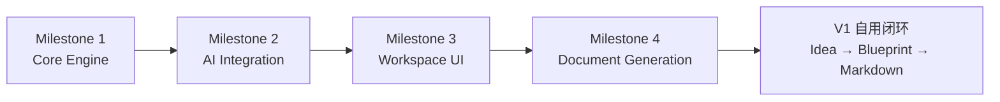

# Project Architect V1：Development Roadmap

> 文档状态：Phase 1.8 Blueprint  
> 依据：[01_PRODUCT_BOUNDARY.md](01_PRODUCT_BOUNDARY.md) 至 [07_DOCUMENT_SYSTEM.md](07_DOCUMENT_SYSTEM.md)  
> 范围：V1 自用闭环的里程碑、验收门槛与主要风险。  
> 非范围：商业化、企业能力、自动 Coding、Multi-Agent 与后续版本路线。

## 1. 路线目标

本路线按“先可信状态，再可信推理，再可用工作台，最后生成文档”推进。

每个 Milestone 都应形成独立可验证的能力。后续阶段只能建立在前一阶段已通过验收的基础上，不能用 UI 或文档掩盖状态和 Agent 行为问题。



## 2. 共通交付原则

- **自用优先。** 先支持单个开发者稳定完成自己的项目定义，不增加团队、组织、账户、计费或运营面板。
- **状态优先。** Project State 是事实来源；任何 UI、AI 结果和文档都不能维护独立事实。
- **B2.1 冻结。** 不在开发过程中重新设计 Constitution 或增加多 Agent。Agent 集成必须保持单 Agent、单次主要调用和结构化输出。
- **本地优先。** 项目材料、状态、历史和文档围绕本地项目闭环工作。
- **先验证再扩展。** 每个 Milestone 完成后都应执行与其风险相匹配的验收，不为赶进度跳过状态、结构化输出或用户授权检查。

## 3. Milestone 1：Core Engine

### 目标

建立不依赖 AI 或完整 Workspace 的 Project State 基础。完成后，系统能够在本地创建、读取、校验和安全更新一个项目的规范状态。

### 功能

- 创建和打开本地项目，维护 `project.json` 与 `state/` 目录。
- 按 [10_INPUT_MATERIAL_CONTRACT.md](10_INPUT_MATERIAL_CONTRACT.md) 保存文本、文件和图片材料，并维护其可分析状态。
- 实现 [04_PROJECT_STATE_MODEL.md](04_PROJECT_STATE_MODEL.md) 中的文件结构、格式校验和 `stateRevision`。
- 建立 Decisions、Assumptions、Gaps、Questions、Risks、Readiness 和 Overview 的读写模型。
- 实现 Candidate、Confirmed、Locked、Superseded 与 Rejected 的合法状态转换。
- 实现用户确认、直接编辑、显式锁定、解锁和替代的确定性规则。
- 建立 Overview 引用规范状态而非复制事实的投影机制。
- 记录文档是否基于当前状态版本，为 Milestone 4 预留追溯基础。

### 验收标准

- 可以创建一个空项目，并生成所有必需状态文件的有效初始内容。
- 文本、支持的文件和支持的图片可形成本地 `inputRef`；不可处理材料有明确失败状态，不能伪装为已分析。
- 关闭并重新打开项目后，Project State、状态标签和 `stateRevision` 保持一致。
- 发生中断或写入失败后，启动恢复会回到最后一个完整 Revision，不会暴露部分更新状态。
- 用户确认可以将 Candidate 升级为 Confirmed；只有明确锁定动作才能产生 Locked。
- 用户修改 Locked 决定时保留旧记录与影响信息，不能静默覆盖。
- Assumption 被确认后会转换为关联 Decision，而不是被直接伪装为 Confirmed。
- 无效引用、非法状态转换或不完整状态写入不会部分污染项目状态。

### 主要风险

| 风险 | 影响 | 控制方式 |
| --- | --- | --- |
| 多个 JSON 文件间的状态漂移。 | Overview、问题和文档可能引用过期事实。 | 以规范记录和稳定 ID 为中心；Overview 只保存结构和引用。 |
| 状态模型过早膨胀。 | 自用闭环变慢，开发被元数据淹没。 | 只实现 Phase 1.4 已定义的文件和状态，不增加权限、完整需求图或复杂历史系统。 |
| 直接编辑语义不清。 | 用户修改可能被误认为 Agent 建议或自动 Lock。 | 明确记录用户来源；直接编辑不自动 Lock；所有高影响变化保留影响提示。 |

### 完成门槛

Milestone 1 完成后，必须能在不调用 AI 的情况下用受控测试数据走通项目状态的创建、确认、锁定、修改、重新加载和校验。

## 4. Milestone 2：AI Integration

### 目标

将已冻结的 B2.1 Agent Runtime 接入 Core Engine，使复杂理解、Gap 发现、推荐与问题生成能安全地返回 Project State 建议。

### 功能

- 实现 [05_AI_PROVIDER.md](05_AI_PROVIDER.md) 定义的统一 Provider Request 与 Structured Result 契约。
- 接入 Antigravity CLI 作为 V1 默认 Provider，保留未来 Adapter 的抽象边界。
- 使用 `structured_output` 作为唯一状态相关结果来源，保留原始封套与可用调用指标。
- 接入冻结的 B2.1 Constitution 与三大 Task Mode：`discovery-turn`、`readiness-review`、`document-plan`。
- 实现 Context Manager 的 Relevant Context Selection、长度预算和任务级上下文裁剪。
- 将 Agent 结果经过 Schema、B2.1 分类、用户授权和 Locked 检查后映射为建议状态变更。
- 实现 Provider 失败、超时、结构化缺失和异常成本的可见处理；失败时状态不变。
- 将现有 B2.1 Benchmark 作为 Agent 行为回归证据，而不是重新引入 Prompt 探索。

### 验收标准

- 每个需要推理的语义操作只触发一次主要 Provider 调用；本地操作不调用 AI。
- `structured_output` 成功且通过 Schema 校验后，才会生成状态变更建议。
- Agent 不能直接将推断写入 Confirmed 或 Locked；State Engine 能拒绝越权更新。
- 对模糊 Idea，首次分析先输出理解状态，不直接生成问卷。
- 对真实硬约束矛盾，结果能保留 Conflict；普通风险、复杂度和取舍不会被程序错误升级为 Conflict。
- 输出与调用失败均可追溯；失败、超时或结构化缺失不改变 Project State。
- 集成验证保持 B2.1 的产品先于技术、Capability Before Mechanism 与单次调用行为。

### 主要风险

| 风险 | 影响 | 控制方式 |
| --- | --- | --- |
| Provider 版本或本地环境差异。 | 调用失败或结构化结果变化。 | 通过 Provider Adapter 隔离；记录原始封套、退出状态和可用用量。 |
| Token 或耗时异常。 | 自用体验不稳定，成本不可控。 | 任务级最小上下文、单次调用、指标记录与异常成本保护。 |
| Prompt 或 Schema 在集成中漂移。 | 已验证的 B2.1 行为退化。 | 版本化冻结资产；用现有 Regression fixtures 验证关键行为。 |
| Agent 结果污染状态。 | 用户信任和后续文档可靠性受损。 | Schema、来源、分类、授权和 Locked 五层校验后再写入。 |

### 完成门槛

Milestone 2 完成后，使用一个最小本地操作入口即可完成：提交 Idea → 首次理解 → Gap / 问题建议 → 用户确认 → State 更新，并能查看一次调用的结构化结果与诊断。

## 5. Milestone 3：Workspace UI

### 目标

将 Core Engine 和 Agent Runtime 变成个人开发者可持续使用的单项目工作台。

### 功能

- 实现轻量首页：产品说明、Idea 输入与 Recent Projects。
- 实现三栏 Workspace：左侧 Navigation、中栏 Chat、右侧 Project Overview。
- 实现 Chat 中的首次理解、Gap / Warning、Recommendation、Question 和用户回答工作单元。
- 实现 Question UI：重要性、为什么现在问、推荐、选项影响和自由输入。
- 实现 Overview 固定与动态 Section、信息状态、成熟度、直接编辑和 Locked 操作。
- 实现 Files、Documents、Settings 的最小导航入口，不扩展为文件管理器、协作中心或运营面板。
- 实现 Readiness UI：Ready、Warnings、Issues、Assumptions、返回 Discovery 与明确批准动作。
- 显示 Agent 调用中的必要状态与失败提示，但不将诊断数据变成复杂仪表盘。

### 验收标准

- 用户可从首页创建或恢复一个项目，并进入同一份 Project State 对应的 Workspace。
- 用户提交 Idea 后，先看到结构化首次理解和 Overview 更新，而不是固定问卷。
- 用户能在 Chat 回答、以自由文本纠正、在 Overview 直接编辑，并在两个位置看到一致的状态结果。
- High / Critical 问题清楚显示原因、推荐和自由输入；选择一个选项不自动视为确认。
- V1 Runtime 对 Normal 问题最多返回两个紧密相关问题；UI 不得扩大该预算。
- 用户可显式锁定 Confirmed 决定；Locked 状态在 Overview 和后续对话中保持可见。
- Readiness UI 能解释继续、返回 Discovery 或带 Warning 批准的含义。
- 对 High Issue 与 Open Critical Conflict，Readiness UI 只在逐项确认后显示对应的例外生成动作，并保留未决标记。
- 首页和 Workspace 没有团队、商业化、跨项目任务管理、复杂统计或自动 Coding 功能。

### 主要风险

| 风险 | 影响 | 控制方式 |
| --- | --- | --- |
| UI 过早变成复杂 Dashboard。 | 用户注意力离开当前项目定义。 | 只保留首页、三栏 Workspace 和当前下一步；所有附加视图必须证明自用闭环价值。 |
| Chat 与 Overview 呈现不一致。 | 用户不知道哪个内容可信。 | 两者只读取同一规范 Project State；Frontend 不缓存独立事实。 |
| 直接编辑与对话更新相互冲突。 | 用户担心 AI 覆盖自己的决定。 | 明确显示来源、影响和确认动作；由 State Engine 统一处理。 |
| Agent 等待时间破坏工作流。 | 用户重复提交或放弃。 | 显示单次操作进行状态和可恢复失败提示；不以隐藏重试掩盖问题。 |

### 完成门槛

Milestone 3 完成后，个人用户可以在实际 Workspace 中完成一个项目的 Idea 输入、理解确认、Gap 驱动问答、Overview 编辑 / Lock 和 Readiness 审阅。

## 6. Milestone 4：Document Generation

### 目标

从用户批准的 Project State 生成稳定、可追溯、可交给 Coding Agent 的 Markdown 文档集合，完成 V1 闭环。

### 功能

- 实现 [07_DOCUMENT_SYSTEM.md](07_DOCUMENT_SYSTEM.md) 定义的 Document Plan 与模板注册表。
- 根据用户批准的 `stateRevision` 装配 8 份固定核心文档：`PROJECT.md`、`PRODUCT.md`、`USER_FLOWS.md`、`UX_UI_SPEC.md`、`TECHNICAL_GUIDE.md`、`DEVELOPMENT_PLAN.md`、`ACCEPTANCE.md` 与 `AGENTS.md`，并按需装配动态专项文档（`docs/specs/*.md`）。
- 实现 `AGENTS.md` 的入口、边界、索引与推荐阅读顺序。
- 生成 `documents/manifest.json`，记录来源状态版本、生成时间、文件清单和未决标记。
- 在 Documents UI 中展示、打开和导出文档，显示它们是否已过期。
- 当用户修改状态后，提示需要重新执行 Readiness 与批准，避免自动覆盖文档。

### 验收标准

- 用户完成 Readiness 并明确批准后，系统生成全部 8 份固定核心 Markdown 文档、按需动态专项文档和有效 `manifest.json`；例外处置时相应 High Issue 或 Critical Conflict 必须保留在文档中。
- 每份文档可追溯到同一个 `sourceStateRevision`。
- `AGENTS.md` 能引导 Coding Agent 了解项目目标、范围、Locked 决定、禁止事项、文档索引和推荐阅读顺序，而不复制全部文档正文。
- Confirmed 与 Locked 内容正确进入文档；Assumption、Warning、Risk、Conflict 和未决项保持显式可见。
- 未确认 Candidate、普通 Agent Recommendation 和无来源内容不会被写成确定需求。
- 状态变化后，旧文档被标记为过期；系统不会未经用户批准自动重写它们。
- 用户可以在 Documents 区查看和导出文档，但不能通过文档编辑绕过 Project State。

### 主要风险

| 风险 | 影响 | 控制方式 |
| --- | --- | --- |
| 文档看起来完整但遗漏未决项。 | Coding Agent 将错误假设当成事实。 | 模板强制插入相关 Assumption、Warning、Risk 与未决标记。 |
| 文档间重复或矛盾。 | 后续开发读者无法判断哪份可信。 | 每份核心文档有唯一职责；使用状态引用和明确文档索引。 |
| 文档过期不明显。 | 开发使用旧范围或旧约束。 | manifest 记录来源版本；当前状态版本变化后显式标记过期。 |
| 文档系统范围膨胀。 | 变成全文编辑器、知识库或自动开发平台。 | V1 只生成固定核心 Markdown，不引入协作、版本库集成或自动执行。 |

### 完成门槛

Milestone 4 完成后，个人用户能从一个真实 Idea 走完：

```text
Idea
  → 首次理解
  → Gap 驱动澄清
  → Overview / Readiness
  → 用户批准
  → 七份 Markdown 文档
  → Coding Agent 输入
```

## 7. V1 完成定义

V1 达成的不是“功能列表全部出现”，而是以下自用闭环可靠成立：

1. 用户可创建和恢复本地项目。
2. 用户可用文本、文件或图片开始项目理解。
3. B2.1 能以结构化、单次推理方式发现关键 Gap 并提出产品级问题。
4. 用户可查看、确认、编辑、锁定和追踪项目定义。
5. Readiness 能清楚说明是否存在重要未决事项。
6. 用户可在明确批准后得到可靠、可追溯的 Markdown 开发文档。

不属于 V1 完成定义的内容包括：付费与订阅、账户体系、团队协作、企业权限、云同步、市场化数据面板、自动代码修改、开发监督或 Multi-Agent 协作。

## 8. 本阶段结论

路线将 V1 拆为四个风险递减的里程碑：先让状态可信，再让 AI 可控，再让个人使用流畅，最后让文档可交付。

这种顺序支持自用优先：每个阶段都服务于同一个人的真实项目定义工作，而不是为未来商业化或企业扩张预先增加复杂度。
