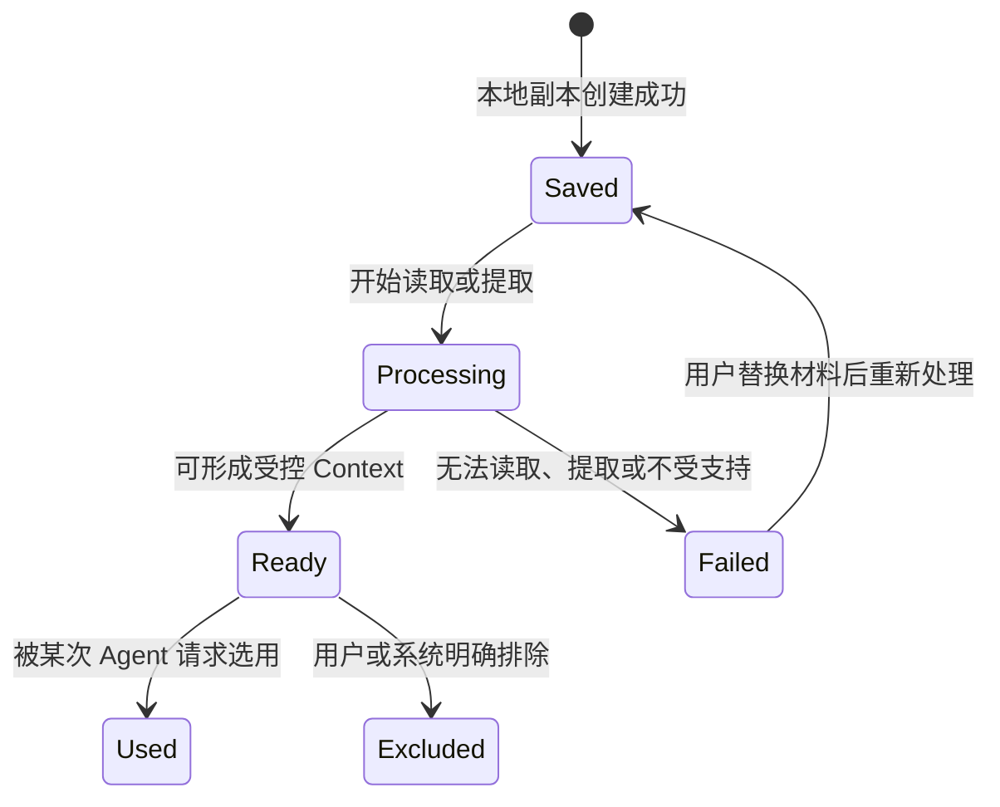

# Project Architect V1：Input Material Contract

> 文档状态：Blueprint Revision  
> 依据：[03_AGENT_RUNTIME.md](03_AGENT_RUNTIME.md)、[04_PROJECT_STATE_MODEL.md](04_PROJECT_STATE_MODEL.md)、[05_AI_PROVIDER.md](05_AI_PROVIDER.md)  
> 范围：V1 文本、文件与图片材料的本地保存、可分析状态和 Context 使用边界。  
> 非范围：外部链接、Git 仓库导入、历史聊天导入或通用文件管理功能。

## 1. 目标

输入材料必须在进入 Agent 前成为可追溯的本地项目资产。系统需要知道材料是什么、是否可读、是否已被纳入分析，以及是否允许进入当前 Context。

材料本身不是项目事实。上传一个文件或图片不会自动创建 Confirmed 决定；只有用户明确表达和后续用户确认才能改变项目定义。

## 2. V1 材料范围

| 类别 | V1 支持 | 可分析条件 |
| --- | --- | --- |
| 文本 Idea | 直接输入的纯文本。 | 成功保存后可立即用于 `idea-analysis`。 |
| 文本文件 | `.txt`、`.md`。 | 本地读取成功并生成文本摘录。 |
| 文档文件 | `.pdf`、`.docx`。 | 可提取可读文本；提取失败时不假装已理解。 |
| 图片 | `.png`、`.jpg`、`.jpeg`、`.webp`。 | 当前 Provider 可接受该图片作为受控 Context，或已有可信的本地文字提取结果。 |

每个材料最大 20 MB；一次提交最多 10 个材料。超出限制时，系统拒绝本次材料并给出明确原因，不创建“已分析”的记录。

## 3. 本地存放与引用

每个项目在根目录下维护材料目录：

```text
project/
├── inputs/
│   └── <input-id>/
│       ├── source.<extension>
│       └── extraction.json
├── project.json
├── state/
└── documents/
```

- `source.<extension>` 保存用户提交的原始材料副本。
- `extraction.json` 保存本地材料处理的状态、可供 Context 使用的摘录及失败原因；它不保存 Agent 推断。
- `project.json.inputRefs` 保存稳定 `input-id`、类型、相对存储引用、状态和是否可用于分析。

材料以项目相对引用关联。移动整个项目目录后，材料仍应能被重新定位。

## 4. 材料状态生命周期



`Used` 是使用记录，不是事实状态。材料可在后续相关 Task 中再次被选用；Context Manager 仍必须根据相关性和预算决定是否使用。

## 5. 处理与失败规则

| 情形 | System 行为 | Agent 行为 |
| --- | --- | --- |
| 支持的文本或文档可读 | 保存材料，生成受限长度的摘录，标记 `ready`。 | 只读取当前 Task 选中的摘录。 |
| 图片可由当前 Provider 处理 | 保存原图，标记 `ready`，在相关单次请求中受控传入。 | 将图片作为用户提供的证据，不把视觉推断自动升级为 Confirmed。 |
| 图片无法由当前 Provider 处理 | 保存并标记 `failed` 或 `unavailable`，提示用户补充文字说明。 | 不虚构图片内容。 |
| 提取失败或格式不支持 | 保留失败状态与原因；用户可替换或移除材料。 | 不将该材料纳入 Context。 |
| 材料过大或超过提交数量 | 拒绝本次材料并显示限制。 | 不调用 Agent。 |

V1 不应为了支持材料输入而增加第二次隐蔽 Agent 调用。材料的可读性与 Context 可用性由本地处理和 Provider 能力检查决定。

## 6. Context 使用边界

Context Manager 只使用 `ready` 的材料，并且每次仅选择与当前 Task 相关的部分：

1. 当前用户正在提交或明确引用的材料。
2. 与当前 Gap、Question 或 Readiness 区域直接相关的材料。
3. 满足长度预算的文本摘录或图片引用。

默认不传递：

- 项目内所有原始文件。
- 未被当前任务引用的图片。
- 提取失败、已排除或用户已替代的材料。
- 整份长文档的逐字内容。

材料摘录必须保留其 `input-id`，使 Agent 产生的 Candidate、Risk 或 Gap 能回到用户提供的证据。Agent 不能把材料存在本身当作用户批准。

## 7. 隐私与可见性

- 原始材料和提取结果默认保留在本地项目目录。
- 仅被 Context Manager 选中的必要摘录或图片，才会在一次 Provider 请求中离开本地运行环境。
- Frontend 的 Files 区必须展示每个材料的类型、处理状态、是否已用于分析和失败原因。
- 用户可以在后续请求中排除材料；排除只影响未来 Context，不删除既有项目状态或历史生成文档。

## 8. 验收条件

Input Material Contract 在 Milestone 1 / 2 满足以下条件后通过：

- 文本、支持的文件和支持的图片都可形成带稳定 ID 的本地 `inputRef`。
- 每份材料都有明确的 `saved`、`ready`、`failed` 或 `excluded` 状态。
- 无法处理的图片或文档不会被标记为已分析。
- Agent 请求只收到当前相关且处于 `ready` 状态的材料。
- 材料引用不会自动变成 Confirmed 项目事实。
- 用户在 Files 区可看到材料状态并理解其是否参与了分析。

## 9. 本阶段结论

V1 的文件与图片输入保持简单：材料先本地保存，再获得明确的可分析状态，最后由 Context Manager 在一次相关 Agent 调用中按需使用。

该契约使“支持文件和图片输入”成为可测试能力，同时不扩大为通用文件系统、外部导入平台或额外 Agent 工作流。
