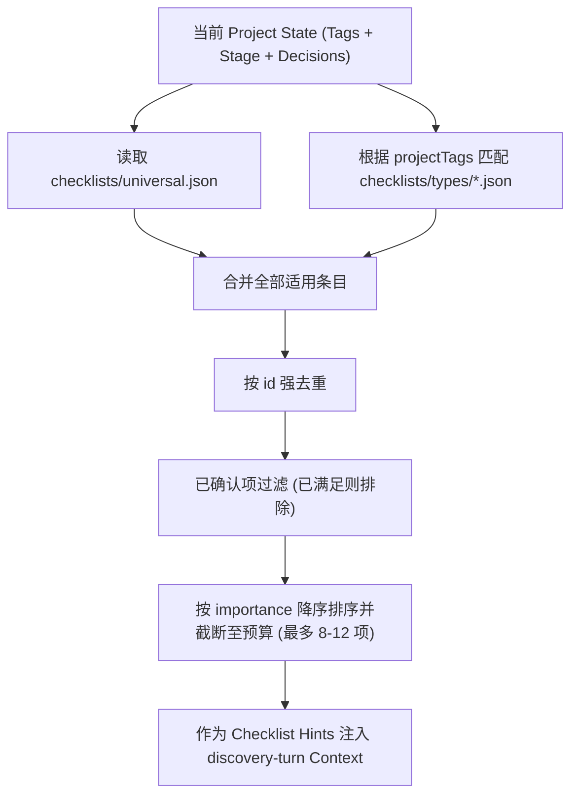
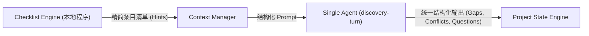

# Project Architect V1：Checklist Engine 设计

> B3 更新：自适应 Discovery 运行时与多问题集预算以 [12_B3_ADAPTIVE_DISCOVERY.md](12_B3_ADAPTIVE_DISCOVERY.md) 为唯一权威生产契约；本文中的旧 B2.1 描述仅为历史背景。
> 文档状态：Phase 0 Blueprint Finalization  
> 依据：[01_PRODUCT_BOUNDARY.md](01_PRODUCT_BOUNDARY.md)、[02_SYSTEM_ARCHITECTURE.md](02_SYSTEM_ARCHITECTURE.md)、[03_AGENT_RUNTIME.md](03_AGENT_RUNTIME.md)  
> 范围：Universal 与 Type Checklists 的结构定义、合并选择算法、与 `discovery-turn` 的 Context 交互边界。  
> 非范围：复杂需求依赖图（DAG）、追踪矩阵、企业合规引擎或繁重的规则编译器。

---

## 1. 目标与定位

Checklist Engine 是 Project Architect 发现产品缺口（Gap Detection）的**确定性辅助支架**。

它与 LLM 动态推理形成双重保障：
```text
Universal Checklist (通用产品底线)
+
Project Type Checklists (领域专项底线)
+
LLM Dynamic Discovery (动态发散推理)
        ↓
统一输出高价值 Gap 与排序后的决策问题
```

### 核心设计原则
1. **检查“结论清晰度”，而非“是否问过”**：
   Checklist 评估的是：*“当前 Project State 中关于该条目的产品定义是否已经足够明确、具体、可被 Coding Agent 执行”*。只要结论尚未闭合，该项就属于 Open Gap，绝不是单纯记录“是否向用户抛出过该问题”。
2. **轻量静态数据驱动**：
   Checklist 条目使用本地 JSON 文件存储，支持按类型组合，无需复杂的规则引擎或数据库。
3. **有限 Context 注入**：
   程序负责根据项目 Tags 进行条目匹配、去重与优先级截断，只把当前最相关的精简 Checklist 提示送入 `discovery-turn`，严格受控于 Token 预算。
4. **不限制 LLM 动态发现**：
   Checklist 是产品完整度的“安全网”，LLM 依然完全允许发现 Checklist 未覆盖的新颖业务 Gap。

---

## 2. 本地目录与文件组织

Checklist 资源位于工程根目录下的 `checklists/`：

```text
checklists/
├── universal.json                  # 所有软件项目通用的核心底线 (MVP、用户、主流程等)
└── types/                          # 按项目类型/特征划分的专项 Checklist
    ├── desktop-app.json            # 桌面应用 (系统集成、离线可用、窗口生命周期)
    ├── web-app.json                # Web 应用 (响应式、浏览器兼容、网络异常)
    ├── ai-product.json             # AI 产品 (Prompt 编排、降级策略、Token 成本、模型不可靠性)
    ├── developer-tool.json         # 开发者工具 (CLI/API 易用性、配置管理、工作区侵入性)
    ├── local-first.json            # 本地优先 (数据所有权、存储格式、多端冲突展示)
    └── utility-tool.json           # 效率/小工具 (单功能闭环、无感启动、轻量开销)
```

---

## 3. Checklist 数据契约 (JSON Schema)

每个 Checklist 文件都是一个轻量 JSON 列表，条目定义如下：

```json
{
  "type": "object",
  "required": ["id", "area", "criterion", "importance", "applicableWhen"],
  "properties": {
    "id": {
      "type": "string",
      "description": "稳定唯一标识，如 chk-univ-mvp-boundary"
    },
    "area": {
      "type": "string",
      "description": "所属产品领域，如 mvp_scope, user_flow, platform, security"
    },
    "criterion": {
      "type": "string",
      "description": "用于评估该条目是否已明确的具体判断标准（产品级语言）"
    },
    "importance": {
      "enum": ["normal", "high", "critical"],
      "description": "重要性等级，直接影响 Gap 排序与提问优先级"
    },
    "applicableWhen": {
      "type": "object",
      "properties": {
        "tags": {
          "type": "array",
          "items": { "type": "string" },
          "description": "适用的项目 Tags（空表示无条件适用）"
        },
        "stage": {
          "type": "array",
          "items": { "type": "string" },
          "description": "适用的生命周期阶段"
        }
      }
    }
  }
}
```

### 3.1 核心条目示例

#### `universal.json` 示例
```json
[
  {
    "id": "chk-univ-target-user",
    "area": "target_user",
    "criterion": "核心目标用户画像及其明确的使用场景与痛点已被陈述，无模糊泛化群组。",
    "importance": "critical",
    "applicableWhen": {}
  },
  {
    "id": "chk-univ-mvp-boundary",
    "area": "mvp_scope",
    "criterion": "MVP 首发版本的功能边界已明确排除次要特性，不存在无节制的范围扩张。",
    "importance": "critical",
    "applicableWhen": {}
  },
  {
    "id": "chk-univ-primary-flow",
    "area": "user_flow",
    "criterion": "核心端到端主流程有明确的输入、关键处理分支与交付产物闭环。",
    "importance": "high",
    "applicableWhen": {}
  },
  {
    "id": "chk-univ-success-signal",
    "area": "acceptance",
    "criterion": "项目有一项可被直观验证的完成信号或验收标准。",
    "importance": "normal",
    "applicableWhen": {}
  }
]
```

#### `types/ai-product.json` 示例
```json
[
  {
    "id": "chk-ai-fallback-policy",
    "area": "trust_safety",
    "criterion": "当底层 AI 出现幻觉、超时、网络中断或格式错误时，产品有明确的降级呈现承诺。",
    "importance": "high",
    "applicableWhen": { "tags": ["AI Product", "AI 工作台"] }
  },
  {
    "id": "chk-ai-cost-guardrail",
    "area": "technical_boundary",
    "criterion": "有明确的 Token 消耗防护预期或长文本截断策略，避免单次调用成本失控。",
    "importance": "normal",
    "applicableWhen": { "tags": ["AI Product"] }
  }
]
```

---

## 4. 条目合并与选择算法 (Selection & Deduplication)

程序（`packages/core`）在每次发起 `discovery-turn` 前，按以下确定性算法进行条目组装：



### 4.1 运行步骤
1. **多 Tag 匹配**：一个项目可以同时具有多个标签（例如 `["Desktop App", "AI Product", "Local-First"]`），系统同时加载对应类型的 JSON 文件。
2. **合并与去重**：以条目 `id` 为主键去重；若同 ID 在不同类型出现，保留 `importance` 更高的一项。
3. **状态比对过滤**：若某条目对应的 `area` 在 `state/decisions.json` 中已有满足条件的 `Confirmed` 或 `Locked` 记录，且成熟度为 `clear` / `locked`，则在本次 Context 中省略，减少 Token 浪费。
4. **数量上限截断**：单次注入 Prompt 的 Checklist 提示严格限制在 **8 ~ 12 项**以内（优先 Critical 与 High），绝不传递整库。

---

## 5. 与 Agent Runtime 的交互边界



- **Checklist 不是问卷**：Checklist 条目不直接作为问题展示给用户，而是作为 **Agent 审查视角的提示词（Review Lens）**。
- **Agent 执行综合仲裁**：Agent 结合用户的实际材料与 Checklist Hints，判断哪些是当前最紧迫的 Gap，并按照 B3 Constitution（参见 [12_B3_ADAPTIVE_DISCOVERY.md](12_B3_ADAPTIVE_DISCOVERY.md)）转换为符合预算的高价值 Question 与 Recommendation。
- **严禁过度设计**：V1 坚决不引入 DAG 拓扑排序、不引入有向无环依赖图、不引入追踪矩阵。简单的标签匹配 + 优先级截断足以支撑个人开发者的自用闭环。
