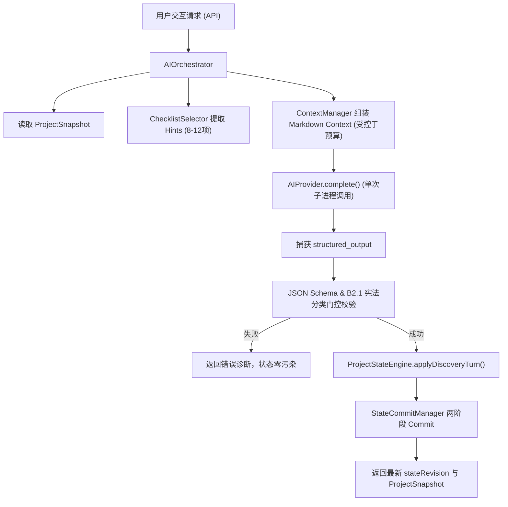

# Project Architect V1 — Phase 2：Discovery Intelligence 实施蓝图

> **文档状态**：Official Phase 2 Implementation Blueprint  
> **依据**：[03_AGENT_RUNTIME.md](03_AGENT_RUNTIME.md)、[11_CHECKLIST_ENGINE.md](11_CHECKLIST_ENGINE.md)、`experiments/agent-benchmark/prompts/constitution-b2-1.md`  
> **核心目标**：将冻结的 B2.1 Discovery Agent 与 Phase 1 Core Engine 深度集成，实现产品缺口发现（Gap Detection）、智能问题优先级排序（Question Prioritization）、假设管理（Assumption Policy）与准备度基础（Readiness Foundation）。

---

## 1. 目标与非目标 (Goals & Non-goals)

### 1.1 Phase 2 核心闭环
```text
Idea / User Input
       ↓
Unified Discovery Turn (单次 AI 推理)
       ↓
Gap Detection (Checklist + 动态缺口)
       ↓
Question Prioritization (7 级优先级与受控预算)
       ↓
User Answer / Action
       ↓
Project State Commit (两阶段原子更新)
       ↓
Readiness Progress (准备度持续推进)
```

### 1.2 严正声明：Phase 2 不做事项 (Non-goals)
- ❌ **不做 Markdown 文档生成与编译器**（属于 Milestone 4）。
- ❌ **不做 React 完整前端界面**（属于 Milestone 3）。
- ❌ **不做自动 Coding Agent 或代码补全**。
- ❌ **不做 Multi-Agent 流水线或角色轮流辩论**。
- ❌ **不做数据库、ORM 或云端中心化服务**。
- ❌ **不做企业级权限、多租户与组织管理**。

---

## 2. 核心模块详细设计 (Architecture Modules)

---

### Module 1: Gap Detection Engine（产品缺口发现引擎）

#### 目标
系统化识别项目当前定义中缺失的关键产品信息，形成结构化 `GapItem`。

#### 输入与数据流
- `ProjectSnapshot`：当前项目的全部决策、状态阶段与已明确事实。
- `ChecklistHints`：由 `ChecklistSelector` 从 `universal.json` 与 `types/*.json` 筛选出的高质量底线准则（8~12 项）。
- `DiscoveryResult`：Agent 本轮单次推理输出的结构化 `gaps` 数组。

#### 缺口来源三维结合矩阵
```text
Universal Checklist (通用产品质量底线：MVP边界、目标用户、主流程)
       +
Project Type Checklist (领域特征底线：桌面离线、开发者工具侵入性等)
       +
LLM Dynamic Discovery (Agent 针对特定业务场景发散发现的新颖缺口)
       ↓
统一映射为规范 GapItem 存入 state/gaps.json
```

#### 设计约束
- **严禁引入 Requirement DAG 或复杂知识图谱**。
- 缺口只关注“产品结论是否闭合清晰”，不关注是否展示过问卷。

---

### Module 2: Question Engine（智能提问与优先级引擎）

#### 目标
从当前发现的 Gaps、Tensions 与 Conflicts 中，按照 B2.1 宪政选择最高价值的事项，生成严格受控的问题与推荐。

#### 2.1 B2.1 严格 7 级提问优先级 (Question Priority)
当存在多个 Open Gap 时，提问顺序必须严格遵循以下梯队：
1. **Product Identity（产品本体与定位）**：这个产品是什么？它坚决不是什么？
2. **Target User（核心目标用户）**：最核心的用户是谁？在什么具体场景下使用？
3. **Core Workflow（核心主流程闭环）**：端到端的主流程输入、处理与交付物是什么？
4. **MVP Scope（首发版本边界）**：第一版必须排除哪些次要特性？
5. **Safety / Trust（信任与安全底线）**：离线可用性、数据所有权与降级呈现承诺。
6. **UX Tradeoff（体验与复杂度权衡）**：易用性与高级灵活度之间的取舍。
7. **Technical Constraint（硬性技术底线）**：操作系统、平台环境与运行约束（严禁提前提问机制细节）。

#### 2.2 严格受控的提问预算 (Question Budget)
| 重要性级别 (Importance) | 提问数量限制 | 处置规则 |
| :--- | :---: | :--- |
| **Critical / High** | **1 个核心问题** | 聚焦当前首要阻塞项；必要时最多允许 +1 个强直接依赖子问题。 |
| **Normal** | **最多 2 个问题** | 仅当两个问题高度关联且属于同一产品领域时允许同时呈现。 |
| **Low** | **0（默认不提问）** | 属于可逆常规细节，严格走 Assumption Policy 自动记录为假设。 |

#### 2.3 问题数据结构要求
每个 `QuestionItem` 必须包含以下完整字段（缺失任何一项均为非法）：
```typescript
interface QuestionItem {
  id: string;                       // e.g. "q-01"
  issueRef: TypedRef;               // 关联的 gap/conflict/risk 引用
  importance: 'critical' | 'high' | 'normal';
  question: string;                 // 明确的问题题干
  reason: string;                   // 为什么现在问（阻塞了什么）
  recommendation: string;           // 产品级推荐方向（严禁输出具体数据库/框架名）
  recommendationReason: string;     // 推荐理由与权衡
  options: Array<{
    label: string;
    impact: string;
  }>;
  allowFreeInput: true;             // 恒为 true
}
```

---

### Module 3: Assumption Policy（假设与可逆性策略）

#### 目标
避免在早期构思阶段用大量细枝末节打扰用户，以显式假设保持思考连贯性。

#### 3.1 风险分级处置策略
- **Low-risk（低风险 / 高可逆 / 行业通用惯例）**：
  Agent 自动将其作为 `Assumption` 写入 `state/assumptions.json`（`status: 'active'`），不向用户发起 Question。
- **Medium-risk（中等风险 / 局部影响）**：
  作为 `Candidate` 或附带在 Recommendation 中呈现，由用户在正常交互中顺带确认。
- **High-risk / Irreversible（高风险 / 架构级不可逆）**：
  **严禁作为 Assumption 盲目假设**，必须提升为 `Critical/High Question` 强制要求用户决策。

#### 3.2 绝对禁止项：技术机制假设
- ❌ **严重违规**：“默认假设使用 SQLite 保存数据”、“默认假设采用 JWT 认证”、“默认假设采用 WebSocket 同步”。
- ✅ **正确范式**：“假设首发版本仅支持单用户本地数据读写，暂不考虑多端同步冲突”（基于产品能力，而非技术机制）。

---

### Module 4: Discovery Turn Runtime（单次统一推理运行时）

#### 目标
确保 Agent 交互在底层系统中的单次调用纯粹性与状态安全隔离。



- **单次调用保证**：单次用户输入仅触发一次主要 Provider 调用，严禁内部伪装发起多次调用。
- **Schema 门控**：所有状态输出 100% 经由 `b2-unified.schema.json` 强校验。

---

### Module 5: Readiness Foundation（准备度底线审阅）

#### 目标
为项目提供明确的“构思成熟度”评估模型，指出进入下一阶段前的遗留风险。

#### 5.1 核心检查领域 (Required Areas)
1. **Product Identity & Goals**（产品定位与核心目标明确）
2. **Target User Profile**（目标用户与痛点场景闭合）
3. **MVP Scope Boundary**（首发版本边界无失控蔓延）
4. **Primary User Flow**（端到端主流程清晰可验证）
5. **UX & UI Direction**（核心体验原则确定）
6. **Safety & Technical Boundary**（离线/安全/平台运行底线确定）

#### 5.2 输出报告快照 (`ReadinessSnapshot`)
```typescript
interface ReadinessSnapshot {
  id: string;
  status: 'ready' | 'ready-with-warnings' | 'not-ready';
  reviewedAt: string;
  requiredAreas: string[];
  warnings: string[];               // 存在未完全闭合的 Medium 缺口或假设
  issues: string[];                 // 存在未解决的 Critical/High 缺口或冲突
  assumptionRefs: AssumptionRef[];
  userDisposition: UserDisposition;
}
```
