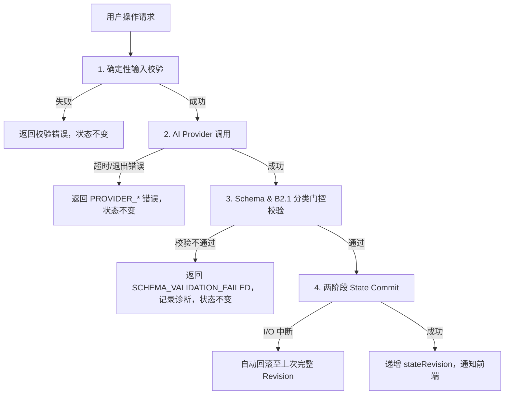

# Project Architect V1：错误处理体系与状态安全隔离

> 文档状态：Phase 0 Engineering Blueprint  
> 范围：全系统错误代码表、恢复策略与状态隔离原则。  
> 核心原则：**AI 推理失败、超时或 Schema 校验失败，绝不能部分污染 Project State。**

---

## 1. 错误数据结构定义

所有通过 API 或子系统边界抛出的错误，必须严格遵循统一格式：

```typescript
export interface ApiErrorPayload {
  code: ErrorCode;
  message: string;
  recoverable: boolean;
  details?: Record<string, unknown>;
  requestId?: string;
}
```

---

## 2. 标准错误代码矩阵 (Error Code Matrix)

| 错误代码 (ErrorCode) | 所属领域 | 严重度 | 是否可恢复 | 触发场景与程序行为 |
| :--- | :--- | :---: | :---: | :--- |
| **`PROVIDER_NOT_AVAILABLE`** | Provider | High | 是 | 本地未安装或无法执行 CLI（如 `agy` 未在 PATH 中）。提示用户检查运行环境，状态不变。 |
| **`PROVIDER_TIMEOUT`** | Provider | Medium | 是 | AI 调用超出配置的超时时限（如 90s）。终止子进程，提示重试，状态不变。 |
| **`PROVIDER_PROCESS_FAILED`** | Provider | Medium | 是 | 子进程异常退出或返回非零 exitCode。捕获 stderr 记录诊断，状态不变。 |
| **`STRUCTURED_OUTPUT_MISSING`** | Provider | Medium | 是 | CLI 执行成功但响应封套中缺少 `structured_output` 字段。拒绝落盘，提示用户重试。 |
| **`SCHEMA_VALIDATION_FAILED`** | Agent / Core | Medium | 是 | `structured_output` 格式不满足目标 Task 的 JSON Schema。记录非法原始输出，拒绝状态变更。 |
| **`PROJECT_NOT_FOUND`** | Core / State | High | 否 | 请求的项目 ID 或本地目录不存在。 |
| **`STATE_REVISION_CONFLICT`** | Core / State | Medium | 是 | 客户端提交操作的 `expectedRevision` 与服务器当前 `stateRevision` 不一致。提示客户端拉取最新快照。 |
| **`STATE_VALIDATION_FAILED`** | Core / State | High | 否 | 状态更新违反业务约束（如非法状态转换、非法引用、越权将 AI 建议设为 Confirmed）。 |
| **`STATE_COMMIT_FAILED`** | Core / State | Critical | 否 | 两阶段 Commit 写入失败。由 StateCommitManager 自动执行回滚。 |
| **`STATE_RECOVERY_REQUIRED`** | Core / State | Critical | 需人工 | 启动时检测到不一致的 Commit Marker 且备份损坏。以只读模式打开项目，报告恢复指引。 |
| **`INPUT_TOO_LARGE`** | Core / Inputs | Low | 是 | 上传的单文件超过大小限制（默认 20MB）。拒绝接收并提示用户。 |
| **`INPUT_UNSUPPORTED`** | Core / Inputs | Low | 是 | 不支持的文件扩展名或格式损坏。标记为 `failed`，不影响其他文件。 |
| **`INPUT_EXTRACTION_FAILED`** | Core / Inputs | Low | 是 | 文本/PDF 抽取失败。材料状态标记为 `failed`，Context 不选用此文件。 |
| **`DOCUMENT_GENERATION_FAILED`** | Compiler | Medium | 是 | 模板装配出错或缺少必需的状态字段。保持旧文档有效，报告缺失字段。 |

---

## 3. 核心错误防护与状态隔离机制



### 3.1 零污染原则
- 任何发生在步骤 1、2、3 的异常，**物理上不会触碰** `state/*.json` 规范文件。
- 诊断日志独立写入临时日志目录（或内存 Diagnostic Envelope），避免将测试/失败残余注入 Project State。

### 3.2 两阶段 Commit 自动回滚
- 在写入目标 `state/*.json` 前，必须先在 `state/.commit_staging` 写入候选文件与 Marker。
- 只有全部文件写入完成，才原子更新 `project.json` 的 `stateRevision`。
- 若中途进程崩溃，下次 `OpenProject` 时会自动根据 Marker 校验，发现提交点未更新时直接丢弃 staging，恢复上一个合法 Revision。
