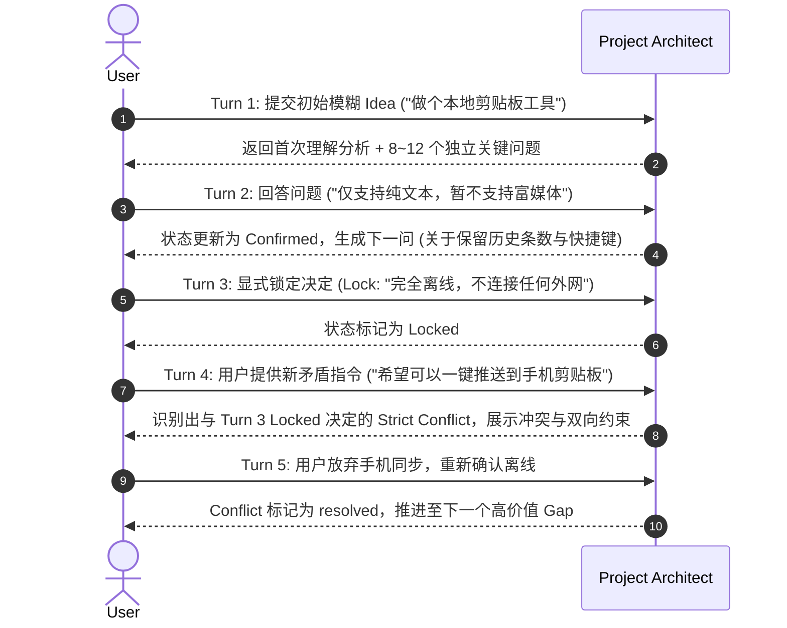

> 2026-10-04 重构：冲突项以 docs/blueprint/13_PLANNING_WORKBENCH.md 为准。旧单 Agent/单调用、通用兜底题、百分比准备度、短时强制超时规则已撤销。自由文本先保存，结构化答案或变更包批准才成为正式事实。以下保留旧设计背景。

## 2026-10-04 正式重构检查

1. Node 24 构建与 Schema 同步检查；模板与 Schema 必须随编译产物发布。
2. Core 规划边界、审批、锁/版本/幂等、自由输入、主题答案、材料变化、两阶段恢复与 revision hash 校验。
3. Runtime 注册调用、依赖/并行、独立评审与修订、三次无进展、局部失败保留、取消/重启、依据变化、产物 receipt 外改保护；不再断言每操作单次调用。
4. API 实际 HTTP 请求与 SSE 重放；开发包 staging、文件集合/正文差异/hash、未审阅输入和外改拒绝。
5. Web 投影、未预选答题、直接委托、阶段与变更预览、解锁、中文任务状态及完整 coverage 编译门控。
6. Playwright 使用正式 dist、临时项目、FixturePlanningProvider，覆盖模糊想法到三阶段/文档/ZIP、反馈、取消恢复、仅材料输入与提取失败；明确属于确定性界面验收。
7. 真实 agy、SDK stdio、图片原文、官方来源和 Docker 隔离单独保留调用/工具/源文件/hash 证据；失败与未执行不可记为通过。默认模型三阶段、实际用户审阅与 Coding Agent 落地分别记录，不用 Mock 或 AI 评审替代。
8. 容量恢复单独覆盖实际超限后登记分工、独占范围与循环、全量汇集/独立评审、单并发、失败片恢复、取消/依据变化、源收据缺失或外改；本地汇集写入中断只从合法完整来源重建。四题分两批、第四题合法重问、回答后新增块与既有候选修改/删除均不能遗漏。研究/验证/评审的派生 Schema 与接受边界同时检查；未开发应用测量和不可用环境如实保留开发验证任务。
9. 初次分工和旧任务恢复均验证范围中正式已有 ID 必须有实际候选动作；旧成功但遗漏职责的片段及其派生产物不能复用，原收据保留。用确定性门控覆盖调用准备保存期间取消，断言不再调用 Provider、运行结束且并发槽归零，不以扩大超时掩盖竞态。

最新结果及对应原始全量日志见 `docs/validation/REFACTOR_ACCEPTANCE_2026-10-04.md`，真实能力见 `docs/validation/AGY_CAPABILITIES_2026-10-04.md`。历史日志保留，不将旧基线冒充最新结果。

---

# Project Architect V1：全链路测试策略

> 文档状态：Phase 0 Engineering Blueprint  
> 范围：指导开发各里程碑的测试金字塔与验收门控。  
> 目标：确保确定性状态引擎可靠、AI 行为符合 B3 宪法、自适应问题集无重复或依赖冲突。

---

## 1. 测试体系结构概览

```text
┌─────────────────────────────────────────────────────────────┐
│ 4. Agent Regression Tests (experiments/agent-benchmark)    │
│    - 10 大固定用例 + 4 个 B3 问题集用例，独立性与预算门控 │
├─────────────────────────────────────────────────────────────┤
│ 3. Multi-turn Flow Tests (多轮状态流转集成测试)            │
│    - Idea → Clarify → Lock → Conflict → Next Turn           │
├─────────────────────────────────────────────────────────────┤
│ 2. Subsystem Integration Tests (模块集成测试)              │
│    - Project I/O, Commit/Recovery, Provider Adapter, API    │
├─────────────────────────────────────────────────────────────┤
│ 1. Core Unit Tests (单元测试)                              │
│    - State Transition, Typed Refs, Checklist, Context Trunc │
└─────────────────────────────────────────────────────────────┘
```

---

## 2. 单元测试（Unit Tests - `packages/core`）

无需运行实际 AI，100% 确定性运行与毫秒级断言：

1. **状态迁移合法性测试 (`StateTransitions.test.ts`)**：
   - 验证 `Candidate` 经用户确认转为 `Confirmed`。
   - 验证用户拒绝/替代转换为 `Rejected` / `Superseded`。
   - 验证非用户来源（Agent）直接写入 `Confirmed` 必须被 State Engine 拒绝。
2. **Locked 保护测试 (`LockedProtection.test.ts`)**：
   - 验证锁定项不可被新 AI 建议静默覆盖。
   - 验证用户主动修改锁定项时生成旧版本关联与明确影响记录。
3. **Assumption 转换测试 (`AssumptionConversion.test.ts`)**：
   - 验证用户确认 Assumption 后，生成关联 `Decision` (Confirmed)，原 Assumption 标记为 `converted`。
4. **Typed References 解析测试 (`TypedReferences.test.ts`)**：
   - 验证 `decision:<id>`, `gap:<id>`, `input:<id>` 前缀解析与反向寻址正确性。
   - 验证断裂引用检测（引用的 ID 不存在时校验报错）。
5. **Checklist 选择器测试 (`ChecklistSelector.test.ts`)**：
   - 验证按 Tags 合并多个 JSON，验证去重逻辑。
   - 验证当对应领域成熟度达到 `clear`/`locked` 时自动过滤已满足条目。
   - 验证条目数量上限（截断至 8~12 项高优先级）。
6. **Context 预算裁剪测试 (`ContextManager.test.ts`)**：
   - 验证超长输入文本根据预算策略优先级进行结构化截断。

---

## 3. 集成测试（Integration Tests - `packages/core`, `packages/agent`, `apps/server`）

1. **项目持久化与启动恢复测试 (`StatePersistenceRecovery.test.ts`)**：
   - 模拟断电崩溃：写入 Staging 和 Marker 后人为终止进程，测试重新打开时回滚到上一个合法 `stateRevision`。
2. **Provider 适配与 Schema 门控测试 (`ProviderAdapter.test.ts`)**：
   - 使用 Mock Provider 返回各种封套（合法 JSON、非法 JSON、缺失 structured_output、退出码非 0、超时）。
   - 验证各种失败均返回标准 `ErrorCode` 且不修改 `state/*.json`。
3. **API Contract 端到端测试 (`ApiContract.test.ts`)**：
   - 测试所有 API 路由的请求参数校验、响应包裹结构与 `stateRevision` 单调递增。

---

## 4. 多轮流转测试（Multi-turn Integration Fixtures）

在 Milestone 2 必须构建针对 5 轮交互的标准集成测试场景：



### 多轮断言标准
- 不重复向用户询问已 Confirmed 或已 Locked 的决策。
- Locked 项在后续轮次中持续保持。
- 能够准确触发 Strict Conflict 并引用正确的双向证据。
- Context Manager 在多轮累积后，总 Token 保持在基线预算内，没有上下文膨胀。

---

## 5. Agent 行为回归基准（Agent Benchmark）

保留 `experiments/agent-benchmark/` 作为**不可变黄金基准库**：

- **活动基准资产**：既有 14 个 Initial 用例 + 4 个 Explore/Converge/Readiness 多阶段用例、`prompts/constitution-b3.md`、`schemas/b3-discovery.schema.json`。
- **执行命令**：`pnpm --dir experiments/agent-benchmark run b3:validate`。
- **发布回归门控**：
  - 结构化输出成功率必须 = 100%。
  - `Capability Before Mechanism` 零违规（无未授权的数据库、框架、机制泄漏）。
  - Strict Conflict 分类准确率符合预期。
  - 问题数量严格符合 12/8/4/2 阶段上限，同批无重复 `decision_key` 或未解决依赖。
  - 推荐 Option Key 必须在 `options` 列表中 100% 存在且对应。
  - 每个 Case 必须提供两份带证据引用的真实独立评审；五个维度各自平均分均 ≥ 4.0/5.0，任何单项不得低于 3.0。
  - 缺少人工证据或完整时延样本时发布门禁必须失败，禁止自动生成评分或硬编码 PASS。
