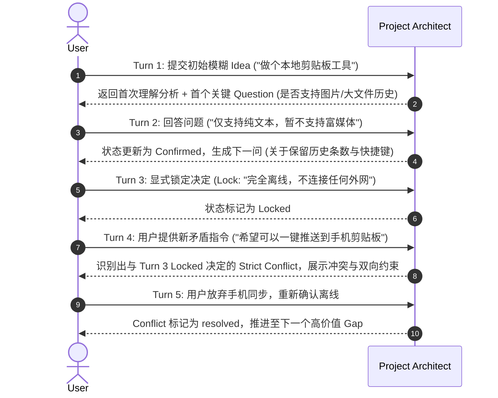

# Project Architect V1：全链路测试策略

> 文档状态：Phase 0 Engineering Blueprint  
> 范围：指导开发各里程碑的测试金字塔与验收门控。  
> 目标：确保确定性状态引擎 100% 可靠、AI 行为符合 B2.1 宪法、多轮交互无漂移。

---

## 1. 测试体系结构概览

```text
┌─────────────────────────────────────────────────────────────┐
│ 4. Agent Regression Tests (experiments/agent-benchmark)    │
│    - 10 大固定用例，B2.1 宪法遵从性，无技术泄漏门控       │
├─────────────────────────────────────────────────────────────┤
│ 3. Multi-turn Flow Tests (多轮状态流转集成测试)            │
│    - Idea → Clarify → Lock → Conflict → Next Turn           │
├─────────────────────────────────────────────────────────────┤
│ 2. Subsystem Integration Tests (模块集成测试)              │
│    - Project I/O, Commit/Recovery, Provider Adapter, API    │
├─────────────────────────────────────────────────────────────┤
│ 1. Core Unit Tests (单元测试)                              │
│    - State Transition, Typed Refs, Checklist, Context Trunc │
└─────────────────────────────────────────────────────────────┘
```

---

## 2. 单元测试（Unit Tests - `packages/core`）

无需运行实际 AI，100% 确定性运行与毫秒级断言：

1. **状态迁移合法性测试 (`StateTransitions.test.ts`)**：
   - 验证 `Candidate` 经用户确认转为 `Confirmed`。
   - 验证用户拒绝/替代转换为 `Rejected` / `Superseded`。
   - 验证非用户来源（Agent）直接写入 `Confirmed` 必须被 State Engine 拒绝。
2. **Locked 保护测试 (`LockedProtection.test.ts`)**：
   - 验证锁定项不可被新 AI 建议静默覆盖。
   - 验证用户主动修改锁定项时生成旧版本关联与明确影响记录。
3. **Assumption 转换测试 (`AssumptionConversion.test.ts`)**：
   - 验证用户确认 Assumption 后，生成关联 `Decision` (Confirmed)，原 Assumption 标记为 `converted`。
4. **Typed References 解析测试 (`TypedReferences.test.ts`)**：
   - 验证 `decision:<id>`, `gap:<id>`, `input:<id>` 前缀解析与反向寻址正确性。
   - 验证断裂引用检测（引用的 ID 不存在时校验报错）。
5. **Checklist 选择器测试 (`ChecklistSelector.test.ts`)**：
   - 验证按 Tags 合并多个 JSON，验证去重逻辑。
   - 验证当对应领域成熟度达到 `clear`/`locked` 时自动过滤已满足条目。
   - 验证条目数量上限（截断至 8~12 项高优先级）。
6. **Context 预算裁剪测试 (`ContextManager.test.ts`)**：
   - 验证超长输入文本根据预算策略优先级进行结构化截断。

---

## 3. 集成测试（Integration Tests - `packages/core`, `packages/agent`, `apps/server`）

1. **项目持久化与启动恢复测试 (`StatePersistenceRecovery.test.ts`)**：
   - 模拟断电崩溃：写入 Staging 和 Marker 后人为终止进程，测试重新打开时回滚到上一个合法 `stateRevision`。
2. **Provider 适配与 Schema 门控测试 (`ProviderAdapter.test.ts`)**：
   - 使用 Mock Provider 返回各种封套（合法 JSON、非法 JSON、缺失 structured_output、退出码非 0、超时）。
   - 验证各种失败均返回标准 `ErrorCode` 且不修改 `state/*.json`。
3. **API Contract 端到端测试 (`ApiContract.test.ts`)**：
   - 测试所有 API 路由的请求参数校验、响应包裹结构与 `stateRevision` 单调递增。

---

## 4. 多轮流转测试（Multi-turn Integration Fixtures）

在 Milestone 2 必须构建针对 5 轮交互的标准集成测试场景：



### 多轮断言标准
- 不重复向用户询问已 Confirmed 或已 Locked 的决策。
- Locked 项在后续轮次中持续保持。
- 能够准确触发 Strict Conflict 并引用正确的双向证据。
- Context Manager 在多轮累积后，总 Token 保持在基线预算内，没有上下文膨胀。

---

## 5. Agent 行为回归基准（Agent Benchmark）

保留 `experiments/agent-benchmark/` 作为**不可变黄金基准库**：

- **基准资产**：`fixtures/case-01.json` ~ `case-10.json`，`prompts/constitution-b2-1.md`，`schemas/b2-unified.schema.json`。
- **执行命令**：`npm run smoke` 或 `npm run run`。
- **回归门控**：
  - 结构化输出成功率必须 = 100%。
  - `Capability Before Mechanism` 零违规（无未授权的数据库、框架、机制泄漏）。
  - Strict Conflict 分类准确率符合预期。
