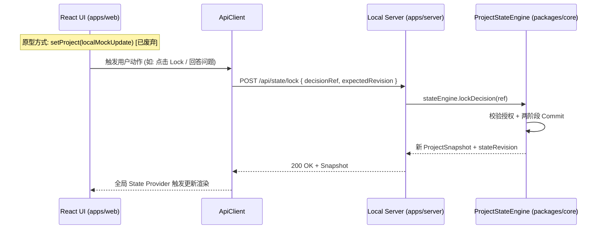

# Project Architect V1：前端原型差异审计与迁移指南

> 文档状态：Phase 0 Engineering Blueprint  
> 审计对象：`frontend/` 交互原型代码（`frontend/src/types/project.ts`, `frontend/src/App.tsx` 等）。  
> 目标：记录原型与正式架构契约（`packages/contracts`）之间的差异，为 Milestone 3 (Workspace UI) 的正式联调提供无缝迁移对照。  
> **重要说明**：Phase 0 **不修改**当前 `frontend/` 目录中的原型代码。

---

## 1. 核心差异对照矩阵 (Audit Matrix)

| 审计项 | 前端原型现状 (`frontend/`) | 正式系统契约 (`packages/contracts`) | 迁移策略与说明 |
| :--- | :--- | :--- | :--- |
| **锁定语义 (`locked`)** | `ItemStatus` 中有 `'locked'`，同时 `OverviewItem` 中有 `locked?: boolean` 双重定义。 | `DecisionStatus` 统一使用枚举 `'candidate' \| 'confirmed' \| 'locked' \| 'superseded' \| 'rejected'`。 | 废弃独立的 `locked` 布尔字段，由状态引擎根据引用的 `decision` 状态统一判定。 |
| **阶段枚举 (`Stage`)** | `'discovery' \| 'broad_pass' \| 'deep_dive' \| 'readiness' \| 'documented'` | `'created' \| 'initial-analysis' \| 'broad-pass' \| 'deep-dive' \| 'readiness-review' \| 'approved' \| 'documents-generated'` | 正式采用中划线标准枚举，完整覆盖初始化与文档生成后状态。 |
| **材料状态 (`MaterialStatus`)** | 简化的 `'uploaded' \| 'parsed'` | `'saved' \| 'processing' \| 'ready' \| 'used' \| 'failed' \| 'excluded'` | 替换为正式契约，精确表达本地副本已存、抽取就绪、失败与排除语义。 |
| **状态流转与修改** | React 组件内部直接调用 `setProject()` 本地修改 Overview、Readiness 与 Lock。 | **严格单向数据流**：Frontend 仅通过 API 发送用户意图事件，由 State Engine 执行两阶段 Commit 后返回最新快照。 | 前端移除所有本地 Mock 状态拼装逻辑，改为消费统一的 API Client。 |
| **Overview 存储** | `OverviewSection.items` 直接包含全量 title 与 content 文本。 | `OverviewSection.itemRefs` 仅保存 `decision:<id>` 等 Typed Refs，不存副本。 | 前端组件改为根据 `itemRefs` 在快照决策索引中寻址渲染文本。 |
| **文档体系** | Mock 中遗漏了 `TECHNICAL_GUIDE.md`，文档列表固定为 6 份。 | **8 份固定核心文档**（含 `TECHNICAL_GUIDE.md`）+ 动态 `docs/specs/*.md`。 | 更新 Documents 视图的数据驱动模型，支持 8 核心 + 动态专项展示。 |

---

## 2. 状态流转迁移路径 (Phase 3 接入路线)

---

## 3. 前端原型中应保留的优秀资产

在迁移到正式 `apps/web` 时，原型的以下设计资产经过验证非常优秀，应 100% 继承：

1. **视觉设计语言**：暖灰中性色调、安静的工作台风格、自研 MarkdownRenderer、轻量 Toast 提示。
2. **三栏工作台布局**：左侧折叠 Navigation、中间 Chat/Decision 流水、右侧可折叠/可编辑 Overview 投影。
3. **Question Card 交互**：清晰展示“为什么现在问”、推荐方向与原因、选项影响与自由输入框。
4. **Readiness 审阅交互**：Ready/Warnings/Issues 分桶呈现，明确的批准与返回 Discovery 按钮组。
